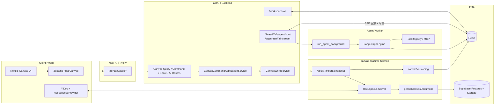
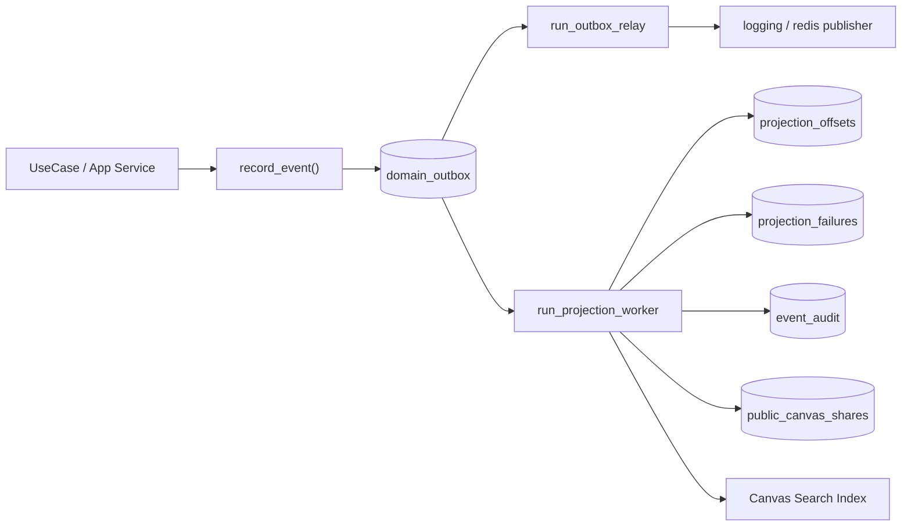
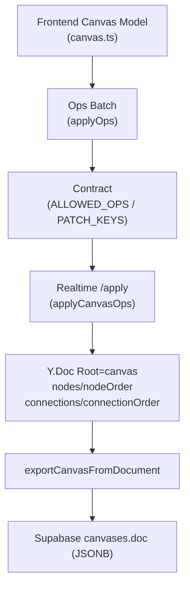
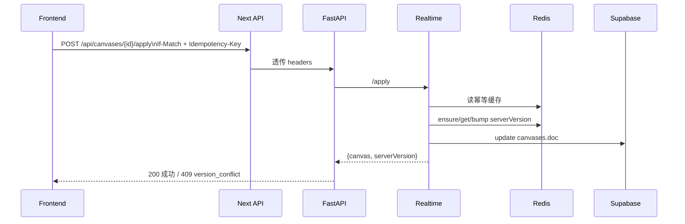
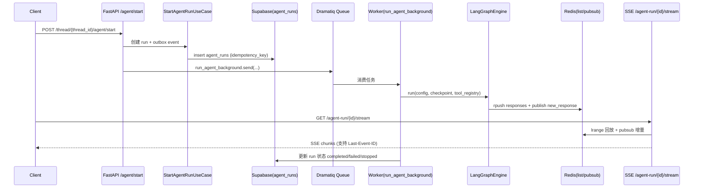
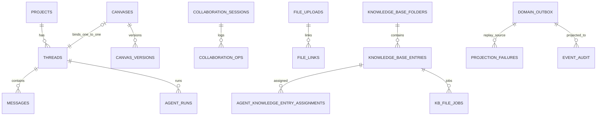

# Zmind 全系统架构梳理（汇报版）

更新时间：2026-02-27  
适用对象：产品、研发、架构评审、管理汇报  
基线说明：本文以当前仓库实现为准（非理想蓝图）。

## 1. 系统总览（端到端）



### 核心结论

1. Canvas 写入主链路已迁移到 `canvas-realtime`（`/apply`、`/import`）。
2. Backend 仍保留 legacy canvas 路径，用于兼容与降级。
3. Agent 是异步执行架构：HTTP 启动、Worker 执行、Redis 缓冲、SSE 流式。
4. 数据最终真相在 Supabase（RLS + JSONB + 业务表 + 读模型表）。

---

## 2. DDD 分层与事件外盒

### 2.1 后端分层（代码真实结构）

```txt
interfaces/http
  -> application/services + application/use_cases
    -> domains (model/events/ports)
      -> infrastructure (supabase/redis/outbox/projections)
```

### 2.2 事件链（Outbox + Projection）



### 2.3 价值

1. 写模型与读模型解耦，降低联动发布风险。
2. 失败可追踪（`projection_failures`）且可重放。
3. 审计链路完整（`event_audit`）。

---

## 3. Canvas 架构与 JSON 映射

### 3.1 写入双路径（当前）

```txt
Path A: Realtime 协作主路径
UI 编辑 -> Zustand/Realtime Adapter -> Y.Doc transact -> Hocuspocus
       -> onStoreDocument(debounce) -> persist canvases.doc

Path B: REST apply 命令路径
UI 编辑 -> FileCanvasRepository.applyOps -> Next /api/canvases/{id}/apply
       -> Backend /canvases/{id}/apply -> CanvasWriteService.apply_canvas_ops
       -> Realtime /apply -> persist canvases.doc

Fallback:
Backend 配置关闭 realtime 写入时 -> legacy CanvasEditTool
```

### 3.2 协议契约（前后端统一）

`ALLOWED_OPS`:

- `add_node`
- `update_node`
- `delete_node`
- `move_node`
- `apply_style`
- `add_connection`
- `update_connection`
- `delete_connection`
- `update_canvas`
- `relayout_mindmap`

`CANVAS_PATCH_KEYS`:

- `title`
- `cornerStyle`
- `fontStyle`
- `textOpacityPreset`
- `textLayoutPreset`
- `folderId`
- `backgroundColor`
- `backgroundStyleId`
- `patternColor`
- `metadata`

### 3.3 模型映射（UI -> Ops -> Y.Doc -> DB）



```txt
字段示例映射
1) title
   UI canvas.title
   -> op.update_canvas.patch.title
   -> YDoc root["title"]
   -> canvases.doc.title

2) 节点坐标
   UI node.x/node.y
   -> op.move_node {x,y}
   -> YDoc root["nodes"][nodeId].x/.y
   -> canvases.doc.nodes[].x/.y

3) 并发版本
   UI canvas.serverVersion
   -> HTTP If-Match
   -> Redis key: canvas:server-version:{canvasId}
   -> 回写 doc.serverVersion
```

### 3.4 并发与幂等



---

## 4. Agent 架构（执行链）



### Agent 抗故障点

1. `agent_runs(thread_id, idempotency_key)` 防重复启动。
2. Redis run lock + heartbeat 防止并发重复执行。
3. Checkpoint 支持 Supabase 与内存降级。
4. SSE 支持断点续传（`Last-Event-ID`）。
5. LLM 流式异常具备 fallback model 与重试逻辑。

---

## 5. 数据库关系图（核心）



### 关系说明

1. `threads.canvas_id` 对 `canvases.id` 有唯一约束（一个画布最多绑定一个线程）。
2. `collaboration_*` 与 `public_canvas_shares` 多为逻辑关联（并非都强 FK）。
3. 事件读模型链：`domain_outbox` -> `projection_offsets/failures` -> `event_audit/public_canvas_shares/search`。

---

## 6. 反脆弱机制矩阵

```txt
+----------------------+----------------------------------------------+--------------------------------------+
| 风险场景             | 机制                                         | 系统表现                             |
+----------------------+----------------------------------------------+--------------------------------------+
| 重复提交             | Idempotency-Key / 唯一索引 / 中间件          | 避免重复写与重复执行                 |
| 并发覆盖             | If-Match(serverVersion) + 409                | 不静默覆盖，前端可重试               |
| 实时写放大           | Debounced Persist + cancelPendingPersist     | 降低写放大，最终一致                 |
| Worker重复消费       | run lock + TTL heartbeat                     | 单 run 单执行实例                    |
| SSE中断              | Redis list 回放 + Last-Event-ID              | 可续传、低丢包风险                   |
| Projection失败       | projection_failures + offset游标             | 可追踪、可重放                       |
| Checkpoint后端异常   | Supabase -> Memory fallback                  | 不中断运行                           |
| LLM流式异常          | timeout/retry/fallback model                 | 服务降级而非直接崩溃                 |
+----------------------+----------------------------------------------+--------------------------------------+
```

---

## 7. 汇报口径

### 7.1 3分钟版

1. 系统主干是 `Client -> Next Proxy -> FastAPI -> Realtime/Worker -> Redis/Supabase`。
2. Canvas 已进入增量协作时代：Ops 合同统一、`serverVersion` 并发控制、实时持久化。
3. Agent 采用异步执行与流式回放架构，能支撑长任务与断线恢复。
4. Outbox + Projection 让写入与读模型解耦，提升可审计与可恢复性。
5. 当前关键管理动作是继续收敛 legacy 路径，减少双轨复杂度。

### 7.2 10分钟版

1. 总览图：系统分层与责任边界。  
2. Canvas：双路径、协议契约、Y.Doc 与 JSONB 映射。  
3. Agent：从启动到 SSE 的完整链路。  
4. 数据库：主业务关系 + 协作/分享/知识库。  
5. 反脆弱：幂等、并发、降级、重放与审计。  
6. 收敛建议：统一写路径、清理 legacy 分叉、增强 read model 监控。

---

## 8. 单页汇报图

单页展示版见：`docs/reports/2026-02-27-system-architecture-onepager.md`
