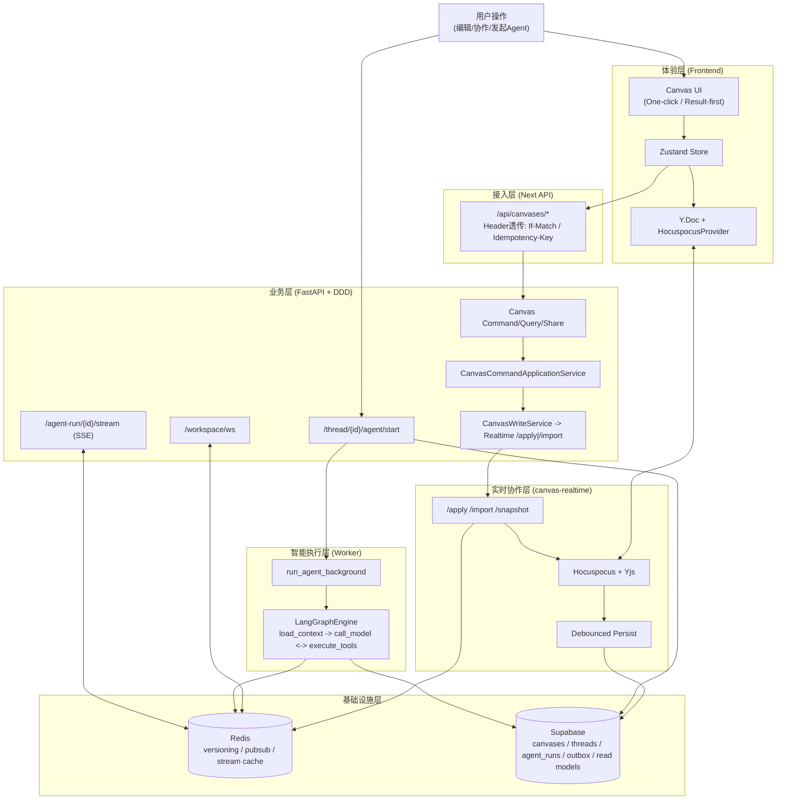

# Zmind 单页汇报图（System One-Pager）

更新时间：2026-02-27  
用途：管理层/跨团队快速同步（1页投屏）

## 30秒口播

1. 前端把复杂协作收敛成两条可控路径：Realtime 增量写 + REST apply 兜底写。  
2. 后端通过 DDD 服务层做协议治理与并发控制（`If-Match/serverVersion`）。  
3. Agent 是异步执行架构：API 启动、Worker 运行、Redis 回放、SSE 推送。  
4. Outbox + Projection 让系统具备可审计、可重放、可降级的反脆弱能力。  
5. 当前演进重点是继续压缩 legacy 分叉，向单一路径收敛。

## 关键词（便于答疑）

- 并发控制：`If-Match` + `serverVersion`  
- 幂等：`Idempotency-Key` + 唯一索引 + 中间件缓存  
- 协作模型：`Canvas JSON -> Ops -> Y.Doc -> JSONB`  
- 流式保证：Redis list 回放 + pubsub 增量 + SSE `Last-Event-ID`  
- 事件化：`domain_outbox -> projection_* -> read models`
