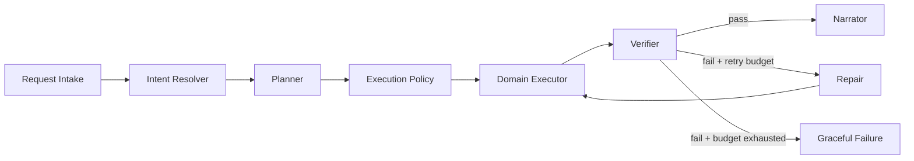
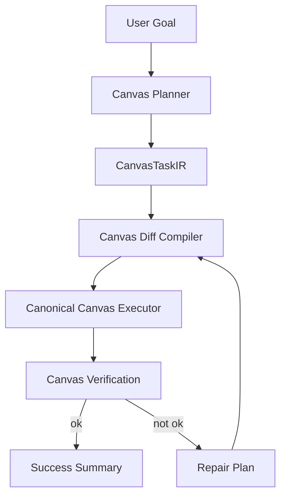
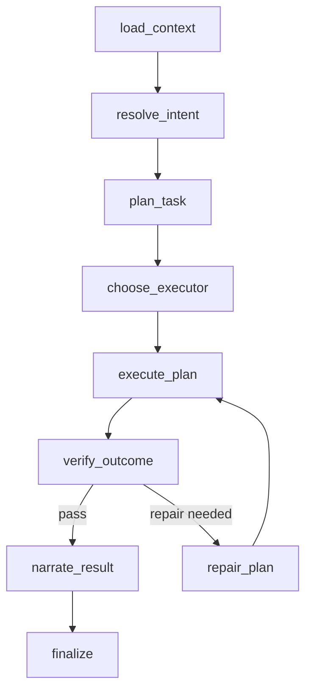

# Agent vNext Blueprint & Roadmap

Date: 2026-03-07  
Authoring basis: current backend implementation audit + existing backend layering

## 0. 先给结论

这次重构的目标，不是“把 agent 再调聪明一点”，而是把它从：

```text
Prompt 驱动的工具循环器
```

升级为：

```text
目标驱动的执行系统
```

如果只继续堆：

- prompt
- 工具说明
- route hint
- fallback model
- tool retry patch

那系统会继续变大，但不会跨代提升。

真正的跨代升级，必须同时完成 4 件事：

```text
1. 显式 Planner
2. 显式 Verifier
3. 显式 Repair
4. 单一 Canonical Canvas Executor
```

---

## 1. 两条路线，我的推荐

```text
+------------------+----------------------+---------------------------+--------------------------+
| 路线             | 特点                 | 优点                      | 风险                     |
+------------------+----------------------+---------------------------+--------------------------+
| 激进路线         | 新旧双栈并行         | 提升快，架构最干净        | 迁移管理复杂             |
| 稳健路线         | 在现有 LangGraph 上  | 风险低，能边改边上线      | 历史包袱保留更多         |
|                  | 渐进插入新节点       |                           |                          |
+------------------+----------------------+---------------------------+--------------------------+
```

**推荐：稳健路线执行，架构目标按激进路线设计。**

意思是：

- 目标蓝图按 vNext 新体系设计
- 落地顺序按低风险渐进方式推进

这样不会被历史包袱拖死，也不会因为大爆破影响当前业务。

---

## 2. vNext 北极星

### 2.1 产品目标

对用户来说，agent 应该表现成：

```text
看懂目标
  -> 快速形成方案
  -> 直接动手
  -> 自动校验
  -> 出错会修
  -> 最终结果稳定、可预测、可解释
```

### 2.2 技术目标

```text
+------------------------+----------------------------------------------+
| 目标                   | 定义                                         |
+------------------------+----------------------------------------------+
| Deterministic Outcome  | 同类任务结果波动显著降低                     |
| Fast Time-to-Action    | 更快出现首个有效动作/首个有效画布变化        |
| Recoverable Execution  | 出错后自动修复，而不是直接结束               |
| Observable Degradation | 降级被显式标记，而不是静默吞掉               |
| Canvas-native          | 画布不再只是工具，而是核心执行域             |
+------------------------+----------------------------------------------+
```

---

## 3. vNext 总体架构

## 3.1 新执行链

```text
Request Intake
  -> Intent Resolver
  -> Planner
  -> Execution Policy
  -> Domain Executor
  -> Verifier
  -> Repair Loop (bounded)
  -> Narrator / Streamer
```



## 3.2 为什么这样改

当前系统最大的问题是：

- `call_model` 同时承担理解、规划、决策、工具拼装、异常恢复
- `execute_tools` 只负责执行，不判断“目标是否完成”
- graph 没有“结果验收”节点

所以 vNext 的核心不是多一个 node，而是**职责拆分正确**。

---

## 4. vNext 的五层职责模型

```text
L1 入口层       = 鉴权、run 创建、流式连接
L2 决策层       = 意图识别、planner、policy、routing
L3 执行层       = canvas/doc/research/integration 执行域
L4 验证层       = 结果验收、差异检查、修复决策
L5 观测层       = stream、trace、metrics、degraded state
```

```text
+--------+----------------------+---------------------------------------------+
| 层级   | 核心对象             | 职责                                        |
+--------+----------------------+---------------------------------------------+
| L1     | AgentRun             | run 生命周期、API、worker、SSE             |
| L2     | TaskPlan / Policy    | 把用户目标变成可执行计划                    |
| L3     | CanvasExecutor       | 真正完成 domain 操作                        |
| L4     | VerificationReport   | 判断是否达成目标，是否需要 repair           |
| L5     | RunTelemetry         | 跟踪质量、速度、失败和降级                  |
+--------+----------------------+---------------------------------------------+
```

---

## 5. 重点：Canvas 必须升级为原生执行域

## 5.1 从 Tool Set 升级为 Canvas Domain

现在：

```text
canvas_read / canvas_write / canvas_edit
  -> legacy CanvasEditTool
```

未来：

```text
Canvas Domain
  -> Canvas Task IR
  -> Canvas Planner
  -> Canvas Diff Compiler
  -> Canonical Executor
  -> Canvas Verifier
```

## 5.2 新的 Canvas 执行模型



## 5.3 CanvasTaskIR 建议结构

```text
CanvasTaskIR
  - task_id
  - target_canvas
  - scope
  - user_goal
  - read_requirements
  - create_entities[]
  - update_entities[]
  - delete_entities[]
  - layout_constraints
  - visual_constraints
  - connection_rules
  - verification_checks[]
  - retry_budget
```

### 例子

```text
user_goal:
  "把这段竞品分析整理成一个左右对比图，左边优势，右边风险，底部给结论"

CanvasTaskIR:
  target_canvas = current
  scope = selection.right
  create_entities = [title, left_group, right_group, summary]
  layout_constraints = { type: "two-column-summary", anchor: "selection.right" }
  verification_checks = [
    "must_have_4_nodes_min",
    "must_have_left_right_balance",
    "must_have_summary_node"
  ]
```

这样模型负责“目标和结构”，而不是直接硬拼底层 patch。

---

## 6. LangGraph vNext 设计

## 6.1 新 Graph

当前 graph：

```text
load_context -> call_model -> execute_tools -> finalize
```

建议升级为：

```text
load_context
  -> resolve_intent
  -> plan_task
  -> choose_executor
  -> execute_plan
  -> verify_outcome
  -> repair_plan (optional, bounded)
  -> narrate_result
  -> finalize
```



## 6.2 每个节点的职责

```text
+------------------+--------------------------------------------------+
| 节点             | 职责                                             |
+------------------+--------------------------------------------------+
| load_context     | 加载对话、selection、workspace、system policy    |
| resolve_intent   | 识别 domain / target / complexity                |
| plan_task        | 产出 TaskPlan / CanvasTaskIR / ResearchPlan      |
| choose_executor  | 决定走 canvas/doc/research/integration 哪条域    |
| execute_plan     | 域执行器真正落地                                 |
| verify_outcome   | 对照 verification checks 做验收                  |
| repair_plan      | 基于失败原因出补救计划                           |
| narrate_result   | 面向用户总结变化和限制                           |
| finalize         | 持久化、关闭 run、对外发终态                     |
+------------------+--------------------------------------------------+
```

---

## 7. 数据模型升级建议

## 7.1 GraphState v2

当前 state 更像运行缓存。  
vNext state 应该有“目标”和“验收”。

建议新增：

```text
GraphStateV2
  - intent
  - task_plan
  - domain
  - execution_policy
  - verification_report
  - repair_count
  - degraded_flags[]
  - outcome_summary
```

## 7.2 新核心对象

```text
IntentResolution
  - domain
  - user_goal
  - target_surface
  - confidence

TaskPlan
  - plan_id
  - domain
  - tasks[]
  - success_criteria[]
  - retry_budget

VerificationReport
  - passed
  - failed_checks[]
  - repairable
  - recommended_action

DegradedState
  - code
  - component
  - severity
  - user_visible
```

---

## 8. 模块落点建议

为了尽量贴合你们当前目录结构，我建议这样放：

```text
backend/core/
  application/
    processes/
      agent_orchestration_process.py
      canvas_execution_process.py
    services/
      planner_service.py
      verification_service.py
      degraded_state_service.py
  domains/
    agent/
      task_plan.py
      intent.py
      verification.py
      degraded_state.py
    canvas/
      task_ir.py
      diff.py
      verification_rules.py
      execution_result.py
  langgraph_engine/
    nodes/
      resolve_intent.py
      plan_task.py
      choose_executor.py
      execute_plan.py
      verify_outcome.py
      repair_plan.py
      narrate_result.py
  canvas/
    execution/
      canonical_executor.py
      diff_compiler.py
      planner.py
      verifier.py
```

### 为什么这样落

```text
domains       = 定义稳定业务对象
application   = 编排业务流程
langgraph     = graph 节点适配层
canvas        = 领域执行核心
```

不要把业务逻辑继续堆进 `call_model.py` 或 `run_agent_background.py`。

---

## 9. 必须收敛的三条技术债

## 9.1 Canvas 双脑问题

当前：

```text
CaC path
  + legacy CanvasEditTool
  + realtime apply
```

目标：

```text
One domain compiler
  -> One executor
  -> One verification path
```

## 9.2 上下文三重压缩

当前上下文处理存在多次重复裁剪。  
目标是保留一套统一预算器：

```text
load raw messages
  -> build final prompt context once
  -> pass to planner / executor
```

## 9.3 静默降级

所有降级必须进入统一 `degraded_flags`：

```text
tool_registry_unavailable
event_persistence_disabled
canvas_realtime_degraded
fallback_model_used
context_truncated
```

并且：

- trace 能看见
- metrics 能计数
- 必要时用户能感知

---

## 10. P0 / P1 / P2 路线图

## P0：先把系统从“不舒服”变成“可控”

### P0-1. 插入 `verify_outcome` 和 `repair_plan`

**目标**

- 工具失败后不再直接终止能力
- 系统具备 bounded self-repair

**交付**

- 新增 graph 节点：`verify_outcome`、`repair_plan`
- `call_model.py` 移除“工具失败后禁止再调工具”的硬策略
- 用 repair budget 限制修复次数，例如 `max_repair_attempts=1~2`

**验收**

```text
复杂 canvas 任务首轮失败后，可自动修复一次
同类失败不再直接变成“只回复文字”
```

### P0-2. 给 Canvas agent 写链路补齐并发与幂等

**目标**

- 不再出现重复写、覆盖写、冲突后莫名结果

**交付**

- agent canvas 写/edit 路径透传 `expected_version`
- 所有写入生成 `idempotency_key`
- run / tool / canvas operation 三层 trace id 打通

**验收**

```text
重试同一任务不重复插入
并发冲突会进入 repair/refresh，而不是悄悄覆盖
```

### P0-3. 建立统一 Degraded State

**目标**

- 从“静默降级”变成“可观测降级”

**交付**

- 新建 `degraded_state.py`
- 在 worker / engine / canvas write / event persistence 中统一上报
- stream metadata 增加 degraded flags

**验收**

```text
每次 run 都能判断是否 degraded
后端能回答：这次为什么慢/弱/异常
```

---

## P1：让能力真正变强

### P1-1. 引入 `CanvasTaskIR`

**目标**

- 模型不再直接拼底层 patch

**交付**

- `domains/canvas/task_ir.py`
- `canvas/planner.py`
- `canvas/diff_compiler.py`

**验收**

```text
复杂画布请求先产出结构计划，再编译为 ops
画布结果一致性显著提升
```

### P1-2. 把 Canvas 升级成 `canonical executor`

**目标**

- 去掉 CaC / legacy 双脑

**交付**

- `canvas/execution/canonical_executor.py`
- legacy `CanvasEditTool` 逐步收缩为兼容层

**验收**

```text
所有 agent 画布写入都走一条执行链
```

### P1-3. 缩短高频画布任务跳数

**目标**

- 明确 canvas 编辑请求不再被多次路由犹豫

**交付**

- `resolve_intent` 输出明确 domain
- 对高置信 canvas 请求可直接走 canvas executor path
- supervisor 保留给跨域复杂任务

**验收**

```text
TTFT 显著下降
简单画布编辑不再额外 handoff
```

---

## P2：拉开与普通 agent 的代差

### P2-1. 建立 verification rules library

例如：

```text
must_have_title
must_have_summary
mindmap_root_exists
all_connections_resolved
selection_anchor_respected
node_count_in_expected_range
```

### P2-2. 做 domain-specific planner

不要只有一个 planner。

建议至少拆成：

- canvas planner
- doc planner
- research planner
- integration planner

### P2-3. 引入 shadow compare

同一请求：

- v1 继续 serving
- vNext shadow 执行
- 对比 task completion / latency / degradation / tool churn

这会极大降低大迁移风险。

---

## 11. 里程碑建议

## 11.1 4 周版本

```text
Week 1
  - degraded state
  - expected_version/idempotency 打通
  - verify_outcome node skeleton

Week 2
  - repair_plan node
  - 移除“失败后禁止再调工具”的冲突逻辑
  - 新增 run-level quality metrics

Week 3
  - CanvasTaskIR v1
  - canvas diff compiler v1
  - 高置信 canvas 快路径

Week 4
  - canonical executor 接入 20~30% 画布场景
  - shadow compare
  - 首轮性能调优
```

## 11.2 8 周版本

```text
Month 1
  系统可控：更稳、更可测、更少静默降级

Month 2
  系统变强：复杂画布任务明显提升，速度明显优化
```

---

## 12. 关键指标

建议你们不要只看成功率，要看下面这组：

```text
+-------------------------------+------------------------------------------+
| 指标                          | 目标                                     |
+-------------------------------+------------------------------------------+
| TTFT                          | 首个有效输出时间                         |
| TTFA                          | 首个有效动作时间                         |
| Task Completion Rate          | 用户目标真正完成率                       |
| Canvas Verification Pass Rate | 画布验收通过率                           |
| Tool Churn                    | 单次 run 工具调用次数                    |
| Repair Success Rate           | 首轮失败后的自动修复成功率               |
| Degraded Run Rate             | 降级运行占比                             |
| Duplicate Write Rate          | 重试重复写入率                           |
+-------------------------------+------------------------------------------+
```

**最重要的不是 token，不是 QPS，是：**

```text
Task Completion Rate
Canvas Verification Pass Rate
TTFA
```

---

## 13. 这次重构中，什么要坚决停止

```text
1. 继续往 call_model.py 堆越来越多的启发式
2. 继续让 prompt 承担系统恢复逻辑
3. 继续让 canvas_write / canvas_edit / legacy edit 三层并存且职责重叠
4. 继续默认静默降级
5. 继续用“工具调用成功”代替“用户目标完成”
```

---

## 14. 最终推荐执行顺序

```text
Phase A 先控风险
  -> degraded state
  -> expected_version / idempotency
  -> verify / repair

Phase B 再提能力
  -> CanvasTaskIR
  -> canonical executor
  -> canvas fast path

Phase C 最后做架构收敛
  -> multi-domain planners
  -> shadow compare
  -> 逐步淘汰 legacy path
```

## 推荐原因

```text
先控风险
  才能解释问题

先有 verifier
  才知道变强没有

先做 canonical executor
  才能真正提升 canvas 能力
```

---

## 15. 给团队的管理建议

这不是“模型调优项目”，而是“执行系统重构项目”。

建议内部拆 3 条并行线：

```text
Track A: Agent Graph / Planner / Verifier
Track B: Canvas Domain / Canonical Executor
Track C: Observability / Metrics / Shadow Compare
```

不要再按：

```text
谁负责 prompt
谁负责工具
谁负责 stream
```

这种工程切法推进。  
要按结果链路切。

---

## 16. 我的明确建议

如果只能选一件最值得马上开干的事：

```text
先上 verify_outcome + repair_plan + degraded_state
```

因为这三件会立刻让你们：

- 看清系统为什么难受
- 停止很多“明明可修却直接失败”的体验
- 为后续 CanvasTaskIR 和 canonical executor 打地基

如果只能选第二件：

```text
就做 CanvasTaskIR
```

因为你们当前最大的真实产品短板，确实就是：

```text
画布操作能力不够像一个顶级 agent
```

而这个问题，最终只能靠**领域执行模型升级**来解决，不会靠 prompt 解决。
