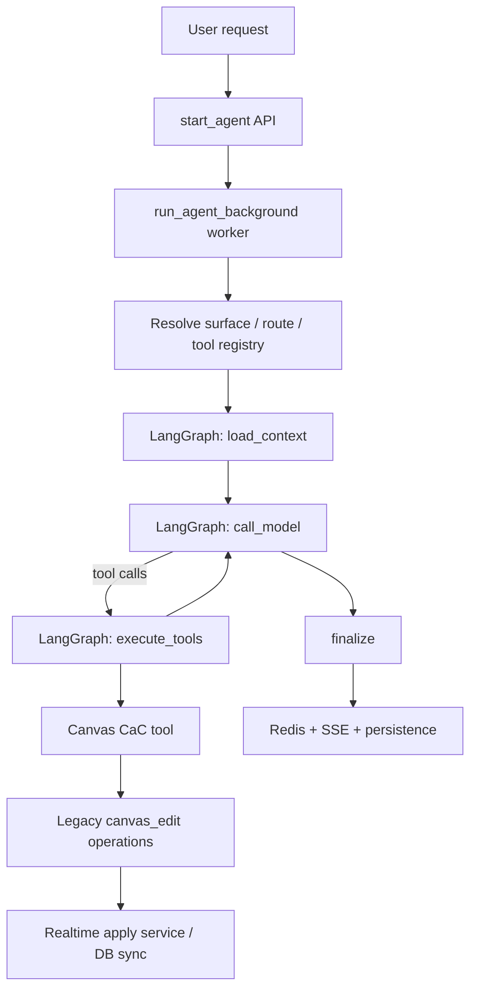
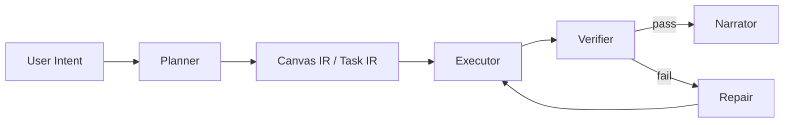

# Backend Agent 架构审计报告

Date: 2026-03-07  
Scope: `backend/` agent architecture, especially canvas operation capability, stability, latency, and user-perceived quality

## 一句话结论

当前后端 agent 不是“差”，而是**架构意图和执行现实严重错位**：

- 上层想做的是「高水平自主规划 + 稳定落地到画布」
- 实际做成的是「Prompt 驱动的单循环工具代理 + 多层兼容适配 + 大量静默降级」

结果就是四个典型体感同时出现：

```text
画布能力弱    = 能做基础增删改，但复杂结构与连续修复能力不足
能力不稳定    = 同样需求，是否路由/是否拿到工具/是否自修复，受启发式影响大
速度慢        = 每次运行都在重新构建上下文、工具集、路由、再多跳执行
很难受        = 系统更像“工程流水线拼装”而不是“一个会干活的 agent”
```

## 总评

```text
+----------------------+--------+------------------------------------------------+
| 维度                 | 评分   | 结论                                           |
+----------------------+--------+------------------------------------------------+
| 基础工程骨架         | 7/10   | 分层多、可扩展，但链路过长、职责重叠            |
| Canvas 执行能力      | 4/10   | 有工具，但仍偏“底层 patch 执行器”               |
| Agent 稳定性         | 4/10   | 缺少显式 planner / verifier / recovery         |
| 性能                 | 4/10   | 多次 DB/HTTP/压缩/重建工具 schema              |
| 用户体感             | 3/10   | 会“跑”，但不够笃定、不够果断、不够顺滑          |
+----------------------+--------+------------------------------------------------+
```

## 当前真实执行链

```text
用户请求
  -> HTTP start_agent
     -> 创建 agent_run
     -> dramatiq worker
        -> 解析 surface / agent / supervisor / skills / MCP
        -> build_registry()
        -> LangGraphEngine.run()
           -> load_context
           -> call_model
           -> execute_tools
           -> call_model
           -> ...
        -> Redis stream + DB persistence
        -> SSE 输出给前端
```



---

## 五个核心假设与验证

### H1：画布能力弱，不是因为“没有工具”，而是因为**没有中层语义执行层**

**验证结果：成立。**

现状不是没有 canvas 工具，而是 canvas 能力被拆成了：

1. `canvas_read`
2. `canvas_write`
3. `canvas_edit`
4. 底层 legacy `canvas_edit_tool`

问题在于：

- `canvas_write` 负责“骨架”
- `canvas_edit` 负责“精修”
- 真正落库还是回落到 `core/tools/canvas_edit_tool.py`
- 这个 legacy 执行器自己也明确写着“Minimal canvas edit tool”“intentionally conservative”

所以系统表面上是 CaC，内核上仍然是**保守 patch engine**。

### H2：能力不稳定，核心原因不是模型本身，而是**路由、工具暴露、失败恢复三套策略互相打架**

**验证结果：成立。**

同一个请求会被以下机制共同影响：

- Supervisor 语义/关键词路由
- 首轮最小工具集裁剪
- 工具失败后的“禁止继续工具调用”
- 子 agent handoff

这四层不是统一设计，而是叠加设计。

最致命的冲突：

- Canvas Agent prompt 说：工具失败后修复并重试一次
- `call_model.py` 却在发现工具失败后明确追加系统消息：**Do not retry tools in this turn**
- 同文件后段还会把 pending tool calls 直接清空

这会直接导致 agent“看上去知道该修”，但实际上运行框架不允许它修。

### H3：慢，不是某一处慢，而是**每次 run 都在重复做一整套昂贵准备**

**验证结果：成立。**

重复成本主要来自：

- `start_agent` 做一轮线程/agent/model 解析
- worker 再做一轮 thread/message/surface/doc context 解析
- 每次 run 重建 tool registry
- 加载消息后先压缩一次，再在 load_context 压缩一次，再在 call_model 按 token budget 再裁一次
- canvas 写入前先取 snapshot，再 apply ops
- supervisor 写场景还要多一跳 subagent

这不是单点延迟，是**架构性重复工作**。

### H4：稳定性差的深层原因是**大量“继续跑，但悄悄降级”**

**验证结果：成立。**

系统很多关键点的策略是：

- tool registry 构建失败 -> 继续跑，但 without tools
- event persistence 失败 -> 继续跑，但关闭持久化
- async persistence queue 满 -> status event 可丢
- realtime sync 失败 -> degraded warning，但整体成功

这类设计对可用性友好，但对 agent 体感非常伤：

- 从工程视角：系统没挂
- 从用户视角：它突然变笨、变慢、变不一致

### H5：“很难受”的真正来源，是**系统没有把‘结果确定性’做成第一原则**

**验证结果：成立。**

当前 graph 只有 4 个节点：

- `load_context`
- `call_model`
- `execute_tools`
- `finalize`

缺的不是更多 prompt，而是：

- 显式 planner
- 显式 verifier
- 显式 recovery / repair
- 面向用户结果的 completion criteria

所以它更像“循环试工具”，不是“面向目标完成任务”。

---

## 关键问题详解

### 1. Canvas 能力为什么会显得弱

#### 1.1 Canvas 写入仍然依赖 legacy patch engine

`canvas_write` / `canvas_edit` 最终都委托到 `core/tools/canvas_edit_tool.py`。

这意味着：

- 高层 CaC 只是更好用的输入外观
- 真正支持的能力，仍被 legacy op 白名单决定
- 复杂结构、连续编辑、局部修复、并发安全，都被 legacy executor 上限卡住

#### 1.2 Canvas Agent 被流程设计成“先读 -> 写骨架 -> 再精修”

这个流程在 prompt 上是合理的，但在执行上意味着：

```text
一次复杂画布任务
  = 至少 1 次 read
  + 1 次 write
  + 1 次 edit
  + 若 supervisor 开启，再多 1 次 handoff
```

这对复杂画布任务太重了。

#### 1.3 缺少真正的 Canvas IR（中间表示）

现在系统只有两层：

- 用户语义
- 底层 ops

中间没有一个稳定的“Canvas Intent / Plan / Diff IR”。

所以模型必须直接负责：

- 结构规划
- 节点布局
- ID 关系
- 后续 patch 细节

这会显著提升失败率。

#### 1.4 并发保护不完整

虽然 `CanvasWriteService.apply_canvas_ops()` 支持 `If-Match` / `expected_version`，
但 CaC 路径调用 legacy `CanvasEditTool.edit()` 时**没有传 expected_version**。

这意味着 agent 路径下很多 canvas 写操作其实没有强并发保护。

---

### 2. 为什么自身能力不稳定

#### 2.1 Prompt 在要求重试，框架在阻止重试

这是最严重的系统矛盾之一。

Canvas Agent prompt 明确要求：

```text
失败 -> 修参数 -> 重试一次
```

但 model node 一旦识别到 tool failure / tool loop：

- 会追加“不要再调工具”的系统消息
- 会丢弃 pending tool calls

这会把 agent 的自修复能力直接打断。

#### 2.2 首轮最小工具集策略过于启发式

系统为了降低首轮 schema 体积，默认启用 `first-turn minimal tools`。

这本身没问题，但它依赖：

- latest user text
- 关键词命中

如果用户表达不是标准 canvas 关键词，而是更自然的产品表达，
首轮很可能拿不到正确工具集合。

#### 2.3 Supervisor 路由是“提示型”，不是“强约束型”

默认配置下：

- supervisor enabled = true
- mode = `handoff_only`
- router_hard_gate = false

这意味着：

- 系统会给 route hint
- 但不是强执行约束

所以它会出现：

```text
模型“可能”该委派
但不一定委派
即使委派，也不一定第一次就委派对
```

#### 2.4 Graph state 没有“目标完成状态”

当前 state 只有：

- messages_context
- pending_tool_calls
- tool_results
- termination

没有：

- task goal
- subgoal list
- expected deliverable
- verification result
- recovery state

这意味着 agent 没有“我到底完成了没”的结构化认知。

---

### 3. 为什么慢

### 3.1 上下文处理明显重复

当前消息路径大致是：

```text
load_thread_messages()
  -> compress_user_messages()
  -> compress_assistant_messages()
load_context()
  -> ContextManager.compress_messages()
call_model()
  -> _trim_messages_by_token_budget()
```

这是三轮上下文压缩/裁剪。

如果 message 很长、tool output 很多，这部分成本会非常可观。

### 3.2 每次 run 都重建 registry / prompt / graph

系统每次都会：

- build tool registry
- 生成 prompt
- compile graph
- 注入 tool list / canvas contract / usage examples

这是纯架构开销，不是用户价值。

### 3.3 Canvas 写操作链路太长

典型 canvas 写入链路：

```text
CanvasWriteTool.write
  -> 查 account
  -> 查 thread bound canvas
  -> 查 selection_context
  -> 拉 canvas snapshot
  -> 本地布局/编译
  -> 调 legacy CanvasEditTool.edit
  -> HTTP apply 到 realtime service
```

这对一次“放几个节点”的简单任务也太重。

### 3.4 Supervisor 对写场景天然增加一次 LLM 跳数

主 agent 默认只保留 non-canvas + canvas_read；
真正 canvas 写需要 handoff 到 `canvas_agent`。

这对复杂任务是对的，对高频轻量编辑是慢的。

---

### 4. 为什么会“很难受”

这是最关键但最容易被忽视的问题。

用户感受到的不舒服，通常来自下面四种体验混合：

```text
它懂我，但不马上干
它干了，但不够稳
它稳住了，但又太慢
它没报错，但结果像是“差一点点”
```

这个系统当前正好把四种都占了：

- 上层会先路由、裁剪、handoff
- 中层没有显式 verifier
- 下层大量静默降级
- canvas 真实写入仍是 conservative patch engine

所以整体质感不是“果断可靠”，而是“复杂、谨慎、但不够有把握”。

---

## 我认为最需要改的，不是点修，而是三次架构转向

## 转向 A：从“Prompt 驱动工具代理”升级为“目标驱动执行系统”

目标架构：

```text
Intent
  -> Planner
  -> Canvas Plan / IR
  -> Executor
  -> Verifier
  -> Repair
  -> Narrator
```



核心原则：

- 模型不直接对底层 ops 负责
- 模型先生成结构化任务计划
- 执行器负责把计划编译成可靠 canvas ops
- verifier 负责确认“是否达成用户目标”

## 转向 B：把 Canvas 从“工具集合”升级为“原生执行域”

现在 canvas 是一组工具。  
未来 canvas 应该是一个**专属执行域**：

```text
CanvasDomain
  - read model
  - write model
  - diff model
  - layout engine
  - verification rules
  - repair strategies
```

不要再让模型直接拼低层 patch 为主；
要让模型说“我要生成一个 3 层树状结构 + 右侧摘要区 + 中间主线”，
然后由 CanvasDomain 自己产出正确 ops。

## 转向 C：把“静默降级”改成“显式失真管理”

不是不能 degraded，而是 degraded 必须被管理：

```text
tool registry fail
  -> fail fast / fallback policy / visible run reason

event persistence fail
  -> mark run degraded

realtime sync fail
  -> mark canvas write degraded
```

否则系统会持续产生：

```text
工程成功
≠
用户成功
```

---

## 建议的改造优先级

## P0：必须先做

### P0-1. 引入 Verifier / Repair 节点

至少在 graph 中新增：

- `plan`
- `verify_outcome`
- `repair_after_tool_error`

并移除当前“工具失败后禁止继续工具调用”的硬冲突策略。

### P0-2. 给 agent canvas 写路径补上 expected_version / idempotency

这是稳定性底线。

如果不补：

- 重放
- 并发覆盖
- 重试重复写

都会持续产生“莫名其妙”的画布结果。

### P0-3. 收敛为单一 canvas write pipeline

现在是：

```text
CaC tool
  -> legacy canvas_edit_tool
  -> realtime apply / db sync
```

建议收敛为：

```text
Canvas Intent / Canvas Diff
  -> one canonical executor
  -> realtime apply
  -> verification
```

不要双脑：

- 一个 CaC 脑
- 一个 legacy patch 脑

## P1：高收益

### P1-1. 去掉重复上下文压缩

保留一层真正有效的上下文预算器即可。  
不要 `message_loader`、`load_context`、`call_model` 三层都做。

### P1-2. 缩短 canvas 写任务的默认跳数

对于明确 canvas 编辑请求：

- 直接 route 到 canvas executor
- 不必先由 supervisor 绕一圈“思考是否 handoff”

### P1-3. 工具 schema 分层缓存

至少缓存：

- static tool registry
- sanitized tool schema
- canvas contract fragment

避免每个 run 全量重建。

## P2：拉开差距

### P2-1. 引入 Canvas IR

建议定义 `CanvasTaskIR`：

```text
CanvasTaskIR
  - goal
  - target_canvas
  - read_scope
  - entities_to_create
  - entities_to_update
  - layout_constraints
  - visual_constraints
  - verification_checks
```

### P2-2. 引入 deterministic canvas planner

复杂图形、mindmap、presentation、column/group，不应完全依赖 LLM 现拼。  
应由 planner + layout engine 产出稳定结构。

### P2-3. 建立“用户目标完成”测试，而不是只测 plumbing

现在测试更多在测：

- engine happy path
- checkpoint resume
- route semantic
- ops normalization

还缺最关键的一层：

```text
给定用户目标
  -> 是否生成正确工具调用序列
  -> 是否落到正确 canvas 结构
  -> 失败时是否能自修复
  -> 最终回复是否与真实结果一致
```

---

## 我给你的最终专业判断

### 这套架构值不值得继续推？

**值得。**

原因是底层资产并不差：

- LangGraph 骨架已经有
- Canvas Realtime / WriteService 已经有
- CaC 工具语义已经初步成型
- Supervisor / Subagent 框架已经在位

### 但能不能靠小修小补变成顶级 agent？

**不能。**

因为当前问题不是“少几个功能”，而是：

```text
执行哲学不对
```

你们现在还是在用：

```text
“让模型边想边调工具”
```

去做一个应该由系统保障结果的高确定性任务。

而你们的目标很高。  
目标一旦是高水平生产力 agent，就必须升级到：

```text
“系统负责结果确定性，模型负责策略与意图”
```

这一步不迈，后面只会继续陷入：

- 加 prompt
- 加规则
- 加工具说明
- 加兼容分支
- 加降级策略

最后系统越来越大，但体感不会真正变强。

---

## 我最明确的建议

```text
未来 2~4 周，不要再继续堆 prompt 和工具说明。
把主战场转到：

1. 显式 planner / verifier / repair
2. 单一 canonical canvas executor
3. CanvasTaskIR
4. expected_version / idempotency / degraded-state 体系
```

如果这四件事做成，系统体感会出现一次“代际提升”。

如果你们愿意，我下一轮可以继续给你们直接出：

1. `目标架构蓝图（vNext）`
2. `P0/P1/P2 详细拆解路线图`
3. `CanvasTaskIR + Graph redesign 草案`
4. `一个可落地的重构顺序，尽量不断业务`
