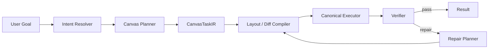

# Canvas Agent Superiority Strategy

Date: 2026-03-07  
Goal: make Zmind's canvas-native agent decisively stronger than generic agents + skills/tool wrappers

## 1. 先定标准：什么叫“最强的 Agent 画布能力”

不是“能调 canvas API”就算强。  
真正的强，至少要同时满足下面 8 项。

```text
+----+------------------------+----------------------------------------------+
| #  | 能力维度               | 强的定义                                     |
+----+------------------------+----------------------------------------------+
| 1  | 语义理解               | 能把模糊目标转成正确的信息结构               |
| 2  | 结构规划               | 能先规划节点/分组/关系/层级，再执行          |
| 3  | 布局智能               | 能自动给出稳定、美观、符合任务类型的布局     |
| 4  | 精准编辑               | 能做局部改动，不破坏已有结构                 |
| 5  | 自我修复               | 写失败、ID 失效、冲突时能自动修并重试        |
| 6  | 速度                   | 更快达到首个有效画布变化                     |
| 7  | 上下文感知             | 理解 selection / viewport / thread / workspace|
| 8  | 可验证性               | 能判断“是否真的完成用户目标”                 |
+----+------------------------+----------------------------------------------+
```

如果只强在：

- 工具更多
- prompt 更长
- skills 更多

那顶多叫“更会调 API”，不叫“最强画布 agent”。

---

## 2. 为什么通用 Agent + Skills 很难在 Canvas 上赢你们

通用 agent 的 canvas 通常是：

```text
LLM
  -> function call
  -> 外部工具
  -> patch / API write
```

它们天生有 4 个短板：

```text
1. 对画布状态理解不深
2. 对布局没有原生心智
3. 对局部编辑没有稳定执行模型
4. 对“完成没完成”没有领域验证器
```

你们如果想赢，不是把这条链做得更长，而是把它变成：

```text
LLM
  -> Canvas-native planner
  -> Canvas IR
  -> deterministic executor
  -> verifier
  -> repair
```

这才是本质差异。

---

## 3. 可能的实现方式：五条路线

## 路线 A：超强化工具路线

### 定义

继续沿用现在的 agent 模型，只是把 canvas 工具做得更强：

- 更多 tool
- 更好的 schema
- 更好的 usage examples
- 更强的 prompt
- 更丰富的 skills

### 架构

```text
LLM
  -> canvas_read / canvas_write / canvas_edit / ...
  -> apply ops
```

### 优点

```text
1. 改造成本最低
2. 与现有系统最兼容
3. 可以很快上线一些能力增强
```

### 缺点

```text
1. 上限低
2. 复杂布局和复杂编辑仍不稳定
3. 自修复仍靠 prompt 驱动
4. 工具越多，首轮决策越差
```

### 适合什么

```text
短期补强
不适合做“最强 canvas-native agent”
```

---

## 路线 B：Canvas Skills / Recipes 路线

### 定义

把常见画布任务沉淀成可复用 recipes：

- 对比图 recipe
- 时间线 recipe
- SWOT recipe
- 树图 recipe
- 研究卡片墙 recipe
- 演示页 recipe

本质是“领域化 skills”。

### 架构

```text
LLM
  -> select recipe / skill
  -> fill parameters
  -> recipe compiler
  -> apply ops
```

### 优点

```text
1. 对高频场景效果好
2. 结果稳定度会提升
3. 上线速度快
```

### 缺点

```text
1. 泛化能力有限
2. recipe 越多，维护越重
3. 容易变成模板系统，不是真正自主 agent
```

### 适合什么

```text
适合作为中间层
不适合作为终局架构
```

---

## 路线 C：Canvas DSL / IR + Compiler 路线

### 定义

让模型不直接写 ops，而是先输出一个更高层的 Canvas DSL / IR：

- section
- node groups
- relationships
- layout constraints
- visual intent

然后由 compiler 把 IR 编译成实际 canvas ops。

### 架构

```text
LLM
  -> Canvas DSL / Canvas IR
  -> Diff Compiler
  -> Canonical Executor
```

### 优点

```text
1. 稳定性显著高于直接 tool call
2. 更适合复杂结构生成
3. 可以做 deterministic layout
4. 更容易做验证与修复
```

### 缺点

```text
1. 需要重新定义 IR
2. compiler 设计成本高
3. 初期会有抽象不够全的问题
```

### 适合什么

```text
这是成为“最强 canvas-native agent”的必要条件之一
但单独做还不够
```

---

## 路线 D：Canvas Native Runtime 路线

### 定义

把 Canvas 变成一个原生执行域，而不是一组工具。

核心组成：

- Canvas context resolver
- Canvas planner
- CanvasTaskIR
- layout engine
- diff compiler
- canonical executor
- verifier
- repair strategies

### 架构

```text
User Goal
  -> Intent Resolver
  -> Canvas Planner
  -> CanvasTaskIR
  -> Canonical Executor
  -> Verification
  -> Repair
```



### 优点

```text
1. 上限最高
2. 复杂画布任务稳定度最高
3. 能形成真正的产品护城河
4. 能明显强于通用 agent + skills
5. 更容易做 benchmark 和持续优化
```

### 缺点

```text
1. 建设成本最高
2. 需要较强领域建模能力
3. 需要重新梳理执行边界与状态模型
```

### 适合什么

```text
最适合你们
这就是我推荐的主路线
```

---

## 路线 E：双引擎路线（通用 Agent + Canvas Native Runtime）

### 定义

保留通用 agent 作为总控，把 Canvas Native Runtime 作为最强执行域嵌入。

### 架构

```text
General Orchestrator
  -> decide domain
  -> if canvas:
       Canvas Native Runtime
     else:
       Generic tool/subagent path
```

### 优点

```text
1. 产品面最完整
2. 兼顾泛化与纵深
3. 可逐步迁移，不影响现有业务
```

### 缺点

```text
1. 架构复杂度更高
2. 需要严格边界，不然职责会重新混乱
```

### 适合什么

```text
这是最现实、也最强的落地路线
```

---

## 4. 五条路线横向对比

```text
+--------+------------------+--------+--------+--------+--------+----------------------+
| 路线   | 核心思路         | 成本   | 风险   | 上限   | 速度   | 结论                 |
+--------+------------------+--------+--------+--------+--------+----------------------+
| A      | 强化工具         | 低     | 低     | 低     | 快     | 只能补，不够强       |
| B      | recipes/skills   | 中     | 低     | 中     | 快     | 适合做中间层         |
| C      | IR + compiler    | 中高   | 中     | 高     | 中     | 必须做，但还不够     |
| D      | native runtime   | 高     | 中     | 很高   | 中     | 最强主路线           |
| E      | 双引擎融合       | 高     | 中高   | 最高   | 中     | 最佳落地形态         |
+--------+------------------+--------+--------+--------+--------+----------------------+
```

---

## 5. 哪一种最好

## 结论

**最佳方案不是 A/B/C/D 单独某一条，而是：**

```text
主路线 = D（Canvas Native Runtime）
落地形态 = E（通用编排 + Canvas 原生执行域）
增强层 = B（recipes）作为 planner 的一部分
基础抽象 = C（CanvasTaskIR / DSL）
```

也就是：

```text
E = D + C + B
```

### 为什么这才是最优

因为你们要同时赢三个维度：

```text
1. 比通用 agent 更懂 canvas
2. 比模板工具更灵活
3. 比纯 LLM tool calling 更稳定
```

单一路线都赢不全。

---

## 6. 我推荐的终局架构

## 6.1 总体

```text
Request
  -> Orchestrator
     -> Intent Resolver
     -> if canvas-dominant:
          Canvas Native Runtime
        else:
          Generic Agent / other domain runtime
```

## 6.2 Canvas Native Runtime 组成

```text
Canvas Native Runtime
  1. Context Resolver
  2. Planner
  3. Recipe Selector
  4. CanvasTaskIR Builder
  5. Layout Engine
  6. Diff Compiler
  7. Canonical Executor
  8. Verifier
  9. Repair Planner
```

### 说明

```text
Context Resolver
  = 不是简单 canvas_read
  = 是 selection / viewport / semantic neighborhood / workspace scope 解析器

Planner
  = 决定结构目标，不是直接写 patch

Recipe Selector
  = 在合适时自动用最佳 recipe，加速稳定输出

CanvasTaskIR Builder
  = 把自然语言目标转成领域结构

Layout Engine
  = 把结构变成稳定美观的位置和容器关系

Diff Compiler
  = 生成最小必要改动，不破坏现有画布

Canonical Executor
  = 唯一写路径，保证幂等、版本、安全

Verifier
  = 检查是否真的满足目标

Repair Planner
  = 失败后做 bounded repair
```

---

## 7. 要比通用 Agent 强，必须建立的 10 个原生能力

## 7.1 语义级画布读取

不是只读 JSON，而是读出：

```text
- 结构块
- 视觉分区
- 语义聚类
- 当前选择区域
- 可复用节点
- 画布叙事流
```

## 7.2 任务级规划

把用户要求拆成：

```text
- create
- transform
- reorganize
- summarize
- annotate
- connect
```

## 7.3 布局原生引擎

这是通用 agent 很难有的护城河。

你们至少要内置：

```text
- stack
- row
- grid
- 2-column comparison
- timeline
- mindmap
- tree
- matrix
- kanban
- card wall
- presentation board
```

## 7.4 最小破坏式编辑

系统应该优先：

```text
改局部
不重写全画布
保留用户原布局和风格
```

## 7.5 结构化修复

失败不是“再猜一次”，而是：

```text
失败类型识别
  -> ID 失效
  -> 版本冲突
  -> 选择区域失效
  -> 节点不存在
  -> 编译不合法
  -> 布局不满足约束
  -> 写成功但目标未达成
```

然后走对应 repair 策略。

## 7.6 选择区域原生感知

selection 不是提示信息，应该是一级输入。

## 7.7 视口/焦点原生感知

用户当前正在看的地方，比整张画布更重要。

## 7.8 Recipe 自动化

不是让用户选模板，而是系统自动判断：

```text
这次适合 comparison recipe
这次适合 mindmap recipe
这次适合 timeline recipe
```

## 7.9 可验证目标

不能只看 tool success。  
要看：

```text
是否真的生成了用户要的结构
是否真的存在 summary
是否真的形成左右对比
是否真的锚定到当前 selection
```

## 7.10 质量反馈闭环

把真实效果回流成：

```text
- best recipe choice
- best layout defaults
- best repair strategy
- worst failure classes
```

---

## 8. 三种实现深度

## 深度 1：工程增强版

```text
tool upgrade
+ recipes
+ better prompt
```

### 效果

能变强，但不会代际领先。

## 深度 2：领域编译版

```text
planner
+ CanvasTaskIR
+ diff compiler
+ verifier
```

### 效果

已经能明显强过通用 agent。

## 深度 3：原生运行时版

```text
Canvas Native Runtime
+ context resolver
+ planner
+ layout engine
+ canonical executor
+ verifier
+ repair
```

### 效果

这才是“最强”的级别。

---

## 9. 具体怎么实现：推荐的模块化方案

## 9.1 Context Resolver

输入：

```text
thread
messages
selection_context
viewport
canvas snapshot
workspace metadata
```

输出：

```text
CanvasWorkingSet
  - target_canvas
  - focus_region
  - selected_nodes
  - nearby_nodes
  - reusable_groups
  - semantic_summary
  - write_policy
```

## 9.2 Planner

输出：

```text
CanvasPlan
  - intent_type
  - recipe_candidate
  - target_anchor
  - plan_steps
  - constraints
  - success_criteria
```

## 9.3 CanvasTaskIR

输出：

```text
CanvasTaskIR
  - create_entities[]
  - update_entities[]
  - delete_entities[]
  - reparent_entities[]
  - connect_entities[]
  - layout_constraints
  - visual_constraints
```

## 9.4 Layout Engine

原则：

```text
用户没说布局时
  -> 自动给最优结构

用户说了布局时
  -> 严格尊重约束
```

## 9.5 Canonical Executor

必须满足：

```text
- single write path
- expected_version
- idempotency
- minimal diff
- rollback / repair hooks
```

## 9.6 Verifier

至少包含：

```text
- structural checks
- semantic checks
- anchor checks
- completeness checks
- no-unexpected-damage checks
```

## 9.7 Repair Planner

repair 不应该全靠 LLM 自由发挥。

建议：

```text
error class
  -> repair strategy table
  -> if needed, ask LLM only for missing detail
```

---

## 10. 取舍和权衡

## 10.1 灵活性 vs 稳定性

```text
纯 LLM 工具调用
  = 灵活高，稳定低

recipe/template
  = 稳定高，灵活低

IR + native runtime
  = 在中间取得最优平衡
```

## 10.2 开发速度 vs 护城河

```text
强化工具
  = 开发快，护城河弱

原生 runtime
  = 开发慢，护城河强
```

## 10.3 通用性 vs 产品纵深

```text
通用 agent
  = 横向广

canvas-native runtime
  = 纵向深
```

你们是产品型公司，不是 agent 平台公司。  
对你们来说，**纵深比横向更值钱。**

## 10.4 自主性 vs 可控性

```text
让模型自由调工具
  = 自主性高，结果波动大

让系统接管执行与验证
  = 可控性高，结果更稳
```

在 AI Canvas 里，后者更重要。

---

## 11. 最终推荐答案

## 如果你问：

### “有哪些可能方式？”

答案是：

```text
A. 强化工具
B. recipes / canvas skills
C. Canvas DSL / IR + compiler
D. Canvas Native Runtime
E. 通用编排 + Canvas 原生执行域
```

### “哪一种最好？”

答案是：

```text
最终最优 = E
核心内核 = D
关键抽象 = C
高频增强 = B
```

### “最大的取舍是什么？”

答案是：

```text
你们不是在选一个“省事方案”
你们是在选：

短期快补
还是
长期护城河
```

如果目标真的是“最强 AI 画布 agent”，那就不要把终局押在：

- tool 数量
- skill 数量
- prompt 强化

而要押在：

```text
Canvas Native Runtime
```

---

## 12. 我的明确建议

```text
现在开始：

1. 保留现有 orchestrator
2. 新建 Canvas Native Runtime
3. 引入 CanvasTaskIR
4. 把 recipes 当作 planner 的稳定器
5. 建立 verifier + repair
6. 逐步把复杂 canvas 请求切到 native runtime
```

这是最现实、最强、也最能持续拉开差距的路线。
