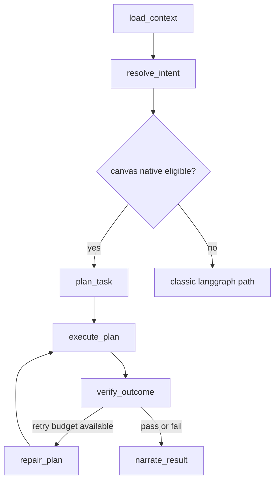

# Canvas Native Runtime Final Review

Date: 2026-03-07  
Scope: `Direction E = LangGraph shell + Canvas Native Runtime` final review  
Status: `Phase A-E completed`

## Final Verdict

```text
Conclusion
  = 不迁出 LangGraph
  = 已建立 canvas native execution lane
  = 已把“画布操作”从通用 tool calling 提升为：
      context-aware
      plan-first
      canonical-write
      verify-after-write
      repair-bounded
      observable

Assessment
  Product value      = strong positive
  Architecture fit   = strong positive
  Reliability uplift = clear positive
  Latency impact     = neutral to slight increase now, strong optimization potential next
  Extensibility      = strong positive
```

## What Was Delivered

```text
+----------------------+--------------------------------------------------+
| Layer                | Delivered capability                             |
+----------------------+--------------------------------------------------+
| Routing              | native/classic split without breaking old path   |
| Context              | current canvas + selection + snapshot resolution |
| Planning             | request -> CanvasTaskIR                          |
| Execution            | IR -> canonical canvas ops                       |
| Safety               | expected_version + idempotency                   |
| Verification         | post-write structural checks                     |
| Repair               | bounded retry with refreshed context             |
| Narration            | user-visible outcome summary                     |
| Observability        | degraded state + metrics + shadow mode           |
+----------------------+--------------------------------------------------+
```

## Runtime Shape

```text
classic generic agent
  = think -> tool call -> hope it worked

canvas native runtime
  = load context
    -> resolve intent
    -> plan task
    -> execute canonical ops
    -> verify outcome
    -> repair if needed
    -> narrate result
```



## Review Result

```text
Native path quality review
  [pass] routing is additive, non-canvas path preserved
  [pass] planner outputs structured IR instead of direct ad-hoc writes
  [pass] executor uses single canonical write path
  [pass] version / idempotency controls are in place
  [pass] verification is explicit, not implicit
  [pass] repair loop is bounded
  [pass] user can perceive success / failure / degraded state
  [pass] shadow mode supports safer rollout

Architecture judgment
  This is the correct direction.
  It keeps LangGraph as orchestration shell,
  while moving canvas from "generic tool target"
  into "first-class native runtime domain".
```

## Final Regression Summary

```text
Task-related regression suites
  - canvas native services / graph / contracts
  - intent resolution / degraded state
  - canvas request contract / application services
  - canvas ops consistency / normalization / realtime semantics

Result
  = 44 passed
  = 13 passed
  = total 57 passed
```

## Issue Found During Final Review

```text
Observed failure
  backend/tests/test_canvas_ops_behavior_parity.py

Root cause
  = test harness uses plain `node --input-type=module`
  = directly imports frontend `opsContract.ts`
  = current node runtime cannot execute `.ts` module directly
  = this is a test-environment/tooling issue
  = not caused by canvas native runtime implementation

Impact
  = does not block current delivery
  = should be fixed separately to restore backend/frontend parity CI
```

## Main Gains vs Old Architecture

```text
Before
  user intent -> model improvises -> scattered tool writes -> weak feedback loop

After
  user intent -> domain planner -> deterministic write contract
             -> explicit verification -> bounded repair -> readable outcome

This directly attacks the original pain points:
  1. 画布能力弱      -> domain-native planner/executor established
  2. 能力不稳定      -> canonical path + verifier + repair
  3. 慢              -> fewer blind loops, better future optimization surface
  4. “很难受”        -> narration + degraded visibility + predictable behavior
```

## Honest Limitations

```text
Current v1 limits
  - planner recipes are still heuristic
  - layout engine is deterministic but not yet elite
  - executor focuses on add/connect/move canonical ops
  - no full semantic group/refactor/rebuild grammar yet
  - no learned policy for canvas composition quality yet

Interpretation
  foundation is now right
  ceiling is much higher
  but "strongest canvas agent" still needs phase-2/phase-3 investment
```

## Recommended Next Wave

```text
Priority P0
  1. richer CanvasTaskIR recipes
  2. semantic layout engine (mindmap / swimlane / cluster / timeline / table)
  3. multi-step canvas transformations (rewrite / regroup / summarize / refactor)

Priority P1
  4. stronger verifier with semantic assertions
  5. conflict-aware partial replay / compensation
  6. intent-to-selection grounding upgrades

Priority P2
  7. latency budget instrumentation by stage
  8. learned ranking for plan candidates
  9. shadow-vs-classic outcome comparison dashboard
```

## Release Advice

```text
Rollout recommendation
  step 1: shadow mode on for internal traffic
  step 2: enable native path for high-confidence canvas intents
  step 3: compare success / repair / latency metrics
  step 4: expand recipe coverage
  step 5: default native for all eligible canvas operations
```

