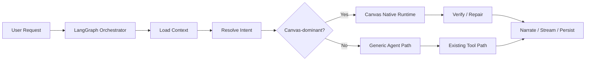
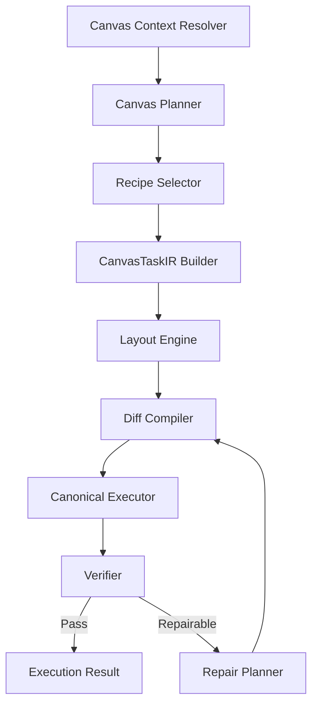
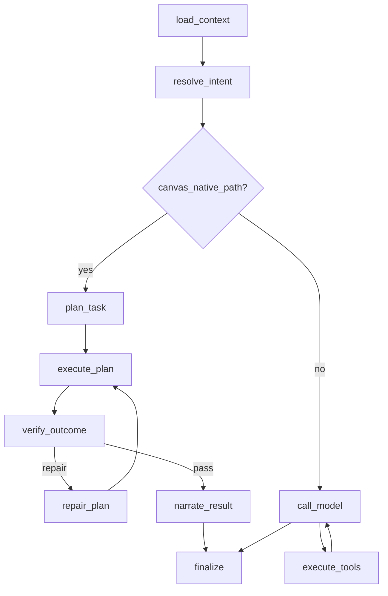

# Canvas Native Runtime Implementation Spec

Date: 2026-03-07  
Decision: **Adopt Direction E**

## 1. 决策确认

是的，方向就是 **E**：

```text
通用编排层
  + Canvas Native Runtime
  + CanvasTaskIR
  + Verifier / Repair
  + Recipes 作为 planner 稳定器
```

这不是妥协方案，而是最适合 Zmind 的最优解。

### 为什么 E 是对的

```text
+----------------------+-----------------------------------------------+
| 原因                 | 说明                                          |
+----------------------+-----------------------------------------------+
| 不丢现有资产         | 保留 worker / stream / checkpoint / routing   |
| 不再被通用 agent 限制| Canvas 业务内核独立演进                       |
| 上限最高             | 可以做原生布局、验证、修复                    |
| 落地风险可控         | 可 feature-flag、可灰度、可 shadow compare    |
+----------------------+-----------------------------------------------+
```

---

## 2. 终局架构

## 2.1 全局结构

```text
User Request
  -> Orchestrator (LangGraph shell)
     -> Context Load
     -> Intent Resolve
     -> Route
        -> Canvas Native Runtime
        -> or Generic Agent Path
  -> Stream / Persist / Finalize
```



## 2.2 Canvas Native Runtime 内部

```text
Canvas Native Runtime
  1. Context Resolver
  2. Planner
  3. Recipe Selector
  4. CanvasTaskIR Builder
  5. Layout Engine
  6. Diff Compiler
  7. Canonical Executor
  8. Verifier
  9. Repair Planner
```



---

## 3. 核心原则

```text
1. 模型负责意图和结构，不直接负责底层 patch
2. Canvas 写入只允许一条 canonical write path
3. 验证通过才算完成，不是 tool success 就算完成
4. repair 是系统能力，不是 prompt 小聪明
5. selection / viewport / current canvas 是一级输入，不是附属 metadata
6. 复杂高频场景优先 recipe 化，但 recipe 只是 planner 稳定器
```

---

## 4. 三层执行模式

为了兼顾灵活性和确定性，Canvas Native Runtime 内部建议支持三层模式：

```text
+--------+----------------------+----------------------------------------------+
| 层级   | 模式                 | 适用场景                                     |
+--------+----------------------+----------------------------------------------+
| L1     | Recipe-first         | 时间线、对比图、SWOT、树图、卡片墙等高频场景 |
| L2     | IR-first             | 中复杂度自由结构生成                         |
| L3     | Repair-first         | 写失败、冲突、局部修改、自修复               |
+--------+----------------------+----------------------------------------------+
```

### 执行决策

```text
if 高频明确场景:
  recipe-first
elif 自由结构任务:
  IR-first
elif 已有结构上修补:
  repair-first
```

---

## 5. CanvasTaskIR 设计

## 5.1 目标

CanvasTaskIR 要解决的问题是：

```text
把用户自然语言目标
  -> 转成稳定的画布领域结构
  -> 再编译成 deterministic diff
```

## 5.2 顶层结构

```text
CanvasTaskIR
  - ir_version
  - task_id
  - task_type
  - target_canvas
  - working_set
  - user_goal
  - success_criteria[]
  - entities_to_create[]
  - entities_to_update[]
  - entities_to_delete[]
  - connection_intents[]
  - layout_constraints
  - visual_constraints
  - execution_policy
  - verification_plan
  - metadata
```

## 5.3 详细字段建议

```text
+----------------------+-------------------------+----------------------------------+
| 字段                 | 类型                    | 说明                             |
+----------------------+-------------------------+----------------------------------+
| ir_version           | str                     | 版本号                           |
| task_id              | str                     | 本次任务唯一 ID                  |
| task_type            | enum                    | create / edit / transform / ...  |
| target_canvas        | TargetCanvasRef         | 目标画布                         |
| working_set          | CanvasWorkingSet        | 当前工作集                       |
| user_goal            | str                     | 用户目标原文/归纳               |
| success_criteria     | list[str]               | 成功标准                         |
| entities_to_create   | list[CanvasEntitySpec]  | 待创建实体                       |
| entities_to_update   | list[CanvasPatchSpec]   | 待更新实体                       |
| entities_to_delete   | list[EntityRef]         | 待删除实体                       |
| connection_intents   | list[ConnectionIntent]  | 关系意图                         |
| layout_constraints   | LayoutConstraints       | 布局约束                         |
| visual_constraints   | VisualConstraints       | 样式约束                         |
| execution_policy     | ExecutionPolicy         | 幂等/冲突/最小改动策略           |
| verification_plan    | VerificationPlan        | 验证计划                         |
| metadata             | dict                    | 调试与 trace 元信息              |
+----------------------+-------------------------+----------------------------------+
```

## 5.4 关键子结构

### `TargetCanvasRef`

```text
TargetCanvasRef
  - canvas_id
  - source            # current_thread / explicit_user / workspace_match
  - confidence
  - requires_confirmation
```

### `CanvasWorkingSet`

```text
CanvasWorkingSet
  - focus_scope       # selection / viewport / canvas / workspace
  - anchor
  - selected_nodes[]
  - nearby_nodes[]
  - reusable_groups[]
  - semantic_summary
  - current_canvas_snapshot_ref
```

### `CanvasEntitySpec`

```text
CanvasEntitySpec
  - temp_id
  - entity_type       # text/todo/table/code/media/group/column/canvas-link
  - semantic_role     # title/summary/pro/con/step/branch/evidence/...
  - content
  - props
  - parent_ref
  - children_refs[]
```

### `ConnectionIntent`

```text
ConnectionIntent
  - from_ref
  - to_ref
  - relation_type
  - label
  - style
  - priority
```

### `LayoutConstraints`

```text
LayoutConstraints
  - recipe_name
  - mode              # stack/row/grid/mindmap/timeline/kanban/...
  - anchor
  - preserve_existing_layout
  - avoid_overlap
  - max_width
  - density
  - grouping_policy
```

### `ExecutionPolicy`

```text
ExecutionPolicy
  - write_mode                    # minimal_diff / rebuild_section / replace_region
  - expected_server_version
  - idempotency_key
  - max_repair_attempts
  - allow_cross_canvas_write
  - require_explicit_target
```

### `VerificationPlan`

```text
VerificationPlan
  - checks[]
  - fail_fast
  - repairable_failures[]
```

---

## 5.5 Python 建模建议

建议放在：

- `backend/core/domains/canvas/task_ir.py`
- `backend/core/domains/canvas/verification_rules.py`
- `backend/core/domains/canvas/execution_result.py`

### 示例草图

```python
from dataclasses import dataclass, field
from typing import Any, Literal

TaskType = Literal["create", "edit", "transform", "organize", "summarize"]

@dataclass(slots=True)
class TargetCanvasRef:
    canvas_id: str | None
    source: str
    confidence: float
    requires_confirmation: bool = False

@dataclass(slots=True)
class CanvasEntitySpec:
    temp_id: str
    entity_type: str
    semantic_role: str | None = None
    content: str | None = None
    props: dict[str, Any] = field(default_factory=dict)
    parent_ref: str | None = None
    children_refs: list[str] = field(default_factory=list)

@dataclass(slots=True)
class CanvasTaskIR:
    ir_version: str
    task_id: str
    task_type: TaskType
    target_canvas: TargetCanvasRef
    user_goal: str
    success_criteria: list[str] = field(default_factory=list)
    entities_to_create: list[CanvasEntitySpec] = field(default_factory=list)
    entities_to_update: list[dict[str, Any]] = field(default_factory=list)
    entities_to_delete: list[str] = field(default_factory=list)
    connection_intents: list[dict[str, Any]] = field(default_factory=list)
    layout_constraints: dict[str, Any] = field(default_factory=dict)
    visual_constraints: dict[str, Any] = field(default_factory=dict)
    execution_policy: dict[str, Any] = field(default_factory=dict)
    verification_plan: dict[str, Any] = field(default_factory=dict)
    metadata: dict[str, Any] = field(default_factory=dict)
```

---

## 6. Canvas Native Runtime 接口设计

## 6.1 Runtime 外观接口

建议单入口：

- `backend/core/canvas/runtime/runtime.py`

### 接口

```python
class CanvasNativeRuntime:
    async def execute(
        self,
        *,
        run_context: CanvasRuntimeContext,
        user_goal: str,
        requested_scope: str | None = None,
    ) -> CanvasRuntimeResult: ...
```

## 6.2 运行时上下文

```text
CanvasRuntimeContext
  - agent_run_id
  - thread_id
  - account_id
  - project_id
  - canvas_id
  - current_messages
  - selection_context
  - interaction_surface
  - client_message_hint
  - requested_model
  - expected_server_version
  - degraded_flags[]
  - trace_ids
```

## 6.3 运行时结果

```text
CanvasRuntimeResult
  - success
  - task_ir
  - compiled_diff
  - applied_operations
  - verification_report
  - repair_attempts
  - user_summary
  - degraded_flags[]
  - metadata
```

---

## 7. 模块设计

## 7.1 `context_resolver.py`

职责：

```text
1. 读取 selection / viewport / thread-bound canvas
2. 计算 focus region
3. 提炼 semantic neighborhood
4. 给 planner 提供工作集
```

输入：

```text
thread_id, account_id, canvas_id, latest messages, selection_context
```

输出：

```text
CanvasWorkingSet
```

## 7.2 `recipes.py`

职责：

```text
将高频结构沉淀为稳定 recipe
```

建议首批 recipe：

```text
- comparison_2col
- timeline_linear
- mindmap_basic
- card_wall
- swot_quad
- pros_cons_summary
- research_board
- presentation_outline
```

## 7.3 `planner.py`

职责：

```text
1. 识别任务类型
2. 选择 recipe 或自由 IR
3. 输出 CanvasTaskIR
```

模式：

```text
recipe-first
ir-first
repair-first
```

## 7.4 `layout_engine.py`

职责：

```text
把语义结构映射成稳定布局
```

核心能力：

```text
- anchor-aware
- selection-aware
- preserve-existing-layout
- no-overlap
- container-aware
```

## 7.5 `diff_compiler.py`

职责：

```text
把 CanvasTaskIR 编译成最小必要改动
```

输出不是随意 ops，而是：

```text
CanvasDiff
  - create_nodes
  - update_nodes
  - delete_nodes
  - create_connections
  - update_connections
  - delete_connections
  - update_canvas
```

## 7.6 `canonical_executor.py`

职责：

```text
唯一写路径
```

必须满足：

```text
- expected_version
- idempotency
- minimal diff
- traceable
- recoverable
```

执行实现上，Phase 1 可先复用现有：

- `CanvasWriteService.apply_canvas_ops()`
- `CanvasEditTool.edit()` 中已验证的一部分逻辑

但对外必须收敛成一个统一入口。

## 7.7 `verifier.py`

职责：

```text
检查“是否完成目标”
```

验证维度：

```text
- 结构验证
- 布局验证
- 关系验证
- anchor 验证
- 完整性验证
- 破坏性验证
```

## 7.8 `repair.py`

职责：

```text
1. 识别失败类型
2. 给出 repair strategy
3. 触发 bounded retry
```

错误分层建议：

```text
version_conflict
stale_selection
missing_node_ref
missing_connection_ref
invalid_layout_constraint
verification_failed
executor_partial_apply
```

---

## 8. Graph 接入方式

## 8.1 Phase 1 不替换现有 graph，只做 hybrid

```text
load_context
  -> resolve_intent
     -> if canvas_native
          plan_task
          execute_plan
          verify_outcome
          repair_plan?
          narrate_result
        else
          old call_model
          old execute_tools
```



## 8.2 为什么 Phase 1 要 hybrid

```text
1. 风险最小
2. 不影响 doc/research/integration
3. 只把 canvas-dominant 请求切到新路径
4. 可以做灰度和 shadow compare
```

---

## 9. 第一阶段文件级实施方案

## 9.1 新增文件

### Domain

```text
backend/core/domains/agent/intent.py
backend/core/domains/agent/task_plan.py
backend/core/domains/agent/verification.py
backend/core/domains/agent/degraded_state.py

backend/core/domains/canvas/task_ir.py
backend/core/domains/canvas/layout_constraints.py
backend/core/domains/canvas/verification_rules.py
backend/core/domains/canvas/execution_result.py
backend/core/domains/canvas/diff.py
```

### Application services

```text
backend/core/application/services/intent_resolution_service.py
backend/core/application/services/canvas_planner_service.py
backend/core/application/services/canvas_verification_service.py
backend/core/application/services/degraded_state_service.py
```

### Canvas runtime

```text
backend/core/canvas/runtime/__init__.py
backend/core/canvas/runtime/context_resolver.py
backend/core/canvas/runtime/recipes.py
backend/core/canvas/runtime/planner.py
backend/core/canvas/runtime/layout_engine.py
backend/core/canvas/runtime/diff_compiler.py
backend/core/canvas/runtime/canonical_executor.py
backend/core/canvas/runtime/verifier.py
backend/core/canvas/runtime/repair.py
backend/core/canvas/runtime/runtime.py
backend/core/canvas/runtime/contracts.py
```

### LangGraph nodes

```text
backend/core/langgraph_engine/nodes/resolve_intent.py
backend/core/langgraph_engine/nodes/plan_task.py
backend/core/langgraph_engine/nodes/execute_plan.py
backend/core/langgraph_engine/nodes/verify_outcome.py
backend/core/langgraph_engine/nodes/repair_plan.py
backend/core/langgraph_engine/nodes/narrate_result.py
```

## 9.2 需要修改的现有文件

### 编排与状态

```text
backend/core/langgraph_engine/contracts/state_schema.py
backend/core/langgraph_engine/contracts/engine_interface.py
backend/core/langgraph_engine/graph.py
backend/core/langgraph_engine/engine.py
backend/run_agent_background.py
```

### canvas 接口与兼容层

```text
backend/core/canvas/cac/tools.py
backend/core/tools/canvas_edit_tool.py
backend/core/canvas/write_service.py
backend/core/interfaces/http/canvas/service_bindings.py
```

### 可观测与测试

```text
backend/tests/test_langgraph_engine.py
backend/tests/test_canvas_agent_context.py
backend/tests/test_canvas_realtime_apply_semantics.py
backend/tests/test_canvas_native_runtime_*.py   # 新增
backend/tests/test_canvas_task_ir_*.py          # 新增
```

---

## 10. 现有文件如何改

## 10.1 `state_schema.py`

新增字段，保持 additive：

```text
intent
task_plan
domain
execution_policy
verification_report
repair_count
degraded_flags
outcome_summary
```

## 10.2 `engine_interface.py`

`RunConfig` 建议新增：

```text
execution_mode
feature_flags
expected_canvas_server_version
```

说明：

```text
execution_mode = classic | hybrid | canvas_native
```

## 10.3 `graph.py`

改造重点：

```text
插入 resolve_intent / plan_task / execute_plan / verify_outcome / repair_plan / narrate_result
保留旧路径作为 fallback
```

## 10.4 `run_agent_background.py`

改造重点：

```text
1. 将 canvas native feature flag 注入 tool_context / run_config
2. 透传 expected canvas version
3. 记录 degraded state
4. metrics 区分 classic vs canvas_native
```

## 10.5 `canvas/cac/tools.py`

改造重点：

```text
Phase 1:
  不删
  作为兼容入口

Phase 2:
  canvas_write / canvas_edit 内部改为调用 CanvasNativeRuntime / CanonicalExecutor
```

## 10.6 `canvas_edit_tool.py`

改造重点：

```text
Phase 1:
  从“主执行器”降级为“兼容执行适配层”

Phase 2:
  将其中稳定可复用的验证/规范化逻辑抽到 canonical executor
```

---

## 11. Phase 1 开发顺序

## Step 1：状态与 feature flag

```text
目标：
  建立 hybrid 运行通道，不改现有默认行为
```

实施：

```text
1. 扩展 GraphState / RunConfig
2. 新增 feature flag:
   - CANVAS_NATIVE_RUNTIME_ENABLED
   - CANVAS_NATIVE_RUNTIME_SHADOW
   - CANVAS_NATIVE_VERIFY_ENABLED
```

## Step 2：意图识别和 hybrid 路由

```text
目标：
  只把高置信 canvas 请求导入新通道
```

实施：

```text
1. 新增 resolve_intent node
2. 输出 domain = canvas | generic
3. graph route 支持 hybrid
```

## Step 3：CanvasTaskIR v1 + Planner v1

```text
目标：
  先支持 5~8 个高频场景
```

优先 recipe：

```text
comparison_2col
timeline_linear
mindmap_basic
research_board
pros_cons_summary
presentation_outline
```

## Step 4：Canonical Executor v1

```text
目标：
  统一写路径
```

实现策略：

```text
对外新接口统一
对内初期仍可借用现有 apply_canvas_ops + 部分 legacy 校验
```

## Step 5：Verifier / Repair v1

```text
目标：
  让系统第一次具备“写完检查”和“失败自修”
```

## Step 6：Narrate / Stream 集成

```text
目标：
  对用户输出“改了什么、是否有降级、是否有局限”
```

---

## 12. Phase 1 范围控制

必须控制范围，避免一开始过大。

### Phase 1 支持

```text
1. 当前画布内 create / edit / organize
2. selection / viewport anchoring
3. 高频信息结构场景
4. bounded repair
```

### Phase 1 暂不追求

```text
1. workspace 级跨画布复杂推理
2. 超自由图形布局
3. 多域联动（research -> canvas -> doc）一次做完
4. 全量替换 legacy path
```

---

## 13. 风险与权衡

```text
+----------------------+-----------------------------------------------+
| 风险                 | 应对                                          |
+----------------------+-----------------------------------------------+
| IR 抽象过重          | 先做 v1，只覆盖高频结构                       |
| 与现有 graph 冲突    | 走 hybrid route，不全量替换                   |
| runtime 过慢         | recipe-first + layout cache + minimal diff    |
| 兼容层拖住重构       | 明确 legacy 只做 adapter，不再扩逻辑          |
| 过早泛化             | 先只打穿 canvas-dominant 请求                 |
+----------------------+-----------------------------------------------+
```

---

## 14. 最终推荐的立项方式

```text
Track A
  Graph Hybrid + Intent + Verify/Repair

Track B
  CanvasTaskIR + Planner + Recipes

Track C
  Canonical Executor + Degraded State + Metrics
```

### 依赖关系

```text
Track A 与 Track B 可并行
Track C 需要 Track B 的 IR 输入
```

---

## 15. 我给你的最终技术判断

```text
如果你们真要做“最强的 AI 画布 agent”
那么必须让 Canvas 从 tools 升级成 runtime
```

而方向 E 的价值就在于：

```text
既不扔掉已有编排资产
又把真正的竞争力迁移到 Canvas 原生执行域里
```

这条路是最现实、最强、最可持续的。
