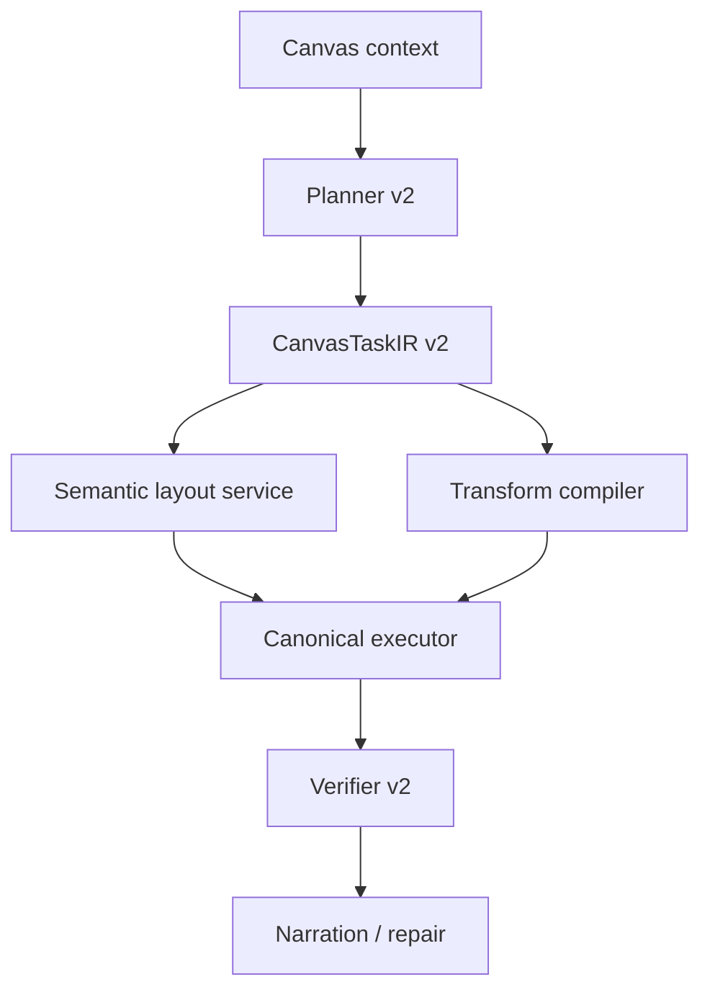

# Canvas Native Runtime Phase 2 Review

Date: 2026-03-07  
Scope: `Phase 2 = semantic layout engine + selection-native transforms`  
Status: `completed`

## Verdict

```text
Phase 1
  = solved safe native execution

Phase 2
  = makes canvas runtime feel more native
  = gives the agent stronger shape-changing ability on the canvas

Judgment
  architecture direction = correct
  product leverage       = high
  canvas-native feel     = clearly improved
```

## What Was Added

```text
+------------------------+------------------------------------------------------+
| Capability             | Delivered value                                      |
+------------------------+------------------------------------------------------+
| Semantic layout engine | grid / cluster / timeline / mindmap / swimlane       |
| Planner v2             | richer recipes + lane-aware planning + root planning |
| Selection context v2   | focus nodes + focus texts from snapshot              |
| Transform layer        | retitle selection / create summary hub               |
| Executor v2            | canonical update_node + summary-node synthesis       |
| Verifier v2            | checks renamed content + summary node/connections    |
+------------------------+------------------------------------------------------+
```

## Runtime Upgrade

```text
Before Phase 2
  create nodes      = yes
  connect nodes     = yes
  relayout basics   = yes
  reshape selection = weak

After Phase 2
  create mindmap/timeline/swimlane = yes
  relayout with semantic lanes     = yes
  rename selected nodes            = yes
  add summary hub over selection   = yes
```



## Stage Review

```text
P2-A review
  [pass] IR supports lanes + transforms
  [pass] layout engine extracted into dedicated service
  [pass] planner supports mindmap / timeline / swimlane recipes
  [pass] executor can render swimlane headers canonically

P2-B review
  [pass] planner emits selection transforms
  [pass] executor compiles retitle_selection to update_node
  [pass] executor compiles create_summary_hub to add_node + add_connection
  [pass] verifier checks transformed content and summary structure

P2-C review
  [pass] wider regression passed
  [pass] task docs and review docs landed
  [pass] stage commits isolated from unrelated parallel work
```

## Regression Result

```text
Focused stage regression
  P2-A = 9 passed
  P2-B = 13 passed

Broader final regression
  = 65 passed
```

## Why This Matters

```text
This phase moves the product from:
  "agent can write to canvas"
to:
  "agent can intelligently restructure thinking on canvas"

That is a different category.
It is much closer to a true canvas-native agent moat.
```

## What Still Limits Us

```text
Current limits
  - semantic transforms are deterministic, not model-ranked
  - summary hub is structural, not deep semantic synthesis
  - swimlane grouping is best when user gives explicit lanes
  - no full selection regroup / merge / split / re-parent grammar yet
  - no benchmark dashboard comparing classic vs native plan quality yet
```

## Best Next Phase

```text
Priority P0
  1. semantic rewrite transforms
     - regroup selection
     - split large node into children
     - merge similar nodes
     - convert bullets <-> mindmap <-> timeline

Priority P1
  2. quality ranking layer
     - generate multiple layout/transform candidates
     - rank by readability / overlap / balance / edge crossings

Priority P2
  3. evaluation system
     - benchmark plan quality
     - benchmark execution success
     - compare native vs classic vs shadow outcomes
```

## Delivered Commits

```text
5161b10cb feat(canvas-native): add semantic layout engine
bf0492aca feat(canvas-native): add selection transforms
```

