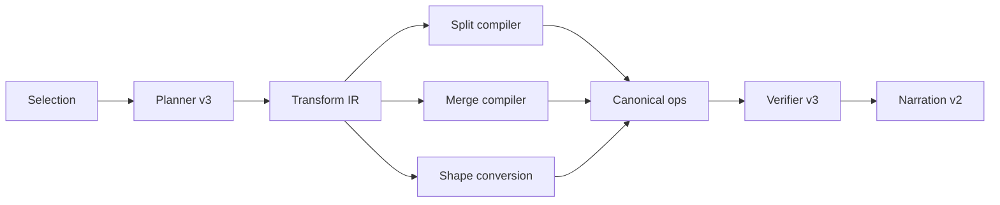

# Canvas Native Runtime Phase 3 Review

Date: 2026-03-07  
Scope: `Phase 3 = semantic rewrite transforms`  
Status: `completed`

## Verdict

```text
Phase 3 turns the runtime from:
  "can arrange structures"
into:
  "can rewrite structures"

This is the first phase where the canvas agent starts to feel
like an actual visual-thinking refactoring system.
```

## What Was Added

```text
+--------------------------+------------------------------------------------------+
| Capability               | Delivered value                                      |
+--------------------------+------------------------------------------------------+
| split transform          | expand one selected node into child nodes            |
| merge transform          | merge selected nodes into one canonical node         |
| merge rewiring           | reconnect external edges during merge                |
| shape conversion boost   | selected nodes auto-connect for timeline/mindmap     |
| verifier v3              | validates split children / merge deletion / rewires  |
| narration v2             | reports rewrite actions in user-visible language     |
+--------------------------+------------------------------------------------------+
```

## Rewrite Map

```text
selected node
  -> split into child structure

selected cluster
  -> merge into one canonical node
  -> reconnect graph boundaries

selected loose nodes
  -> convert to timeline / mindmap semantics
```



## Stage Review

```text
P3-A review
  [pass] planner detects split intent
  [pass] planner detects merge intent
  [pass] planner auto-connects selected nodes for timeline/mindmap conversion

P3-B review
  [pass] executor compiles split to add_node + add_connection
  [pass] executor compiles merge to add_node + reconnect + delete
  [pass] verifier catches missing split / merge outcomes
  [pass] narration exposes rewrite actions

P3-C review
  [pass] broad regression passed
  [pass] no unrelated parallel changes were mixed into task commits
```

## Regression Result

```text
Focused rewrite regression
  = 19 passed

Broader final regression
  = 72 passed
```

## Why This Matters

```text
Phases 1-2 made the runtime reliable and layout-capable.
Phase 3 makes it structurally transformative.

That means the system is no longer just helping users place notes.
It is starting to help them refactor thought.
That is much closer to a true AI canvas moat.
```

## Honest Limits

```text
Still missing
  - multi-candidate ranking for rewrite quality
  - semantic merge synthesis from node content
  - richer regroup grammar (group / subgroup / parent / frame)
  - graph-preserving merge with stronger conflict strategies
  - eval dashboard for rewrite quality
```

## Best Next Phase

```text
Priority P0
  1. candidate generation + ranking
     - multiple rewrite candidates
     - score readability / overlap / balance / edge crossings

Priority P1
  2. semantic content synthesis
     - merged node content generated from selected nodes
     - split children generated from long content blocks

Priority P2
  3. richer canvas grammar
     - parent/child regrouping
     - frame / group semantics
     - selective subgraph rewrite
```

## Delivered Commit

```text
5c6fcce2e feat(canvas-native): add semantic rewrite transforms
```

