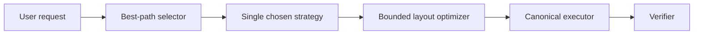

# Canvas Native Runtime Phase 4 Review

Date: 2026-03-07  
Scope: `Phase 4 = Single-Shot Best Path`  
Status: `completed`

## Verdict

```text
Phase 4 improves first-shot quality
without adding online multi-candidate latency.

This is the right direction:
  smarter first decision
  bounded hot path
  no extra user waiting
```

## What Was Added

```text
+--------------------------+------------------------------------------------------+
| Capability               | Delivered value                                      |
+--------------------------+------------------------------------------------------+
| best-path selector       | one best strategy per request                        |
| topology analysis        | chain / star / cluster / unlinked detection          |
| root selection           | deterministic root choice for mindmap-style layouts  |
| reading-order planning   | selection order preserved for timeline/layout flows  |
| bounded layout optimizer | obstacle avoidance without unbounded retries         |
| latency guardrails       | explicit plan/layout budgets and collision pass caps |
| budget observability     | warnings + degraded flags when guardrails trigger    |
+--------------------------+------------------------------------------------------+
```

## Runtime Upgrade

```text
Before Phase 4
  = runtime could plan / layout / rewrite
  = but first-shot strategy selection was still heuristic-only

After Phase 4
  = runtime chooses one better path on purpose
  = selection topology influences layout strategy
  = layout optimizer improves readability within a bounded budget
```



## Stage Review

```text
P4-A review
  [pass] best-path selector added
  [pass] chain/star topology detection added
  [pass] mindmap root selection added
  [pass] planner now uses ordered selection ids

P4-B review
  [pass] layout service supports preferred order
  [pass] layout service performs bounded collision avoidance
  [pass] executor consumes optimization profile + budgets

P4-C review
  [pass] runtime policy exposes best-path and budget settings
  [pass] plan_task records budget overrun as degraded signal
  [pass] final broad regression passed
```

## Regression Result

```text
Focused stage regression
  = 25 passed

Broader final regression
  = 77 passed
```

## Why This Matters

```text
This phase improves "first result quality"
without turning the hot path into a slow search problem.

That matches the product requirement:
  don't make users wait longer
  don't make users choose plans
  make the first result more likely to feel right
```

## Honest Limits

```text
Still not solved
  - semantic merge content synthesis is still shallow
  - split child generation still depends on explicit list-like input
  - no offline evaluation dashboard yet
  - no learned ranking; best path is deterministic heuristic intelligence
```

## Best Next Phase

```text
Priority P0
  1. semantic content synthesis
     - merge node content from selected nodes
     - split long node content into child nodes automatically

Priority P1
  2. offline evaluation and replay
     - benchmark best-path quality
     - track budget hits / repair rates / readability metrics

Priority P2
  3. richer structure grammar
     - frames / groups / parent-child regrouping
     - selective subgraph rewrite
```

## Delivered Commits

```text
d8faefe0a feat(canvas-native): add best path selector
c7a19430a feat(canvas-native): add bounded layout optimization
```

