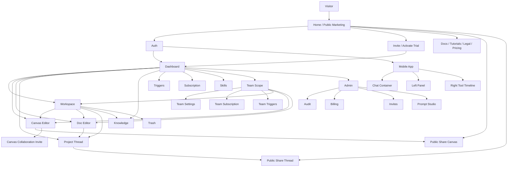

# Zmind 全量功能拆解报告

> 日期：2026-03-12  
> 输出目标：把项目中的用户可见功能，按“页面 -> 模块 -> 动作 -> 状态 -> 跳转/依赖”彻底拆开。  
> 说明：你提到的 `IACL`，这里统一按 `ASCII 结构图` 处理，并辅以 `Mermaid`。  
> 审计范围：以 Web 与 Mobile 的真实页面入口为主，后台无独立页面的纯基础设施只作为依赖说明，不逐函数枚举。

---

## 0. 审计口径

```text
盘点颗粒度
==========
1. 页面级
   - 某个 URL / 某个路由入口到底承担什么职责

2. 模块级
   - 页面上的区块、面板、弹窗、抽屉、侧栏、浮层

3. 动作级
   - 打开页面
   - 打开弹窗
   - 复制
   - 分享
   - 创建
   - 编辑
   - 删除
   - 恢复
   - 搜索
   - 筛选
   - 切换模式
   - 打开外链
   - 打开新标签页

4. 状态级
   - loading
   - empty
   - error
   - success
   - permission denied
   - deep link / query param state

5. 路由级
   - real source page
   - wrapper page
   - redirect page

不重复展开的对象
================
- 只做 locale 转发的页面
- 只做 team 路由包裹的镜像页
- 没有独立页面入口的纯底层工具函数
```

## 1. 结论先行

- 基于静态扫描，当前 Web 路由文件可分成：`42` 个 real route、`55` 个 wrapper route、`7` 个显式 redirect route。
- 另外还有少量“软跳转页”，例如 `enterprise`，它会先渲染过渡态，再自动转向目标页。
- 真正需要逐页拆解的“能力源页面”集中在 6 大域：`Public`、`Auth`、`Workspace Core`、`Settings & Integrations`、`Admin`、`Share & Mobile`。
- 这个产品的主闭环不是单一聊天，而是三条并行主链：
  - `Dashboard/Workspace -> Canvas`
  - `Dashboard/Workspace -> Doc`
  - `Workspace/Project -> Thread`
- 复杂度最高的页面不是首页，也不是计费页，而是：
  - `Canvas Editor`
  - `Doc Editor`
  - `Thread Component`
  - `Workspace`
  - `Knowledge Base`
- 很多“看似不同”的页面其实只是壳：
  - `locale wrapper`
  - `team-scoped wrapper`
  - `redirect page`
- 如果把这些壳页和真实源页混在一起看，功能盘点会虚高，所以本报告先去重，再按真实功能源页展开。

## 2. 产品表面总图

```text
Zmind Product Surface
=====================

[Public / Pre-login]
  |
  +-- Home
  +-- Pricing
  +-- Changelog
  +-- Tutorials
  +-- Legal
  +-- Docs
  +-- Auth
  +-- Invite / Activate Trial
  +-- Team Invitation Accept
  +-- Public Share: Canvas / Thread

[Authenticated Personal Workspace]
  |
  +-- Dashboard
  |    +-- AI quick entry
  |    +-- Workspace snapshot
  |    +-- Knowledge snapshot
  |
  +-- Workspace
  |    +-- Create canvas / doc / folder
  |    +-- Search / open / move / rename / delete
  |
  +-- Canvas Editor
  |    +-- Visual editing
  |    +-- Collaboration / share / invite
  |    +-- AI side panel
  |    +-- Playback / screenshot / outline
  |
  +-- Doc Editor
  |    +-- Rich text editing
  |    +-- Autosave
  |    +-- Inline AI
  |
  +-- Project Thread
  |    +-- Message stream
  |    +-- Attachments / file preview
  |    +-- CTA actions / tool results
  |
  +-- Explore
  +-- Knowledge
  +-- Triggers
  +-- Trash
  +-- Subscription
  +-- Skills
  +-- Settings / Credentials / Env Manager / Teams
  +-- Integrations: Obsidian / OpenClaw

[Team-scoped Workspace]
  |
  +-- Team Settings
  +-- Team Subscription
  +-- Team Triggers
  +-- Team wrappers for dashboard/workspace/canvas/doc/etc.

[Admin]
  |
  +-- Audit
  +-- Billing
  +-- Invites
  +-- Prompt Studio

[Mobile Preview App]
  |
  +-- Home route
  +-- Chat container
  +-- Left panel
  +-- Right tool timeline panel
  +-- Share / settings / delete action modals
```

## 3. Mermaid 总流程图



## 4. 路由分层总表

```text
分层规则
========
real route
  真的承载功能，应该逐页拆解

wrapper route
  只转发到真实页面，本身没有新增业务能力

redirect route
  只负责跳转，本身没有页面业务
```

| 分组 | 真实源页示例 | 典型包装/跳转 | 结论 |
|---|---|---|---|
| Public | `/`, `/pricing`, `/tutorials`, `/legal` | `/[locale]/...` | locale 层不重复展开 |
| Auth | `/auth`, `/auth/reset-password`, `/auth/phone-verification` | `/[locale]/auth/*` | locale 层不重复展开 |
| Dashboard Core | `/dashboard`, `/workspace`, `/canvas/[canvasId]`, `/doc/[itemId]` | `/team/[accountSlug]/*`, `/[locale]/*` | 先看源页，再看 team 差异 |
| Thread | `/projects/[projectId]/thread/[threadId]` | `/team/[accountSlug]/projects/...`, `/thread/[threadId] -> /` | 老线程页已废弃，项目线程页仍有效 |
| Billing | `/subscription` | `/model-pricing -> /subscription`, `/settings/transactions -> /subscription` | 计费能力统一收口到订阅页 |
| Settings | `/settings`, `/settings/env-manager`, `/settings/credentials`, `/settings/teams` | `/settings/knowledge` wrapper | 功能分散，但仍属于账号管理域 |
| Admin | `/admin/audit`, `/admin/billing`, `/admin/invites`, `/admin/prompts` | `/[locale]/admin/*` | locale 层不重复展开 |
| Share | `/share/canvas/[canvasId]`, `/share/[threadId]` | `/[locale]/share/*` | public share 单独拆解 |
| Mobile | `apps/mobile/app/index.tsx` | layout 壳 | 以单入口、多面板盘点 |

---

# 5. 详细功能拆解

## 5.1 Public / 未登录入口域

### 5.1.1 首页 Home

- 真实入口：`/`
- 包装入口：`/[locale]/`
- 源文件：
  - `frontend/src/app/(home)/page.tsx`
  - `frontend/src/components/home/sections/hero-section.tsx`
  - `frontend/src/components/home/sections/template-section.tsx`
  - `frontend/src/components/home/sections/faq-section.tsx`
  - `frontend/src/components/home/sections/pricing-section.tsx`
  - `frontend/src/components/home/sections/cta-section.tsx`

```text
Home
├─ 顶部导航
├─ Hero 首屏
│  ├─ 主 CTA
│  ├─ 次 CTA
│  ├─ Demo Canvas 动画
│  └─ Demo AI 侧栏
├─ Template Showcase
├─ FAQ Accordion
├─ Pricing Section
└─ CTA + Footer
```

功能拆解：

- 打开首页时展示营销结构，不要求登录。
- Hero 主 CTA 根据登录态进入 `dashboard` 或 `auth`。
- Hero 次 CTA 可引导到邀请/试用链路。
- 首屏 demo 不是纯静态图，而是“画布 + AI 面板”组合式演示，承担产品理解功能。
- 模板区可打开公开模板画布，通常走 `share canvas` 路径。
- FAQ 支持折叠/展开，属于内容渐进披露功能。
- 定价区支持月付/年付切换。
- 定价区支持从营销页直接触发订阅或结账流程。
- 定价区兼容支付中的 pending 状态回显。
- CTA 区再次收口到注册、试用、联系等动作。
- Footer 承担公开页导航：
  - 价格
  - 文档
  - 法务
  - 教程
  - 变更日志

状态与边界：

- 未登录态可完整浏览。
- 已登录态 CTA 会更偏向进入工作台。
- 支付 pending 时需要回显支付中状态，避免用户重复购买。

关键依赖：

- 前端营销组件
- 公开 share canvas 链路
- 计费与 checkout 状态

### 5.1.2 公共价格页 Pricing

- 真实入口：`/pricing`
- 源文件：`frontend/src/app/(home)/pricing/page.tsx`

```text
Pricing Page
├─ ModernPricingSection
├─ FAQ
├─ CTA
└─ Footer
```

功能拆解：

- 独立承载公开定价信息。
- 支持套餐浏览。
- 支持月付/年付切换。
- 支持从公开页进入结账。
- 支持浏览 FAQ。
- 支持从底部 CTA 回到注册/订阅路径。

与首页区别：

- 首页价格区是转化子模块。
- `pricing` 页是完整价格着陆页，信息更聚焦。

### 5.1.3 Changelog 变更日志页

- 真实入口：`/changelog`
- 包装入口：`/[locale]/changelog`
- 源文件：
  - `frontend/src/app/(home)/changelog/page.tsx`
  - `frontend/src/components/home/sections/changelog.tsx`

功能拆解：

- 按条目展示版本号、日期、标题、描述。
- 支持每条日志展示功能清单。
- 支持每条日志展示配图。
- 支持每条日志展示外部按钮。
- 外部按钮通过新标签页打开外链。

### 5.1.4 Tutorials 教程页

- 真实入口：`/tutorials`
- 源文件：`frontend/src/app/(home)/tutorials/page.tsx`

```text
Tutorials
├─ 页面总览区
├─ 左侧章节目录
├─ 右侧教程卡片
│  ├─ 视频封面占位
│  ├─ 交互式 iframe Demo
│  └─ 章节元信息
└─ Footer
```

功能拆解：

- 展示教程章节目录。
- 章节目录会根据滚动位置高亮当前章节。
- 每个教程卡片展示：
  - 章节序号
  - 标题
  - 描述
  - 时长
  - 图标
- 真实教程通过嵌入式 iframe 承载。
- 用户第一次看到教程卡片时，默认先展示“Click to interact”覆盖层。
- 用户点击覆盖层后，iframe 才进入交互态。
- 占位教程支持“coming soon”展示。
- 教程页承担“产品教育”而非“产品操作”。

### 5.1.5 Legal 法务页

- 真实入口：`/legal`
- 包装入口：`/[locale]/legal`
- 源文件：`frontend/src/app/legal/page.tsx`

功能拆解：

- 通过 URL query `tab` 维护当前法务标签。
- 支持 `terms` 与 `privacy` 两个 tab。
- 切 tab 时不整页刷新，只更新 URL。
- 根据 locale 加载不同语言的 markdown 文件。
- 支持 loading 文案。
- 支持加载失败文案。
- 支持返回首页。
- 展示最后更新时间。
- Markdown 内容通过渲染器输出，不直接硬编码页面正文。

### 5.1.6 Docs 文档站

- 入口：
  - `/docs` -> redirect 到 `/docs/introduction`
  - `/docs/introduction`
  - `/docs/canvas-guide`
  - `/docs/license`
  - `locale` 文档镜像页
- 源文件：
  - `frontend/src/app/docs/page.tsx`
  - `frontend/src/components/docs/docs-layout.tsx`
  - 各文档内容页

功能拆解：

- `/docs` 自身无内容，负责重定向到文档首页。
- Docs Layout 提供统一的文档背景、移动端头部与容器布局。
- 文档内容页承担“阅读”能力，不承担工作流执行。
- Canvas Guide 文档具体包含：
  - 快速开始
  - 界面入口说明
  - 创建内容方式
  - 编辑整理
  - 连线关系
  - 分组与思维导图
  - 表格与列
  - 样式美化
  - 大纲视图
  - AI 助手
  - 演示与截图
  - 分享与协作
  - 自动保存
  - 快捷键

结论：

- Docs 域本质是内容站，不是操作站。
- 这里的“功能”主要是导航、阅读、移动端适配和路由组织。

### 5.1.7 Enterprise 软跳转页

- 真实入口：`/enterprise`
- 包装入口：`/[locale]/enterprise`
- 源文件：`frontend/src/app/(home)/enterprise/page.tsx`

功能拆解：

- 页面进入后自动 `router.replace('/subscription')`。
- 在跳转发生前展示“正在迁移/跳转”的过渡说明。
- 用户也可以点击按钮手动进入订阅页。

结论：

- 这不是内容页，也不是完整功能页。
- 它承担的是“旧营销入口到新订阅入口”的软迁移职责。

## 5.2 身份、激活、邀请域

### 5.2.1 Auth 登录/注册页

- 真实入口：`/auth`
- 包装入口：`/[locale]/auth`
- 源文件：`frontend/src/app/auth/page.tsx`

```text
Auth
├─ 邮箱登录
├─ 邮箱注册
├─ Google OAuth
├─ 忘记密码弹窗
└─ 注册成功 / 邮箱验证成功态
```

功能拆解：

- 支持邮箱登录。
- 支持邮箱注册。
- 支持 Google 登录。
- 支持登录态与注册态切换。
- 支持 returnUrl 接力，登录后跳回原目标页。
- 支持忘记密码弹窗。
- 支持发送重置邮件。
- 支持注册成功后的成功态展示。
- 支持根据认证方式展示状态徽标。
- 支持将用户从 invite / invitation / protected page 拉回原目标页面。

状态与异常：

- 表单校验错误。
- OAuth 错误。
- 邮件发送成功/失败。
- 已验证或待验证状态提示。

### 5.2.2 Reset Password 重置密码页

- 真实入口：`/auth/reset-password`
- 包装入口：`/[locale]/auth/reset-password`
- 源文件：`frontend/src/app/auth/reset-password/page.tsx`

功能拆解：

- 从 URL 中读取并校验 reset code。
- 展示新密码输入框。
- 展示确认密码输入框。
- 校验两次输入是否一致。
- 提交新密码。
- 成功后进入成功态。
- 成功后引导返回登录页。

### 5.2.3 Phone Verification 手机二次验证页

- 真实入口：`/auth/phone-verification`
- 包装入口：`/[locale]/auth/phone-verification`
- 源文件：`frontend/src/app/auth/phone-verification/page.tsx`

功能拆解：

- 录入手机号并 enroll factor。
- 创建 challenge，发送 OTP。
- 输入 OTP 并验证。
- 支持 resend OTP。
- 支持已有 factor 的复用/处理。
- 支持 unenroll factor。
- 支持从该页直接 sign out。

### 5.2.4 Invite / Activate Trial 试用激活页

- 真实入口：`/invite`
- 包装入口：
  - `/activate-trial` wrapper
  - `/[locale]/activate-trial` wrapper
- 源文件：`frontend/src/app/invite/page.tsx`

```text
Invite Redeem
├─ 登录校验
├─ 邀请码输入
├─ 兑换 CTA
├─ 兑换结果处理
├─ 微信二维码展示
├─ 维护公告兜底
└─ 快捷导航 / 退出登录
```

功能拆解：

- 未登录访问时自动跳转到 `auth`，并带上 `returnUrl`。
- 支持从 URL query 自动预填邀请码。
- 支持邀请码兑换。
- 支持兑换成功后跳转到 `dashboard?invite=redeemed`。
- 支持对不同失败原因做更细的 toast 文案：
  - 已兑换
  - 无效或过期
  - 已使用
  - 仅新用户可用
  - 通用失败
- 支持“后端返回异常但积分其实已到账”的余额兜底判断。
- 支持加载并展示微信二维码。
- 支持二维码加载中、加载失败、占位态。
- 支持维护公告开关，开启时整页被 MaintenanceAlert 接管。
- 支持快速导航到首页和 Dashboard。
- 支持退出登录。

### 5.2.5 Team Invitation 团队邀请接受页

- 真实入口：`/invitation?token=...`
- 包装入口：`/[locale]/invitation`
- 源文件：
  - `frontend/src/app/invitation/page.tsx`
  - `frontend/src/components/basejump/accept-team-invitation.tsx`

功能拆解：

- URL 缺失 token 时直接跳首页。
- 未登录时跳转到 auth，并保留 returnUrl。
- 调用邀请查验 RPC。
- 邀请有效时尝试自动接受邀请。
- 接受成功后跳到团队页。
- 若已是成员，则直接跳到团队页或 dashboard。
- 若邀请无效/过期，则展示 destructive 提示。
- 若邀请已停用，则展示停用提示。
- 若 invitation inactive 但能识别 team slug，则直接跳对应团队。

---

## 5.3 核心工作台域

### 5.3.1 Dashboard 首页工作台

- 真实入口：`/dashboard`
- 包装入口：
  - `/[locale]/dashboard`
  - `/team/[accountSlug]/dashboard` wrapper
  - `/[locale]/team/[accountSlug]/dashboard` wrapper
- 源文件：
  - `frontend/src/app/(dashboard)/dashboard/page.tsx`
  - `frontend/src/components/dashboard/dashboard-content.tsx`

```text
Dashboard
├─ Welcome / Greeting
├─ ChatInput 快速输入区
│  ├─ prompt
│  ├─ attachment
│  ├─ advanced config
│  └─ submit
├─ Invite redeem 成功弹窗
├─ Workspace Snapshot
└─ Knowledge Snapshot
```

功能拆解：

- 进入 Dashboard 时展示欢迎头部与快速输入。
- `ChatInput` 支持输入 prompt。
- `ChatInput` 支持附加文件。
- `ChatInput` 支持高级配置，如模型/运行配置等。
- 提交后创建新的 canvas 工作流。
- 会把首条 prompt 与附件透传给新 canvas。
- 新 canvas 可能触发异步标题生成。
- 进入新 canvas 时会自动折叠左侧栏。
- 处理 `invite=redeemed` query 时展示兑换成功反馈。
- 嵌入 workspace 内容概览。
- 嵌入 knowledge 区域概览。
- 支持新手引导 tour。
- 支持 billing modal。
- 支持 billing error alert。

### 5.3.2 Workspace 工作区页

- 真实入口：`/workspace`
- 包装入口：
  - `/[locale]/workspace`
  - `/team/[accountSlug]/workspace` wrapper
  - `/[locale]/team/[accountSlug]/workspace` wrapper
- 源文件：
  - `frontend/src/app/(dashboard)/workspace/page.tsx`
  - `frontend/src/components/workspace/WorkspaceHomePage.tsx`
  - `frontend/src/canvas/components/workspace/CanvasWorkspaceFlattened.tsx`
  - `frontend/src/components/file-tree/SidebarFileTree.tsx`
  - `frontend/src/components/sidebar/sidebar-left.tsx`

```text
Workspace
├─ 标题与说明
├─ OpenClaw 状态卡
├─ Quick Create
│  ├─ New Canvas
│  ├─ New Doc
│  └─ New Folder
├─ 搜索
├─ 最近项
├─ 文件/画布/文件夹网格
├─ 侧边文件树
└─ 全局侧栏导航
```

功能拆解：

- 打开独立工作区页面。
- 展示 OpenClaw 的集成状态卡。
- 一键创建新 Canvas。
- 一键创建新 Doc。
- 一键创建新 Folder。
- 在工作区头部执行搜索。
- 搜索可同时覆盖 canvas 与 doc。
- 打开搜索结果中的 canvas。
- 打开搜索结果中的 doc。
- 网格中展示最近项。
- 网格中展示文件夹卡片。
- 文件夹支持展开/折叠。
- 文件夹支持重命名。
- 文件夹支持删除。
- 画布卡支持打开。
- 文档卡支持打开。
- 画布支持重命名。
- 画布支持删除。
- 画布支持 pin。
- 画布支持“新标签页打开”。
- 画布/文件夹/doc 支持拖拽移动。
- 当 AI 正在运行、用户尝试切换目标时，会弹出 guard dialog。
- 打开 canvas/doc 后自动折叠侧边栏。
- 左侧全局导航支持：
  - Home
  - Knowledge
  - Skills
  - Triggers
  - Template/Explore
  - Obsidian
  - OpenClaw
  - Trash
- 个人账号侧栏展示 invite code card。
- 侧栏底部支持账号/团队切换。
- 支持 collapsed sidebar。
- 支持 mobile sidebar 行为。

### 5.3.3 Canvas Editor 画布编辑器

- 真实入口：`/canvas/[canvasId]`
- 包装入口：
  - `/[locale]/canvas/[canvasId]`
  - `/team/[accountSlug]/canvas/[canvasId]`
- 源文件：
  - `frontend/src/app/(dashboard)/canvas/[canvasId]/page.tsx`
  - `frontend/src/canvas/components/core/CanvasEditor.tsx`
  - `frontend/src/canvas/components/shared/toolbar/TopBar.tsx`
  - `frontend/src/canvas/components/shared/toolbar/CanvasShareModal.tsx`
  - `frontend/src/canvas/components/shared/toolbar/CanvasInviteModal.tsx`
  - `frontend/src/canvas/components/shared/toolbar/LeftVerticalToolbar.tsx`
  - `frontend/src/canvas/components/shared/OutlineView.tsx`
  - `frontend/src/canvas/components/panels/CanvasAIPanel.tsx`

```text
Canvas Editor
├─ Load / Hydration / Error Overlay
├─ Invite Verify Gate
├─ Top Bar
│  ├─ 标题编辑
│  ├─ 全局搜索
│  ├─ 协作邀请
│  ├─ 公开分享
│  ├─ 大纲开关
│  ├─ 播放
│  ├─ 截图
│  ├─ 文件夹入口
│  ├─ 扩展编辑器
│  └─ 右侧栏开关
├─ Left Toolbar
│  ├─ 模式切换
│  ├─ 拖拽创建节点
│  └─ 样式面板
├─ Infinite Canvas Stage
├─ Right Panel
│  ├─ AI
│  └─ Assets
├─ Outline View
├─ Playback Panel
├─ Screenshot Panel
└─ Draft Recovery / Switch Guard
```

#### A. 进入与加载

- 根据 `canvasId` 做 hydration。
- 支持 pending title 过渡态。
- 支持 store loading / switching / hydrating overlay。
- 支持 canvas load error overlay。
- 支持 `focusNode` query 深链定位到特定节点。
- 若节点不存在但提供了坐标包围盒，也可按 bbox 聚焦。
- node 深链失效时展示提示 toast。
- 支持无缓存重试打开。

#### B. 邀请协作校验入口

- 当 URL 带 `invite` 参数时，先走邀请码验证门。
- 支持从 URL 自动预填 `code`。
- 已登录并带 code 时可以自动触发 verify。
- verify 成功后把 invite token 存入 sessionStorage。
- 可从 token 中解析 workspaceId。
- 若链接已失效/权限失效，会清掉本地 invite token 并显示协作关闭提示。

#### C. Top Bar 顶栏动作

- 双击标题进入编辑态。
- 标题编辑支持全选覆盖输入。
- 标题编辑支持 Enter 保存。
- 标题编辑支持 Escape 取消。
- 标题会做 trim、去换行、长度限制。
- 显示保存状态/同步状态/错误状态。
- 支持 retry save。
- 支持打开全局搜索。
- 支持打开“协作邀请”弹窗。
- 支持打开“公开分享”弹窗。
- 支持切换 canvas / outline 视图。
- 支持播放/停止播放。
- 播放时可打开播放菜单。
- 支持截图按钮。
- 支持打开文件夹/工作区入口。
- 支持打开扩展编辑器。
- 支持折叠/展开右侧 AI 面板。
- 展示协作者头像。
- 在移动端/竖屏时，顶栏动作自动折叠。

#### D. Share Modal 公开分享动作

- 加载分享健康状态。
- 检查后端 schema 是否支持分享。
- 加载当前 canvas 的分享状态。
- 生成公开只读链接。
- 删除公开链接。
- 复制公开链接。
- 控制 `is_public`。
- 控制 `is_listed`，即是否出现在 Explore。
- 控制 `timeline_enabled`。
- 无权限时显示 owner-only 提示。
- 后端不支持时显示 unsupported 提示。

#### E. Invite Modal 协作邀请动作

- 加载当前有效协作邀请。
- 若不存在有效邀请，则自动静默创建一个。
- 展示协作链接。
- 复制协作链接。
- 重新生成协作链接，旧链接失效。
- 关闭协作，链接失效。
- 邀请码以 session 级方式暂存，减少共享设备泄露风险。
- 支持重试加载邀请。

#### F. Left Toolbar 左侧工具栏

- 选择按钮循环切换：
  - chat
  - select
  - drag
- 连接线工具开关。
- 打开 Text 创建面板。
- 打开 Code 创建面板。
- 打开全局样式面板。
- 拖拽创建以下节点：
  - text
  - todo
  - table
  - column
  - mermaid
  - html
  - canvas-link
- 针对选中节点出现节点样式面板。
- 针对选中连线出现连线样式面板。
- 针对选中 group 出现 group 样式面板。
- 支持背景样式、圆角样式、字体样式、背景色、图案色修改。

#### G. Canvas Stage 本体能力

- 画布平移。
- 画布缩放。
- 节点单选。
- 节点多选。
- 框选。
- 拖拽移动节点。
- 编辑节点内容。
- 连接节点。
- 编辑 group。
- 思维导图 group 自动规范宽度。
- 思维导图 group 自动 tidy layout。
- 选中节点时可触发 selection context。
- 存在多种编辑器类型：
  - text
  - todo
  - table
  - code/html
  - mermaid
  - media/svg
  - canvas-link

#### H. Right Panel 右侧面板

- 桌面端支持固定右侧栏。
- 移动端使用 Sheet 抽屉。
- 支持 AI / Assets 两个 tab 状态。
- 记忆右侧栏宽度。
- 记忆右侧栏是否折叠。
- 右侧栏支持拖拽改宽。

#### I. Canvas AI Panel

- 保障/创建 canvas thread。
- 展示聊天历史。
- 发送用户消息。
- 支持队列消息。
- 支持暂停队列。
- 支持停止 agent。
- 支持 session history。
- 支持新 session。
- 支持恢复 session。
- 支持删除 session。
- 支持引用图片选择器。
- 支持 selection-context / node-context 模式。
- 支持 CTA action 反向喂给线程。
- Dashboard 初始 prompt 可自动注入并提交。

#### J. Outline View 大纲视图

- 浮动打开 outline panel。
- 支持拖动整个大纲面板位置。
- 支持关闭 outline。
- 支持节点跳转定位到画布。
- 支持编辑标题。
- 支持 todo 完成状态切换。
- 支持折叠/展开树节点。
- 支持打开 relations drawer。
- public/read-only 模式下禁用编辑动作。

#### K. Playback / Screenshot / Draft Recovery

- 支持播放画布演示。
- 支持播放中自动隐藏 UI。
- 支持播放状态：
  - idle
  - playing
  - paused
- 支持 ScreenshotPanel。
- 截图时自动隐藏 selection / overlay 等干扰元素。
- 支持 RestoreDraftModal。
- 草稿恢复支持“恢复本地草稿”。
- 草稿恢复支持“丢弃草稿”。

#### L. 切换保护与异常

- 当 agent 正在运行且用户尝试切换画布时，弹出确认对话框。
- 确认切换时先 stop 当前 run，再切页。
- save / sync / load 错误会在 UI 层露出。

结论：

- Canvas Editor 是整个项目功能最密集、状态最多、跨域依赖最多的页面。
- 任何后续需求拆分都应该先以它为“功能母树”。

### 5.3.4 Doc Editor 文档编辑器

- 真实入口：`/doc/[itemId]`
- 包装入口：
  - `/[locale]/doc/[itemId]`
  - `/team/[accountSlug]/doc/[itemId]`
- 源文件：
  - `frontend/src/app/(dashboard)/doc/[itemId]/page.tsx`
  - `frontend/src/components/docs/DocEditorShell.tsx`

功能拆解：

- 加载指定文档。
- 富文本编辑。
- 标题自动保存。
- 内容自动保存。
- 展示 dirty/save state/error state。
- 支持 retry save。
- 支持上传图片插入文档。
- 支持文档级 AI。
- 支持选区级 AI。
- 支持确保 doc thread 存在。
- 支持在右侧打开 AI panel。
- 移动端 AI panel 改为底部 Sheet。
- AI 修改文档后刷新内容。
- 支持把当前 markdown/selection 作为 AI 上下文。

### 5.3.5 Project Thread 项目线程页

- 真实入口：`/projects/[projectId]/thread/[threadId]`
- 包装入口：
  - `/team/[accountSlug]/projects/[projectId]/thread/[threadId]`
- 旧入口：
  - `/thread/[threadId]` 已废弃，直接 redirect `/`
- 源文件：
  - `frontend/src/app/(dashboard)/projects/[projectId]/thread/[threadId]/page.tsx`
  - `frontend/src/components/thread/ThreadComponent.tsx`

```text
Project Thread
├─ ThreadContent
├─ ChatInput
├─ Attachment / Reference Image
├─ File Viewer
├─ Storage File Preview
├─ Upgrade Dialog
├─ Agent Limit Dialog
└─ Share Thread hook point
```

功能拆解：

- 加载线程数据、消息、项目信息、agent run 状态。
- 显示消息流。
- 发送用户消息。
- 发送时先插入 optimistic message。
- 支持上传附件。
- 支持引用图片。
- 支持取消/停止当前 agent stream。
- 支持根据 CTA action 二次发起消息。
- 支持 retry prompt。
- 支持实时流式拼接 assistant 消息。
- 支持 streaming / connecting / idle 状态切换。
- 支持文件查看器。
- 支持打开 storage file preview。
- 对 `download_file` / `download` / `open_url` 类 CTA 可直接打开新标签页。
- 若只有 fileId，可先请求 download url 再打开。
- 支持 Google auth 回跳后自动继续 Google Slides 上传。
- 支持 billing limit 检查。
- 支持 upgrade dialog。
- 支持 agent run limit dialog。
- 支持 share thread id 作为分享入口挂点。
- 支持 keyboard shortcuts。
- 进入线程页时会主动刷新 message / run query。

### 5.3.6 Explore 模板/公开画布广场

- 真实入口：`/explore`
- 包装入口：
  - `/[locale]/explore`
  - `/team/[accountSlug]/explore` wrapper
- 源文件：`frontend/src/app/(dashboard)/explore/page.tsx`

功能拆解：

- 拉取公开 listed canvases。
- 展示作者头像与作者名。
- 支持分页或 load more。
- 点击卡片后在新标签页打开 share canvas。

### 5.3.7 Knowledge 知识库

- 真实入口：`/knowledge`
- 包装入口：
  - `/[locale]/knowledge`
  - `/team/[accountSlug]/knowledge` wrapper
  - `/settings/knowledge` wrapper
- 源文件：`frontend/src/components/knowledge-base/knowledge-base-manager.tsx`

```text
Knowledge Base
├─ 容量与升级提示
├─ Upload Zone
├─ Folder Tree
├─ File Grid
├─ Preview Modal
├─ Summary Edit Modal
└─ Assignment Mode
```

功能拆解：

- 展示知识库存储占用。
- 存储不足时展示 upgrade CTA。
- 支持 drag/drop 上传文件。
- 支持 browse files 上传。
- 上传前可选择目标 folder。
- 支持新建文本知识条目。
- 支持创建 folder。
- 支持重命名 folder。
- 支持删除 folder。
- 展示 folder/file 数量。
- 展示 unfiled 文件。
- 文件卡支持预览。
- 文件卡支持删除。
- 文件卡支持编辑 summary。
- 支持知识条目在 tree 中拖拽移动。
- 支持 assignment mode，把知识库条目分配给 agent/workflow。
- query 参数可触发自动打开 preview：
  - `entry`
  - `entryId`
  - `kb_entry_id`

### 5.3.8 Triggers 自动化页

- 真实入口：`/triggers`
- 包装入口：
  - `/[locale]/triggers`
  - `/team/[accountSlug]/triggers`
- 源文件：`frontend/src/components/triggers/triggers-page.tsx`

功能拆解：

- 加载全部 triggers。
- 将 active trigger 排在前面。
- 支持通过 `trigger_id` query 深链到某个 trigger。
- 支持创建 trigger：
  - scheduled task
  - app event task
- 支持 trigger list card 展示。
- 支持空状态。
- 支持右侧 detail panel。
- 移动端 detail panel 走 overlay 行为。

### 5.3.9 Trash 回收站

- 真实入口：`/trash`
- 包装入口：
  - `/[locale]/trash`
  - `/team/[accountSlug]/trash` wrapper
- 源文件：`frontend/src/app/(dashboard)/trash/page.tsx`

功能拆解：

- 列出已删除 canvases。
- 支持搜索。
- 支持排序：
  - 名称
  - 删除时间
  - 节点数
- 支持分页。
- 展示保留天数。
- 支持恢复单个。
- 支持彻底删除单个。
- 支持全选/单选。
- 支持批量恢复。
- 支持批量彻底删除。
- 支持 purge expired。
- 支持 empty trash。
- 对危险动作有确认弹窗。

### 5.3.10 Subscription / Billing 订阅页

- 真实入口：`/subscription`
- 包装入口：
  - `/[locale]/subscription`
  - `/team/[accountSlug]/subscription`
  - `/model-pricing -> /subscription`
  - `/settings/transactions -> /subscription`
- 源文件：`frontend/src/components/pricing/PricingPageClient.tsx`

```text
Subscription
├─ Plan Section
├─ Billing Modal
├─ Credit Purchase Modal
├─ Balance Card
├─ Transactions
└─ Model Pricing Section
```

功能拆解：

- 展示当前 plan。
- 展示下次刷新日期。
- 支持打开 Manage Subscription。
- 展示可用 credits / total / used / extra credits。
- 非无限计划可购买 credits。
- 打开 Credit Purchase Modal。
- 购买成功后刷新 subscription 和 balance。
- 用 Progress 展示周期内积分使用情况。
- 展示 transaction history。
- transaction history 支持折叠显示与分页。
- 嵌入模型价格说明区。
- 处理 loading skeleton。
- 处理 billing error alert。

---

## 5.4 账号、设置、集成域

### 5.4.1 Personal Settings 个人设置页

- 真实入口：`/(dashboard)/(personalAccount)/settings`
- 包装入口：`/[locale]/(dashboard)/(personalAccount)/settings`
- 源文件：`frontend/src/app/(dashboard)/(personalAccount)/settings/page.tsx`

功能拆解：

- 读取个人账号信息。
- 编辑个人账号名称。
- 保存个人账号名称。

### 5.4.2 Local Env Manager 本地环境变量管理

- 真实入口：`/(dashboard)/(personalAccount)/settings/env-manager`
- 源文件：
  - `frontend/src/app/(dashboard)/(personalAccount)/settings/env-manager/page.tsx`
  - `frontend/src/components/env-manager/local-env-manager.tsx`

功能拆解：

- 仅在 local mode 启用。
- 拉取已有 API keys。
- 展示 key 列表。
- 对已有 key 支持明文/密文显示切换。
- 支持新增 key。
- 新增 key 时录入 key 和 value。
- 支持删除“新建但未保存”的 key 行。
- 保存时合并旧 key 与新 key。
- 保存前检查重复 key。
- 保存前检查空值。
- 保存成功后清空新建行。
- 保存失败提示 toast。
- 非 local mode 时只展示说明，不提供编辑能力。

### 5.4.3 Teams 列表页

- 真实入口：`/(dashboard)/(personalAccount)/settings/teams`
- 源文件：
  - `frontend/src/app/(dashboard)/(personalAccount)/settings/teams/page.tsx`
  - `frontend/src/components/basejump/manage-teams.tsx`

功能拆解：

- 拉取当前用户所属团队。
- 只显示非 personal_account 团队。
- 展示团队名称。
- 展示角色 badge。
- 区分 primary owner 与普通 owner/member。
- 提供 `Manage` 按钮打开团队设置页。

### 5.4.4 Skills Marketplace 技能市场

- 真实入口：`/(dashboard)/(personalAccount)/skills`
- 包装入口：
  - `/[locale]/(dashboard)/(personalAccount)/skills`
- 源文件：`frontend/src/components/skills-marketplace/SkillsMarketplacePage.tsx`

功能拆解：

- 在 `Marketplace` 与 `Installed` tab 间切换。
- 展示 featured skills。
- 展示 category chips。
- 支持 debounced search。
- 支持 infinite load more。
- 支持从市场安装 skill。
- 支持导入 skill 弹窗。
- 支持查看 skill detail 弹窗。
- 在已安装列表中按 `all/enabled` 过滤。
- 展示已安装 skill grid。

### 5.4.5 Credentials / Composio 账号凭据页

- 真实入口：`/settings/credentials`
- 包装入口：`/[locale]/settings/credentials`
- 源文件：
  - `frontend/src/app/(dashboard)/settings/credentials/page.tsx`
  - `frontend/src/components/integrations/composio-connections-section.tsx`

功能拆解：

- 查看已连接 auth configs。
- 刷新 auth configs。
- 查看已连接 toolkits。
- 刷新 toolkits。
- 作为各类第三方集成的连接面板。

### 5.4.6 Obsidian 集成页

- 真实入口：`/integrations/obsidian`
- 包装入口：
  - `/[locale]/integrations/obsidian`
  - `/team/[accountSlug]/integrations/obsidian` wrapper
- 源文件：`frontend/src/components/integrations/obsidian/ObsidianHub.tsx`

功能拆解：

- 启动导入向导。
- 发起 export job。
- 轮询/展示任务进度。
- 下载 zip。
- 展示导入/导出错误。

### 5.4.7 OpenClaw 集成页

- 真实入口：`/integrations/openclaw`
- 包装入口：
  - `/[locale]/integrations/openclaw`
  - `/team/[accountSlug]/integrations/openclaw` wrapper
- 源文件：`frontend/src/components/integrations/openclaw/OpenClawHub.tsx`

功能拆解：

- 启用/禁用 OpenClaw bridge。
- 设置角色权限。
- 设置 capability 权限。
- 保存设置。
- 查看 recent activity。
- 执行 rollback。
- 非 owner 用户受限。

## 5.5 团队作用域域

### 5.5.1 Team 根路径

- 入口：`/team/[accountSlug]`
- 源文件：`frontend/src/app/(dashboard)/(teamAccount)/team/[accountSlug]/page.tsx`

功能拆解：

- 本页不承载业务。
- 仅做 redirect 到 `/team/[accountSlug]/settings`。

### 5.5.2 Team Settings 团队设置

- 入口：`/team/[accountSlug]/settings`
- 包装入口：`/[locale]/team/[accountSlug]/settings`
- 源文件：
  - `frontend/src/app/(dashboard)/(teamAccount)/team/[accountSlug]/settings/page.tsx`
  - `frontend/src/components/basejump/team-members-and-invites.tsx`
  - `frontend/src/components/basejump/new-invitation-form.tsx`
  - `frontend/src/components/basejump/manage-team-members.tsx`
  - `frontend/src/components/basejump/manage-team-invitations.tsx`

```text
Team Settings
├─ 团队资料
│  ├─ 名称
│  ├─ slug / URL
│  └─ 打开团队工作区
├─ 成员列表
│  ├─ 角色调整
│  ├─ Primary Owner 转移
│  └─ 移除成员
└─ 邀请管理
   ├─ 创建邀请
   ├─ 选择邀请类型
   ├─ 选择成员角色
   ├─ 展示邀请链接
   └─ 删除邀请
```

功能拆解：

- 加载团队信息。
- 编辑团队名。
- 保存团队名。
- 编辑团队 slug。
- 复制团队 URL。
- 保存团队 slug。
- 打开团队 workspace。
- 加载成员列表。
- 展示成员姓名、邮箱、角色。
- 显示 primary owner 徽标。
- 非 primary owner 成员可打开成员操作菜单。
- 成员操作菜单支持修改角色。
- 若当前用户是 primary owner，可将某 owner 提升为新的 primary owner。
- 成员操作菜单支持移除成员。
- 加载待处理邀请列表。
- 创建新邀请。
- 邀请类型支持：
  - `24_hour`
  - `one_time`
- 邀请目标角色支持：
  - `owner`
  - `member`
- 创建成功后显示完整 invitation URL。
- 删除待处理邀请。

### 5.5.3 Team Subscription / Team Triggers / Team Workspace Mirrors

- 入口：
  - `/team/[accountSlug]/subscription`
  - `/team/[accountSlug]/triggers`
  - `/team/[accountSlug]/workspace`
  - `/team/[accountSlug]/dashboard`
  - `/team/[accountSlug]/knowledge`
  - `/team/[accountSlug]/explore`
  - `/team/[accountSlug]/trash`
  - `/team/[accountSlug]/doc/[itemId]`
  - `/team/[accountSlug]/canvas/[canvasId]`

功能结论：

- `subscription` 是真实页，但复用个人订阅 UI。
- `triggers` 是 team 路由入口，但复用通用 triggers 页。
- `workspace/dashboard/knowledge/explore/trash` 基本都是 wrapper 或 team-scoped mirror。
- 真正的 team 差异主要在“workspace/account scope”而不是 UI 布局本身。

---

## 5.6 Public Share 域

### 5.6.1 Share Canvas 公开画布页

- 入口：`/share/canvas/[canvasId]`
- 包装入口：`/[locale]/share/canvas/[canvasId]`
- 源文件：`frontend/src/app/share/canvas/[canvasId]/page.tsx`

功能拆解：

- 检查分享画布是否存在。
- 只读方式加载画布。
- 支持切换 AI panel 显示。
- 支持切换 outline view。
- 支持 timeline playback。
- 支持播放/暂停/停止/关闭。
- 支持播放速度调整。
- 展示 HUD / progress bar / message markers。
- 支持打开 canvas-link 节点对应的外部/目标画布。

### 5.6.2 Share Thread 公开线程页

- 入口：`/share/[threadId]`
- 包装入口：`/[locale]/share/[threadId]`
- 源文件：`frontend/src/app/share/[threadId]/page.tsx`

功能拆解：

- 加载公开 thread 数据。
- 只读展示消息内容。
- 支持 playback controls。
- 提供 tool call side panel。
- 支持点击 tool call 与内容区域映射联动。
- 支持 file viewer。
- 支持 welcome overlay。
- 支持 floating controls。

---

## 5.7 Admin 域

### 5.7.1 Admin Audit

- 入口：`/admin/audit`
- 源文件：`frontend/src/components/admin/admin-audit-client.tsx`

功能拆解：

- 在 `events` 与 `projection failures` tab 间切换。
- 按事件类型筛选。
- 按对象筛选。
- 按 workspace 筛选。
- 按 user 筛选。
- 按日期筛选。
- 表格分页。
- 打开 detail dialog 查看 payload JSON。
- 复制 ID。

### 5.7.2 Admin Billing

- 入口：`/admin/billing`
- 包装入口：`/[locale]/admin/billing`
- 源文件：`frontend/src/components/admin/admin-billing-client.tsx`

功能拆解：

- 展示用户 billing 表格。
- 刷新用户列表与统计。
- 打开用户详情 dialog。

### 5.7.3 Admin Invites

- 入口：`/admin/invites`
- 包装入口：`/[locale]/admin/invites`
- 源文件：`frontend/src/components/admin/invites-admin-client.tsx`

功能拆解：

- 上传/替换 WeChat QR。
- 创建 invite code。
- 打开高级选项。
- 复制 invite code。
- 启用 delete mode。
- 批量删除邀请码。
- 展开/收起 redemption history。

### 5.7.4 Admin Prompt Studio

- 入口：`/admin/prompts`
- 源文件：`frontend/src/components/admin/prompt-studio-client.tsx`

功能拆解：

- 任务视图与文件视图切换。
- prompt tree 浏览。
- scenario/task 高亮。
- prompt editor 编辑。
- runtime preview，支持展示：
  - tool profile
  - mode
  - agentId
  - threadId
  - datetime
  - selection JSON
  - CTA JSON
- apply changes。
- 历史版本查看。
- rollback。
- 切换节点前的 unsaved changes 确认。

---

## 5.8 Mobile App 域

### 5.8.1 Mobile 根入口

- 入口：`apps/mobile/app/index.tsx`
- 源文件：`apps/mobile/app/index.tsx`

```text
Mobile Home
├─ Auth Overlay
├─ Chat Header
├─ Chat Container
├─ Left Panel
└─ Right Panel
```

功能拆解：

- 先看 auth loading。
- loading 时显示 skeleton。
- 未登录时显示 AuthOverlay。
- 已登录时展示主应用。
- 头部支持打开左面板。
- 头部支持打开右面板。
- 根据当前模式选择新对话 session 或项目 session。

### 5.8.2 Chat Container

- 源文件：`apps/mobile/components/ChatContainer.tsx`

功能拆解：

- 在 new chat mode 与 selected project mode 之间切换数据源。
- 加载消息列表。
- 加载 thread loading state。
- 没选项目时显示 empty state。
- 展示 MessageThread。
- ChatInput 支持发送文本。
- ChatInput 支持携带文件。
- 发送时根据模式调用不同 sendMessage。
- 支持 cancel stream。
- 根据生成中/发送中/新建对话/项目对话切换 placeholder。

### 5.8.3 Left Panel 左侧项目面板

- 源文件：`apps/mobile/components/LeftPanel.tsx`

功能拆解：

- 拉取 projects。
- loading 时显示 skeleton。
- error 时显示错误文案。
- empty 时显示空状态。
- 列表里展示新对话项与已有项目。
- 点击项目进入项目对话。
- 长按项目打开 action modal。
- action modal 支持：
  - share
  - delete
- 打开 share modal。
- 打开 delete confirmation modal。
- 打开 settings drawer。
- 底部展示当前用户信息。

### 5.8.4 Right Panel 右侧工具时间线面板

- 源文件：`apps/mobile/components/RightPanel.tsx`

功能拆解：

- 基于 messages 提取 tool call snapshots。
- 无 tool activity 时显示空状态。
- 有 tool snapshot 时展示 ToolView。
- 支持前一帧/后一帧导航。
- 支持 slider 快速跳到任意 snapshot。
- 显示当前位置计数。
- 区分 live mode 与 manual mode。
- 生成中时可 `Jump to Live`。
- 非生成中时可 `Jump to latest`。
- 支持关闭面板。

### 5.8.5 Settings Drawer / Share Modal / Chat Action Modal

- 相关源文件：
  - `apps/mobile/components/SettingsDrawer.tsx`
  - `apps/mobile/components/ShareModal.tsx`
  - `apps/mobile/components/ChatActionModal.tsx`

功能拆解：

- `SettingsDrawer`
  - 打开设置抽屉
  - 关闭设置抽屉
  - Sign Out
- `ShareModal`
  - 创建 share link
  - 删除 share link
  - 复制 share link
  - 打开系统分享/社交动作
  - 打开外链
- `ChatActionModal`
  - 从项目条目位置做形变弹出
  - Share 按钮
  - Delete 按钮
  - 点击遮罩关闭

---

## 6. 跨页面共享能力

### 6.1 登录态与 returnUrl 继承

- Auth、Invite、Team Invitation 都在使用 `returnUrl` 机制。
- 这保证了用户不会因为中途被要求登录而丢失原始任务目标。

### 6.2 Locale 包装层

- 大部分 `locale` 页面没有新增功能。
- 它们的职责是：
  - 提供多语言路由入口
  - 转发到真实源页

### 6.3 Team Scope 包装层

- Team 路由大多数复用同一套 UI。
- 真差异来自：
  - workspace/account scope
  - 权限
  - team settings/member/invite 管理

### 6.4 Global Search

- Canvas TopBar 已明确接了全局搜索。
- Workspace 也有搜索入口。
- 这是跨 canvas/doc 的统一入口能力，而不只是某个局部页面按钮。

### 6.5 分享体系被拆成两条链

```text
分享体系
========

只读公开分享
  Canvas -> Share Modal -> /share/canvas/[canvasId]
  Thread -> Share Thread -> /share/[threadId]

可编辑协作分享
  Canvas -> Invite Modal -> /canvas/[canvasId]?invite=...&code=...
```

### 6.6 保存与恢复体系

- Canvas 有 draft recovery。
- Doc 有 autosave。
- Thread 有 optimistic message + streaming replace。
- 这三种保存策略完全不同，不能混为一个“自动保存”能力。

### 6.7 文件体系

- Thread 支持附件、下载、预览。
- Doc 支持图片上传。
- Knowledge 支持文件上传、预览、摘要编辑。
- Workspace 支持文件化组织与移动。

### 6.8 AI 体系

- Dashboard：AI 作为“新建入口”。
- Canvas：AI 作为“画布操作侧栏”。
- Doc：AI 作为“文档增强侧栏/选区工具”。
- Thread：AI 作为“主对话引擎”。

---

## 7. 依赖域总图

```mermaid
flowchart LR
    A["Routes"] --> B["Page Components"]
    B --> C["State / Store / Query"]
    C --> D["Supabase Auth / RPC"]
    C --> E["REST / Backend APIs"]
    C --> F["Local Session / Local Storage"]
    C --> G["Streaming / Realtime"]

    H["Canvas Domain"] --> E
    H --> F
    H --> G

    I["Doc Domain"] --> E
    I --> G

    J["Thread Domain"] --> E
    J --> G

    K["Billing Domain"] --> E
    K --> D

    L["Team/Admin Domain"] --> D
    L --> E
```



### 7.1 主要依赖分域

- Auth / Team：
  - Supabase auth
  - team invitation RPC
  - account/member/invitation RPC
- Canvas：
  - canvas store
  - hydration hooks
  - collaboration hooks
  - share/invite endpoints
  - thumbnail/link services
- Doc：
  - doc save/load
  - AI thread bridge
- Thread：
  - thread query
  - add message mutation
  - start/stop agent mutation
  - streaming hook
  - file download API
- Billing：
  - subscription context
  - balance API
  - invite redeem API
  - payment pending handling
- Knowledge：
  - upload / folder / summary / preview APIs
- Mobile：
  - project-api
  - chat hooks
  - local UI store

---

## 8. Redirect / Relay 附录

以下页面的主要职责是跳转、路由纠偏或旧入口迁移：

- `frontend/src/app/(dashboard)/model-pricing/page.tsx`
  - `/model-pricing -> /subscription`
- `frontend/src/app/(dashboard)/thread/[threadId]/page.tsx`
  - `/thread/[threadId] -> /`
- `frontend/src/app/(dashboard)/(personalAccount)/settings/transactions/page.tsx`
  - 个人交易页已统一跳订阅页
- `frontend/src/app/(dashboard)/(teamAccount)/team/[accountSlug]/page.tsx`
  - `/team/[accountSlug] -> /team/[accountSlug]/settings`
- `frontend/src/app/(dashboard)/(teamAccount)/team/[accountSlug]/settings/members/page.tsx`
  - `/team/[accountSlug]/settings/members -> /team/[accountSlug]/settings#members`
- `frontend/src/app/docs/page.tsx`
  - `/docs -> /docs/introduction`
- `frontend/src/app/invitation/page.tsx`
  - 缺 token 时跳首页；有 token 时继续进入团队邀请接受逻辑
- `frontend/src/app/(home)/enterprise/page.tsx`
  - 旧企业入口软跳转到订阅页

---

## 9. Wrapper 附录

### 9.1 非 locale wrapper / mirror

- `frontend/src/app/(dashboard)/settings/knowledge/page.tsx`
- `frontend/src/app/(dashboard)/(teamAccount)/team/[accountSlug]/dashboard/page.tsx`
- `frontend/src/app/(dashboard)/(teamAccount)/team/[accountSlug]/explore/page.tsx`
- `frontend/src/app/(dashboard)/(teamAccount)/team/[accountSlug]/integrations/obsidian/page.tsx`
- `frontend/src/app/(dashboard)/(teamAccount)/team/[accountSlug]/integrations/openclaw/page.tsx`
- `frontend/src/app/(dashboard)/(teamAccount)/team/[accountSlug]/knowledge/page.tsx`
- `frontend/src/app/(dashboard)/(teamAccount)/team/[accountSlug]/projects/[projectId]/thread/[threadId]/page.tsx`
- `frontend/src/app/(dashboard)/(teamAccount)/team/[accountSlug]/trash/page.tsx`
- `frontend/src/app/(dashboard)/(teamAccount)/team/[accountSlug]/triggers/page.tsx`
- `frontend/src/app/(dashboard)/(teamAccount)/team/[accountSlug]/workspace/page.tsx`
- `frontend/src/app/activate-trial/page.tsx`

### 9.2 locale wrapper 全量清单

- `frontend/src/app/[locale]/(dashboard)/(personalAccount)/settings/page.tsx`
- `frontend/src/app/[locale]/(dashboard)/(personalAccount)/settings/billing/page.tsx`
- `frontend/src/app/[locale]/(dashboard)/(teamAccount)/team/[accountSlug]/page.tsx`
- `frontend/src/app/[locale]/(dashboard)/(teamAccount)/team/[accountSlug]/dashboard/page.tsx`
- `frontend/src/app/[locale]/(dashboard)/(teamAccount)/team/[accountSlug]/doc/[itemId]/page.tsx`
- `frontend/src/app/[locale]/(dashboard)/(teamAccount)/team/[accountSlug]/integrations/obsidian/page.tsx`
- `frontend/src/app/[locale]/(dashboard)/(teamAccount)/team/[accountSlug]/integrations/openclaw/page.tsx`
- `frontend/src/app/[locale]/(dashboard)/(teamAccount)/team/[accountSlug]/knowledge/page.tsx`
- `frontend/src/app/[locale]/(dashboard)/(teamAccount)/team/[accountSlug]/settings/page.tsx`
- `frontend/src/app/[locale]/(dashboard)/(teamAccount)/team/[accountSlug]/trash/page.tsx`
- `frontend/src/app/[locale]/(dashboard)/(teamAccount)/team/[accountSlug]/workspace/page.tsx`
- `frontend/src/app/[locale]/(dashboard)/admin/billing/page.tsx`
- `frontend/src/app/[locale]/(dashboard)/admin/invites/page.tsx`
- `frontend/src/app/[locale]/(dashboard)/canvas/[canvasId]/page.tsx`
- `frontend/src/app/[locale]/(dashboard)/dashboard/page.tsx`
- `frontend/src/app/[locale]/(dashboard)/doc/[itemId]/page.tsx`
- `frontend/src/app/[locale]/(dashboard)/explore/page.tsx`
- `frontend/src/app/[locale]/(dashboard)/integrations/obsidian/page.tsx`
- `frontend/src/app/[locale]/(dashboard)/integrations/openclaw/page.tsx`
- `frontend/src/app/[locale]/(dashboard)/knowledge/page.tsx`
- `frontend/src/app/[locale]/(dashboard)/model-pricing/page.tsx`
- `frontend/src/app/[locale]/(dashboard)/settings/credentials/page.tsx`
- `frontend/src/app/[locale]/(dashboard)/settings/knowledge/page.tsx`
- `frontend/src/app/[locale]/(dashboard)/subscription/page.tsx`
- `frontend/src/app/[locale]/(dashboard)/thread/[threadId]/page.tsx`
- `frontend/src/app/[locale]/(dashboard)/trash/page.tsx`
- `frontend/src/app/[locale]/(dashboard)/triggers/page.tsx`
- `frontend/src/app/[locale]/(dashboard)/workspace/page.tsx`
- `frontend/src/app/[locale]/(home)/page.tsx`
- `frontend/src/app/[locale]/(home)/changelog/page.tsx`
- `frontend/src/app/[locale]/(home)/enterprise/page.tsx`
- `frontend/src/app/[locale]/activate-trial/page.tsx`
- `frontend/src/app/[locale]/auth/page.tsx`
- `frontend/src/app/[locale]/auth/phone-verification/page.tsx`
- `frontend/src/app/[locale]/auth/reset-password/page.tsx`
- `frontend/src/app/[locale]/docs/page.tsx`
- `frontend/src/app/[locale]/docs/architecture/page.tsx`
- `frontend/src/app/[locale]/docs/contributing/page.tsx`
- `frontend/src/app/[locale]/docs/introduction/page.tsx`
- `frontend/src/app/[locale]/docs/license/page.tsx`
- `frontend/src/app/[locale]/docs/self-hosting/page.tsx`
- `frontend/src/app/[locale]/invitation/page.tsx`
- `frontend/src/app/[locale]/legal/page.tsx`
- `frontend/src/app/[locale]/share/canvas/[canvasId]/page.tsx`
- `frontend/src/app/[locale]/share/[threadId]/page.tsx`

说明：

- 这些 wrapper 页不应该单独再做业务拆解。
- 它们只影响入口地址，不影响功能本体。

---

## 10. 覆盖说明与边界说明

### 10.1 本报告已经覆盖

- Public Web 页面
- Auth/Invite/Activation 页面
- Dashboard / Workspace / Canvas / Doc / Thread 主工作流
- Knowledge / Triggers / Trash / Subscription
- Settings / Teams / Credentials / Skills / Integrations
- Admin
- Share
- Mobile
- redirect / wrapper 路由附录

### 10.2 本报告没有展开到函数级的内容

- 无独立页面入口的后台调度细节
- 纯服务端工具函数
- 仅影响实现、不直接影响用户感知的内部算法细节

### 10.3 最关键的产品母树

如果后续要继续拆 PRD、拆测试清单、拆验收清单，建议直接沿这 5 个母树继续向下拆：

1. `Canvas Editor`
2. `Workspace`
3. `Doc Editor`
4. `Project Thread`
5. `Knowledge Base`

这 5 个页面已经覆盖了项目里绝大多数高价值交互与状态复杂度。
