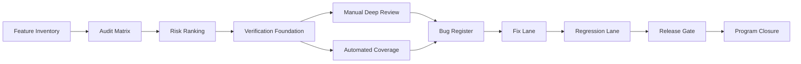

# Zmind 全功能 Bug 审查总报告

> 日期：2026-03-13  
> 基于文档：`docs/reports/2026-03-12-feature-inventory-report.md`  
> 目标：把 Zmind 的“全功能逐项审查找 bug”工作，设计成一个可以落地执行、可量化收口、可分阶段验收的完整质量工程。  
> 口径：这份文档不是修 bug 结果，而是“怎么系统性审、审到什么程度算完成、每个阶段结束后产品会达到什么状态”的总方案。

---

## 0. 执行结论

- 决策记录：**2026-03-13 已正式选择“稳健基准方案”作为默认执行方案。**
- 这不是一个“扫一遍页面”的任务，而是一个完整的质量治理项目。
- 现状决定了不能直接进入“逐功能人工扫 bug”：
  - 后端已有较多测试资产。
  - 前端没有成体系的应用级测试框架。
  - 移动端没有成体系的应用级测试框架。
  - Web 与 Mobile 的很多核心链路依赖复杂状态、权限、异步流、分享和协作，不补验证地基，越往后越失控。
- 推荐方案不是最短工期，而是质量优先的“稳健基准方案”：
  - 启动日期：**2026-03-13**
  - 全量完成日期：**2026-07-16**
  - 总时长：**18 周**
- 如果愿意更激进压缩，可以做到：
  - 激进方案完成日期：**2026-05-21**
  - 但代价是并行资源更高、返工概率更高、非功能性问题更容易后置。
- 如果要做到接近“行业标杆级别的发布前审计”，建议扩展到：
  - 完整强化方案完成日期：**2026-09-10**

---

## 1. 为什么这次必须按“工程项目”做

```text
你要的不是一次 review
========================

不是：
  [页面点一点] -> [记几个 bug] -> [修一轮] -> [结束]

而是：
  [功能总表]
       |
       v
  [审查单元矩阵]
       |
       v
  [统一 bug 口径]
       |
       v
  [验证基线建设]
       |
       v
  [分域审查]
       |
       v
  [修复 + 回归]
       |
       v
  [收口与发布门禁]
```

原因很直接：

1. 你的产品不是单面应用，而是多表面系统。
2. 真正高风险的 bug 往往不是页面崩，而是：
   - 状态错乱
   - 权限泄漏
   - 分享/协作链路失效
   - 计费与额度错误
   - 自动保存/恢复不可靠
   - AI 流式中断后前端状态脏掉
   - team scope 与 personal scope 行为不一致
3. 这些问题如果没有统一矩阵与阶段门槛，审查团队会各自用不同标准，最后报告不可比、不可验收、不可收口。

---

## 2. 当前质量基线

### 2.1 已有资产

- 已有完整功能拆解报告：
  - `docs/reports/2026-03-12-feature-inventory-report.md`
- 后端测试资产：
  - `backend/tests` 当前包含 **321 个测试文件**
- 既有回归文档：
  - `docs/reports/2026-02-23-regression-test-round.md`
- 既有 E2E 清单示例：
  - `docs/skills-e2e-regression-checklist.md`

### 2.2 当前不足

根据仓库现状扫描：

- `frontend/package.json` 只有：
  - `lint`
  - `type-check`
  - `format`
  - `i18n:check`
- **未发现前端应用级测试脚本**
- **未发现项目级 Playwright 配置**
- **未发现 `frontend/src` 下的项目测试文件**
- `apps/mobile/package.json` 只有：
  - `start`
  - `android`
  - `ios`
  - `web`
  - `lint`
- **未发现移动端应用级测试框架接入**

### 2.3 这意味着什么

```text
当前验证结构
============

Backend
  强于 Frontend / Mobile

Frontend
  主要依赖 lint + type-check + 人工点测

Mobile
  主要依赖 lint + 人工点测

结果
====
1. 能防住部分静态错误
2. 防不住大量流程型 bug
3. 防不住状态串扰 / 权限问题 / 深链问题 / 分享问题
4. 防不住“修了 A 坏了 B”的回归
```

结论：

- 这次全功能 bug 审查，**第一阶段必须先把验证体系补起来**。
- 否则你会拿到一大堆 bug 列表，但永远不知道哪些已经彻底被压住，哪些只是“这次没点出来”。

---

## 3. 本次总审查的对象树

### 3.1 审查对象不是 route 数，而是功能单元

昨天的功能报告已经说明：

- Web 路由可分为：
  - `42` 个 real route
  - `55` 个 wrapper route
  - `7` 个显式 redirect route
- 但是本次 bug 审查不会按 104 个页面文件硬扫。
- 我们会按“真实功能源页 + 关键模块 + 用户动作”构成的 **功能审查单元** 来做。

### 3.2 审查单元主树

```text
Bug Audit Object Tree
=====================

P0 核心交易链
├─ Auth
├─ Invite / Activation
├─ Billing / Subscription
├─ Permission / Team / Share
└─ Save / Recover / Data Safety

P0 核心工作链
├─ Dashboard
├─ Workspace
├─ Canvas Editor
├─ Doc Editor
└─ Project Thread

P1 重要支撑链
├─ Knowledge Base
├─ Triggers
├─ Trash
├─ Skills Marketplace
├─ Credentials
└─ Integrations

P1 外部暴露链
├─ Share Canvas
├─ Share Thread
├─ Public Home / Pricing / Tutorials
└─ Legal / Docs

P1 组织管理链
├─ Team Settings
├─ Team Members
├─ Team Invitations
└─ Admin Surfaces

P2 终端一致性链
├─ Mobile App
├─ Responsive
├─ i18n / locale wrappers
└─ Browser / device matrix
```

### 3.3 推荐的功能审查颗粒度

每一个功能单元都必须至少有以下 8 个视角：

1. 能否进入
2. 能否操作
3. 成功结果是否正确
4. 失败提示是否正确
5. 刷新后状态是否正确
6. 跨作用域是否一致
7. 权限是否正确
8. 修复后是否可回归验证

---

## 4. 什么算 bug，怎么分级

### 4.1 Bug 定义

本次审查不把 bug 限制成“报错”。

以下都算 bug：

- 功能失效
- 结果错误
- 状态错乱
- 数据丢失
- 交互误导
- 权限越权
- 分享链路失效
- 计费/额度异常
- 自动保存不可靠
- 不可恢复
- i18n / locale 行为不一致
- mobile / desktop 行为严重偏差
- admin / team / personal scope 串数据

### 4.2 分级标准

```text
Severity
========

P0
  生产不可接受
  例：
  - 数据丢失
  - 计费错误
  - 越权访问
  - 登录/邀请/支付主链断裂
  - 核心编辑器不可用

P1
  核心体验明显受损
  例：
  - Canvas/Doc/Thread 主流程关键功能不稳定
  - 分享链路错误
  - 自动保存/恢复偶发失效
  - Team scope 行为错误

P2
  次核心功能异常，但有绕行路径
  例：
  - 某个面板错位
  - 某个筛选/排序不准
  - 某个 secondary modal 行为错误

P3
  低风险体验问题
  例：
  - copy 错文案
  - 样式问题
  - 低频边缘状态提示不一致
```

### 4.3 审查维度矩阵

| 维度 | 说明 | 典型高风险页 |
|---|---|---|
| 功能正确性 | 按钮、表单、弹窗、流程是否真的工作 | 全部 |
| 状态一致性 | loading / empty / error / success / refresh 后是否一致 | Canvas, Thread, Knowledge |
| 数据安全 | 自动保存、恢复、删除、恢复是否可靠 | Canvas, Doc, Trash |
| 权限与作用域 | personal / team / share / admin 是否串权限 | Team, Share, Admin |
| 计费与额度 | 订阅、额度、兑换、购买是否正确 | Invite, Subscription |
| 分享与公开暴露 | public link 是否越权、是否失效、是否只读 | Share Canvas, Share Thread |
| 终端一致性 | desktop / mobile / responsive 行为差异 | Workspace, Canvas, Mobile |
| 国际化 | locale 包装页与源页是否一致 | Auth, Share, Docs |

---

## 5. 推荐的总执行模型

### 5.1 五条并行工作流

```text
Program Operating Model
=======================

Track A: 审查单元矩阵
Track B: 自动化验证基线
Track C: 人工深度审查
Track D: 修复与回归
Track E: 收口、门禁、发布
```

### 5.2 Mermaid 执行流



### 5.3 每周固定产物

每周都必须稳定产出以下文档/资产：

- `Feature Audit Matrix`
- `Bug Register`
- `Weekly Audit Report`
- `Regression Result`
- `Open Risk List`
- `Release Gate Snapshot`

没有这些产物，阶段就不能算真正完成。

---

## 6. 阶段路线图

## 6.1 阶段 0：审查章程与风险地图

- 时间：**2026-03-13 ~ 2026-03-19**
- 目标：
  - 把昨天的功能报告变成可以执行的审查对象清单。
  - 统一 bug 定义、分级标准、收口口径。

### 本阶段需要什么

- 已有功能清单
- 产品优先级原则
- 当前环境运行方式
- 现有测试命令与基线文档

### 本阶段要做什么

1. 把所有真实功能源页转成 `审查单元矩阵`
2. 给每个单元标：
   - 风险等级
   - 依赖域
   - 是否必须自动化
   - 是否需要权限矩阵
   - 是否需要多端验证
3. 建立 bug 分级与状态机：
   - open
   - triaged
   - in_fix
   - in_regression
   - verified
   - waived
4. 建立统一 evidence 模板：
   - 复现路径
   - 预期结果
   - 实际结果
   - 截图/录屏
   - 环境
   - 版本/提交号

### 本阶段产物

- `Feature Audit Matrix v1`
- `Severity Rubric`
- `Audit Charter`
- `Risk Map`

### 阶段完成后我们会达到什么状态

- 不再是“想到哪查到哪”。
- 所有后续审查都基于同一份对象表推进。
- 团队第一次拥有统一质量口径。

### 阶段退出标准

- 所有源页都被映射为审查对象
- 每个对象都有风险等级
- 每个对象都有负责人类型与验证方式

---

## 6.2 阶段 1：验证地基建设

- 时间：**2026-03-20 ~ 2026-03-26**
- 目标：
  - 把“能人工看”升级成“能持续验证”。

### 本阶段需要什么

- 本地/容器统一运行环境
- 测试账号、team 账号、admin 账号
- 演示/分享/支付/邀请等测试数据

### 本阶段要做什么

1. 整理标准启动方式：
   - `docker compose up -d --build`
   - backend pytest 运行方式
   - frontend lint/type-check 基线
   - mobile lint 基线
2. 建立 Web E2E 框架
   - 推荐：**Playwright**
3. 建立 Mobile 流程测试框架
   - 推荐：**Maestro 先行**
   - 若后续要求更强原生稳定性，再追加 Detox
4. 建立测试数据播种与清理机制
5. 建立截图/录屏/trace 收集标准
6. 建立 CI 或本地批量回归入口

### 本阶段产物

- Web E2E skeleton
- Mobile E2E skeleton
- Test Data Seed 方案
- 环境矩阵
- 基线 smoke 命令清单

### 阶段完成后我们会达到什么状态

- 后续不是纯人工点测。
- 每发现一个高价值 bug，都有机会沉淀成永久回归用例。
- 项目第一次有能力做“阶段回归门禁”。

### 阶段退出标准

- Web 至少跑通 1 条端到端 smoke
- Mobile 至少跑通 1 条端到端 smoke
- backend / frontend / mobile 都有统一基线命令

---

## 6.3 阶段 2：P0 主链路审查

- 时间：**2026-03-27 ~ 2026-04-09**
- 目标：
  - 先压住最不能出问题的链路。

### 本阶段覆盖范围

- Auth
- Reset Password
- Phone Verification
- Invite / Activate Trial
- Team Invitation Accept
- Subscription / Billing
- Credits / Purchase / Redemption
- Permission / share gate / role gate

### 本阶段需要什么

- 测试账号矩阵
- 邀请码数据
- 团队邀请 token
- 不同订阅状态账号
- admin / owner / member / public 四套权限视角

### 本阶段要做什么

1. 审查所有登录、注册、回跳链路
2. 审查 reset password 与验证码链路
3. 审查 invite code 兑换链路
4. 审查订阅、额度、购买、续费、pending 状态
5. 审查 team invitation 自动接受与异常状态
6. 审查 owner/member/public 权限分隔
7. 建立 P0 自动化回归用例

### 本阶段产物

- `P0 Critical Flow Bug Register`
- `Auth/Billing Permission Matrix`
- `P0 E2E Regression Pack`

### 阶段完成后我们会达到什么状态

- 登录、邀请、兑换、订阅这些现金流与准入链路可控。
- 不会出现“连产品都进不去”或“额度算错”的低级致命问题。

### 阶段退出标准

- P0 主链路无 open P0
- P0 主链路自动化回归可重复通过
- 角色/权限关键矩阵验证完成

---

## 6.4 阶段 3：核心工作链审查

- 时间：**2026-04-10 ~ 2026-04-30**
- 目标：
  - 压住 Zmind 的真正核心：工作区、画布、文档、线程。

### 本阶段覆盖范围

- Dashboard
- Workspace
- Canvas Editor
- Doc Editor
- Project Thread

### 本阶段需要什么

- 各类测试内容：
  - 空画布
  - 大画布
  - 多节点画布
  - 有分享/协作的画布
  - 有草稿恢复的画布
  - 带附件和工具流的线程
  - 带图片和 AI 修改的文档

### 本阶段要做什么

1. 审查 Dashboard 快速入口与 prompt 注入
2. 审查 Workspace 创建/打开/重命名/删除/移动/搜索
3. 审查 Canvas：
   - 标题编辑
   - 节点创建
   - 节点编辑
   - 连接与分组
   - AI 面板
   - 分享
   - 邀请协作
   - outline
   - playback
   - screenshot
   - draft recovery
   - 切换保护
4. 审查 Doc：
   - autosave
   - 图片上传
   - AI 生成
   - selection/document context
5. 审查 Thread：
   - optimistic message
   - stream status
   - CTA action
   - file preview/download
   - retry/cancel

### 本阶段产物

- `Core Workspace Bug Register`
- `Canvas Deep Audit Report`
- `Doc/Thread Deep Audit Report`
- `Core Regression Suite`

### 阶段完成后我们会达到什么状态

- 产品最核心的“用起来会不会炸”问题基本被揪出来。
- 用户最常用的主链路进入可回归、可预测状态。

### 阶段退出标准

- Canvas / Doc / Thread 无 open P0
- Core flow 的 open P1 被压到可控数量并进入 fix plan
- 核心工作链已有可执行自动化回归集

---

## 6.5 阶段 4：支撑工作链审查

- 时间：**2026-05-01 ~ 2026-05-21**
- 目标：
  - 补齐高频支撑能力，不让“外围功能”成为隐形故障源。

### 本阶段覆盖范围

- Knowledge Base
- Triggers
- Trash
- Skills Marketplace
- Credentials
- Obsidian
- OpenClaw

### 本阶段需要什么

- 文件样本库
- 文件夹层级样本
- trigger 样本
- skills 安装样本
- integration mock / sandbox 数据

### 本阶段要做什么

1. 审查 Knowledge：
   - 上传
   - 预览
   - 删除
   - summary 编辑
   - folder 管理
   - 拖拽移动
2. 审查 Triggers：
   - 列表
   - 创建
   - 深链
   - 响应式详情面板
3. 审查 Trash：
   - 搜索
   - 排序
   - restore
   - hard delete
   - batch action
4. 审查 Skills：
   - 搜索
   - 安装
   - 已安装过滤
   - detail dialog
5. 审查 Credentials 与 Integrations：
   - refresh
   - 连接状态
   - owner-only 限制

### 本阶段产物

- `Supporting Surface Bug Register`
- `Knowledge/Trigger/Trash Regression Pack`
- `Skills/Integration Compatibility Report`

### 阶段完成后我们会达到什么状态

- 用户把产品真正用深时，外围系统不再频繁掉链子。
- 不会只剩“主功能能用，配套功能全是洞”。

### 阶段退出标准

- 支撑域无 open P0
- 所有高频支撑链路都有 smoke 回归

---

## 6.6 阶段 5：Team / Share / Admin 审查

- 时间：**2026-05-22 ~ 2026-06-11**
- 目标：
  - 压住最容易出“低频但极高风险”的越权、公开暴露和组织管理 bug。

### 本阶段覆盖范围

- Team Settings
- Team Members / Invitations
- Team-scoped mirrors
- Share Canvas
- Share Thread
- Admin Audit
- Admin Billing
- Admin Invites
- Admin Prompt Studio

### 本阶段需要什么

- owner/member/admin/public 四套角色
- 多 team 数据
- public share 样本
- 已失效 share 样本
- 已失效 invitation 样本

### 本阶段要做什么

1. 审查 team scope 与 personal scope 是否串数据
2. 审查 team role 变更与 primary owner 迁移
3. 审查 invitation 创建、复制、删除、接受
4. 审查 share canvas 的只读与 timeline 边界
5. 审查 share thread 的公开展示与文件访问边界
6. 审查 admin 页是否存在越权、脏数据、错误提示与批量操作问题

### 本阶段产物

- `Team/Share/Admin Security & Logic Report`
- `Permission Boundary Matrix`
- `Public Exposure Checklist`

### 阶段完成后我们会达到什么状态

- 低频但危险的问题开始可控：
  - 越权
  - 公开暴露
  - 组织级错误配置
  - admin 批量误操作

### 阶段退出标准

- Team / Share / Admin 无 open P0
- 所有公开暴露入口完成权限边界核验

---

## 6.7 阶段 6：Public / Mobile / 终端一致性审查

- 时间：**2026-06-12 ~ 2026-07-02**
- 目标：
  - 清掉 public 入口和移动端的系统性盲点。

### 本阶段覆盖范围

- Home
- Pricing
- Tutorials
- Changelog
- Legal
- Docs
- Mobile Home
- Mobile Chat
- Mobile Left Panel
- Mobile Right Panel
- Mobile Share/Settings/Action Modal
- Responsive / locale wrappers

### 本阶段需要什么

- 浏览器矩阵
- 移动设备矩阵
- locale 切换场景
- share/public 打开路径

### 本阶段要做什么

1. 审查 public 页面跳转、CTA、嵌入内容和内容页异常状态
2. 审查 legal/docs/tutorials 的 query/tab/locale 行为
3. 审查 mobile 的：
   - auth gate
   - 项目切换
   - 发送消息
   - cancel stream
   - tool timeline
   - share/delete/settings
4. 审查 responsive 断点行为
5. 审查 locale wrapper 与源页行为一致性

### 本阶段产物

- `Public & Mobile Audit Report`
- `Responsive / Locale Consistency Report`
- `Device Matrix Regression Result`

### 阶段完成后我们会达到什么状态

- 产品对外入口和移动端不再是黑箱。
- 不会出现桌面端看起来好、移动端完全不可控的假稳定。

### 阶段退出标准

- Mobile 主链路无 open P0
- Public 页无阻断转化或误导性 P1
- locale / responsive 关键路径验证完成

---

## 6.8 阶段 7：非功能性强化

- 时间：**2026-07-03 ~ 2026-07-09**
- 目标：
  - 从“功能能跑”升级到“线上可承受”。

### 本阶段覆盖范围

- 性能
- 稳定性
- 可恢复性
- 观测性
- 日志与告警

### 本阶段需要什么

- 大数据量场景
- 长时间会话场景
- 弱网/中断场景
- 错误注入场景

### 本阶段要做什么

1. Canvas/Doc/Thread 大对象与长会话性能核查
2. 网络中断、刷新、恢复、重试场景核查
3. 错误提示与 recoverability 核查
4. 关键路径埋点与日志补强
5. 失败后的 fallback 与 runbook 完整化

### 本阶段产物

- `Resilience & Recovery Report`
- `Performance Risk List`
- `Operational Runbook`

### 阶段完成后我们会达到什么状态

- 即使线上出现异常，也更容易定位、止损、恢复。
- 团队从“只会修前台表象”变成“能控系统级故障”。

### 阶段退出标准

- 关键恢复链路有明确 runbook
- 大对象/长会话场景没有 open P0/P1 风险

---

## 6.9 阶段 8：总回归与收口

- 时间：**2026-07-10 ~ 2026-07-16**
- 目标：
  - 把全部阶段收束成真正可发布的质量结论。

### 本阶段需要什么

- 全域 bug register
- 所有自动化回归集
- 风险豁免清单
- 最终候选版本

### 本阶段要做什么

1. 跑全域回归
2. 清点所有 open bug
3. 对无法关闭的问题做 waiver 判定
4. 生成最终质量报告
5. 形成发布门禁结论：
   - go
   - conditional go
   - no go

### 本阶段产物

- `Final Full-Feature Audit Report`
- `Final Release Gate`
- `Known Risk Register`
- `Next-cycle Backlog`

### 阶段完成后我们会达到什么状态

- 项目首次拥有“全功能已审、已分级、已回归、已收口”的完整质量结论。
- 后续版本可以不再重来，而是在这套基线上做增量审查。

### 阶段退出标准

- 无 open P0
- 无未确认归属的 P1
- 核心回归集稳定通过
- 风险豁免清单明确且被业务接受

---

## 7. 三套时间方案

### 7.1 方案对比

| 方案 | 起始日期 | 完成日期 | 总时长 | 并行度 | 适合什么情况 |
|---|---|---:|---:|---|---|
| 激进方案 | 2026-03-13 | 2026-05-21 | 10 周 | 高 | 要尽快拿到全域问题图谱，接受更高并行管理成本 |
| 稳健基准方案（推荐） | 2026-03-13 | 2026-07-16 | 18 周 | 中高 | 质量优先、既要查全也要能真正收口 |
| 完整强化方案 | 2026-03-13 | 2026-09-10 | 26 周 | 中 | 要把非功能性、恢复性、终端一致性做到更接近发布标杆 |

### 7.2 我的建议

推荐选：**稳健基准方案**

原因：

1. 你的项目表面多、状态复杂，不适合只追求最短时间。
2. 当前前端和移动端验证地基不足，过于激进会导致：
   - bug 找到很多
   - 但修完无法稳定证明没回归
3. 18 周方案是“真的有机会全部收口”的时间尺度，而不是“快速扫完一遍”的错觉。

---

## 8. 每个阶段结束后，产品会变成什么样

```text
阶段后的产品形态
================

阶段 0 后
  有统一审查地图，不再盲查

阶段 1 后
  有自动化地基，不再只能靠手点

阶段 2 后
  登录/邀请/计费/权限主链稳定

阶段 3 后
  Workspace/Canvas/Doc/Thread 主工作链稳定

阶段 4 后
  支撑能力不再成为深层使用时的隐性故障源

阶段 5 后
  Team/Share/Admin 这类高风险边界开始可信

阶段 6 后
  Public/Mobile/Responsive 不再是盲区

阶段 7 后
  出问题时能恢复、能定位、能止损

阶段 8 后
  项目拥有完整发布级质量结论
```

---

## 9. 什么叫“全部完成”

“全部完成”不是“bug 看起来少了”，而是同时满足下面 8 条：

1. 所有功能审查单元均已过审或被明确豁免
2. 无 open P0
3. 无未定责 P1
4. 核心路径自动化回归稳定通过
5. 权限、分享、team/admin 边界完成复核
6. mobile / responsive / locale 关键差异已核清
7. 已有运行手册与回滚策略
8. 形成下一周期增量审查机制

---

## 10. 本计划真正需要的资源

### 10.1 人员角色

推荐最小角色面，不是最小人头：

- 质量负责人 / 审查架构负责人
- Web 功能审查负责人
- Canvas/Doc/Thread 专项负责人
- Backend/接口与权限负责人
- Mobile 审查负责人
- 自动化负责人
- 发布门禁负责人

### 10.2 工具与环境

- Docker 本地一致环境
- 稳定测试数据播种脚本
- Web E2E 工具
- Mobile E2E 工具
- 截图/trace/录屏留证工具
- bug register 与阶段报告模板

### 10.3 如果缺任何一个，会怎样

- 缺环境一致性：同 bug 无法稳定复现
- 缺测试数据：大量链路无法系统覆盖
- 缺自动化：回归永远靠人肉，收口速度失控
- 缺统一分级：bug 列表看起来很多，但没有治理价值

---

## 11. 下一步最应该做什么

现在最正确的下一步，不是直接开始修。

而是：

1. 决定采用哪套时间方案
2. 立刻启动 `阶段 0 + 阶段 1`
3. 把“功能清单”转成“审查矩阵”
4. 把 Web/Mobile 验证地基搭起来
5. 再进入 P0 主链路审查

如果跳过这一步直接查 bug，最后一定会陷入：

- 找到很多
- 修了不少
- 但无法证明真的稳定
- 下一轮版本继续重复同样问题

---

## 12. 建议决策

### 推荐决策

- 采用：**稳健基准方案**
- 审查起点：**2026-03-13**
- 目标收口：**2026-07-16**

### 激进备选

- 如果你的目标是最快得到全域缺陷地图，而不是最稳的闭环，可切到：
  - **2026-05-21 完成的 10 周方案**

### 最终判断

你现在需要的不是“更多人去点页面”，而是：

- 一份统一的审查地图
- 一套统一的 bug 口径
- 一条能持续回归的验证链
- 一张能真正收口的阶段路线图

这份报告已经把这 4 件事设计好了。
