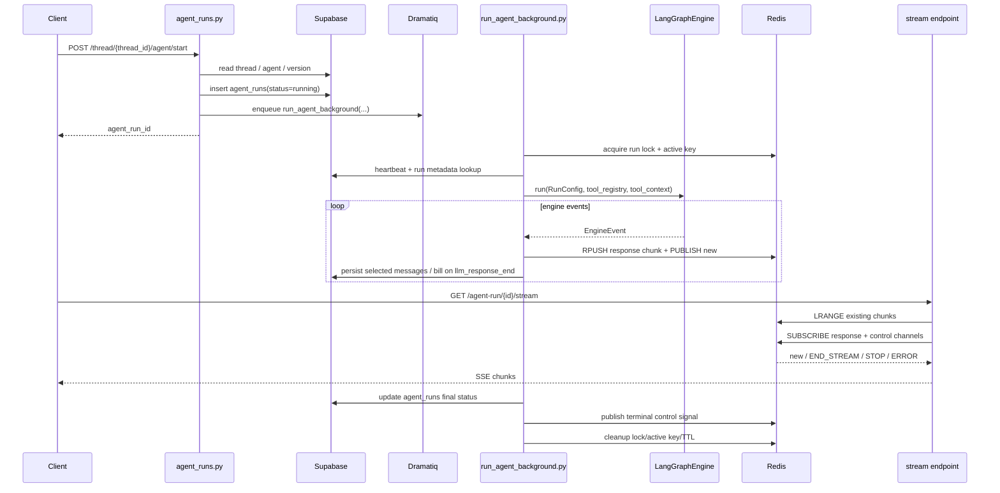

# Backend Agent Context Analysis

Date: 2026-03-31
Scope: current backend agent runtime in `backend/`
Status: Completed

## Goal
- Build a precise map of the current backend agent implementation before optimization work.
- Identify:
  - which files own the feature
  - what each file is responsible for
  - how runtime data moves across API, worker, engine, tools, persistence, and stream layers

## Executive Summary
The current backend agent system is not a single module. It is a layered runtime composed of:

1. HTTP API entrypoints that validate, resolve config, create `agent_runs`, and enqueue work
2. A Dramatiq background worker that owns orchestration, locks, heartbeat, runtime mode selection, tool registry construction, and final cleanup
3. A LangGraph execution engine that loads context, calls the model, executes tools, persists events/checkpoints, and emits canonical runtime events
4. A Redis streaming bridge that keeps the existing SSE contract alive for the frontend
5. A Supabase persistence layer for `agent_runs`, `messages`, checkpoints, and run/event metadata

In short:

```text
HTTP start request
    -> resolve agent + version + model
    -> create agent_runs row
    -> enqueue Dramatiq job
    -> worker builds runtime context
    -> LangGraph engine runs model/tool loop
    -> events fan out to Redis stream + DB persistence
    -> stream endpoint serves client
    -> final status written back to agent_runs
```

## Layer Map

```text
+----------------------+-----------------------------------------------------------+
| Layer                | Main files                                                |
+----------------------+-----------------------------------------------------------+
| App bootstrap        | backend/api.py, backend/core/api.py                      |
| Runtime API          | backend/core/agent_runs.py                               |
| Agent config CRUD    | backend/core/agent_crud.py, agent_service.py             |
| Agent tools config   | backend/core/agent_tools.py                              |
| Config/versioning    | backend/core/config_helper.py, versioning/version_service.py |
| Run domain/use case  | application/use_cases/agent/*, infrastructure/agent/*    |
| Worker orchestration | backend/run_agent_background.py                          |
| Engine core          | backend/core/langgraph_engine/engine.py                  |
| Graph topology       | backend/core/langgraph_engine/graph.py                   |
| Context loading      | message_loader.py, nodes/load_context.py                 |
| Model execution      | nodes/call_model.py                                      |
| Tool execution       | nodes/execute_tools.py, tools/catalog.py, registry.py    |
| Native tools         | tools/adapters/native_tool_adapter.py + backend/core/tools/* |
| MCP tools            | tools/adapters/mcp_tool_adapter.py                       |
| Stream adapter       | stream/legacy_adapter.py, stream/redis_writer.py         |
| Event persistence    | persistence/event_persister.py, message_writer.py        |
| Checkpoints          | checkpoint_store.py                                      |
| Supervisor/subagent  | supervisor/*, research_graph/runner.py                   |
| Lifecycle recovery   | core_utils.py, agent_reaper.py                           |
+----------------------+-----------------------------------------------------------+
```

## Core Files And Responsibilities

### 1. App bootstrap and router assembly

```text
backend/api.py
    -> initializes DB, Redis, Dramatiq broker
    -> calls core_api.initialize(db, instance_id)
    -> starts stale-run reaper
    -> mounts /api routes

backend/core/api.py
    -> aggregates subrouters
    -> exposes agent runs, agent CRUD, agent tools, versioning APIs
```

### 2. Agent runtime API entrypoints

```text
backend/core/agent_runs.py
    -> POST /thread/{thread_id}/agent/start
       - validates thread access
       - infers run_mode: agent/chat
       - infers interaction_surface: canvas/doc
       - resolves agent config + agent version
       - resolves effective model
       - checks billing and model access
       - checks parallel run limits
       - writes agent_runs row via StartAgentRunUseCase
       - registers Redis active key
       - dispatches run_agent_background.send(...)

    -> POST /agent-run/{agent_run_id}/stop
       - triggers stop flow

    -> GET /agent-run/{agent_run_id}/stream
       - reads Redis response list
       - subscribes Redis pubsub
       - serves SSE with resume support

    -> GET /thread/{thread_id}/agent
       - returns last-used agent for the thread
       - important: thread itself is agent-agnostic

    -> POST /agent/initiate
       - creates project/thread/message, then starts run
```

### 3. Agent definition, version, and tool exposure

```text
backend/core/agent_crud.py
    -> create/update/delete/list/get agent definitions
    -> create agent_versions v1 on initial creation
    -> returns config through extract_agent_config(...)

backend/core/agent_service.py
    -> list/filter/sort agent records
    -> batch-load current version config

backend/core/agent_tools.py
    -> MCP tool inspection/update APIs
    -> GET /agents/{agent_id}/tools

backend/core/config_helper.py
    -> normalizes agent config for runtime
    -> merges agent row + version row
    -> special-cases built-in Zmind default agent

backend/core/versioning/version_service.py
    -> create/get/list/activate/rollback agent versions
    -> persists version config blob
    -> updates agents.current_version_id

backend/core/utils/zmind_default_agent_service.py
    -> provisions built-in default agent and initial version
```

### 4. Run domain and persistence boundary

```text
backend/core/application/use_cases/agent/start_agent_run.py
    -> repository create_run(...)
    -> records AgentRunStarted domain event

backend/core/application/use_cases/agent/update_agent_run_status.py
    -> repository update_status(...)
    -> records terminal domain events

backend/core/infrastructure/agent/supabase_agent_run_repository.py
    -> persists agent_runs rows
    -> idempotency lookup
    -> expected-status guarded updates
    -> workspace/account resolution through threads(account_id)

backend/core/domains/agent/model.py
    -> AgentRun domain model

backend/core/domains/agent/events.py
    -> AgentRunStarted / Completed / Failed / Stopped
```

### 5. Background worker orchestration

```text
backend/run_agent_background.py
    -> true runtime entry after queue dispatch
    -> acquires Redis run lock: agent_run_lock:{id}
    -> records worker heartbeat in agent_runs
    -> subscribes to stop control channels
    -> resolves surface and doc context
    -> resolves supervisor mode
    -> optionally connects MCP servers
    -> builds tool registry based on runtime path
    -> builds tool_context
    -> instantiates LangGraphEngine
    -> consumes canonical engine events
    -> converts events to legacy Redis stream chunks
    -> publishes terminal END_STREAM / ERROR / STOP
    -> writes final status back to DB
    -> disconnects MCP, clears keys, sets TTL, removes lock
```

This file is the most important orchestration choke point.

### 6. Engine core and graph topology

```text
backend/core/langgraph_engine/engine.py
    -> loads checkpoint or initial state
    -> applies runtime overrides
    -> builds LangGraphBuilder
    -> runs compiled graph
    -> persists checkpoints
    -> persists selected events
    -> yields canonical EngineEvent stream

backend/core/langgraph_engine/graph.py
    -> defines graph state
    -> defines node order and routing

       load_context
         -> resolve_intent
             -> plan_task -> execute_plan -> verify_outcome -> repair_plan -> narrate_result
             -> or call_model -> execute_tools -> call_model
             -> finalize
```

### 7. Context loading and message preparation

```text
backend/core/langgraph_engine/message_loader.py
    -> loads messages from DB for current thread/session
    -> restores structured message objects
    -> inlines text attachments when possible
    -> truncates tool payloads
    -> compresses context
    -> trims by token budget

backend/core/langgraph_engine/nodes/load_context.py
    -> emits thread_run_start status
    -> builds system prompt via PromptManager
    -> merges client_message hint into context
    -> injects tool list and supervisor hint into prompt when needed
```

### 8. Model call path

```text
backend/core/langgraph_engine/nodes/call_model.py
    -> prepares messages for LLM
    -> trims prompt further for hard budget
    -> disables tools in chat mode
    -> supports forced_tool_call injection
    -> handles streaming response
    -> emits assistant_chunk events
    -> parses tool calls
    -> applies fallback/retry model chain
    -> detects tool loops / recent tool failures
    -> emits assistant_final + llm_response_end
    -> writes pending_tool_calls back into graph state
```

### 9. Tool execution path

```text
backend/core/langgraph_engine/nodes/execute_tools.py
    -> executes pending_tool_calls
    -> emits tool_started and tool_message events
    -> supports parallel handoff execution for some subagent tools
    -> blocks disallowed tools on doc surface
    -> appends tool results into messages_context
    -> terminates when terminating tools are used

backend/core/langgraph_engine/tools/catalog.py
    -> assembles full runtime tool catalog
    -> static native tools + dynamic MCP tools
    -> optional allowlist/prefix filtering

backend/core/langgraph_engine/tools/registry.py
    -> in-memory tool registry
    -> schema sanitization
    -> args repair/coercion
    -> execution dispatch

backend/core/langgraph_engine/tools/adapters/native_tool_adapter.py
    -> defines native tool schemas and adapters
    -> bridges LangGraph registry to concrete backend/core/tools/* implementations

backend/core/langgraph_engine/tools/adapters/mcp_tool_adapter.py
    -> converts connected MCP server tools into ToolSpec
    -> sanitizes input schemas
    -> caches sanitized schemas in Redis
```

### 10. Special runtime restrictions

```text
backend/core/langgraph_engine/tools/doc_surface.py
    -> strict allowlist for doc surface
    -> only doc-native + minimal messaging tools

backend/core/langgraph_engine/supervisor/registry.py
    -> builds registry for supervisor mode
    -> handoff tools + optional native tools
```

### 11. Stream bridge and persistence fanout

```text
backend/core/langgraph_engine/stream/legacy_adapter.py
    -> maps canonical EngineEvent into legacy chunk protocol

backend/core/langgraph_engine/stream/redis_writer.py
    -> RPUSH to agent_run:{id}:responses
    -> PUBLISH "new" to agent_run:{id}:new_response

backend/core/langgraph_engine/persistence/event_persister.py
    -> persists assistant_final / tool_message / llm_response_end / error
    -> optionally persists terminal status events
    -> bills on llm_response_end

backend/core/langgraph_engine/checkpoint_store.py
    -> memory or Supabase checkpoint backend
```

### 12. Recovery, stop, and stale-run cleanup

```text
backend/core/core_utils.py
    -> runtime initialize/cleanup helpers
    -> stop_agent_run_with_helpers(...)
    -> access-check helpers

backend/core/agent_reaper.py
    -> scans running agent_runs for stale worker heartbeat
    -> marks stale runs failed
    -> emits error status into Redis
    -> clears locks/active keys
```

## Runtime Data Flow

### Primary request-to-completion path

```text
[Client]
   |
   | POST /api/thread/{thread_id}/agent/start
   v
[backend/core/agent_runs.py]
   |
   | validate thread + infer run_mode/surface
   | resolve agent + version + model
   | create agent_runs row
   | enqueue Dramatiq job
   v
[backend/run_agent_background.py]
   |
   | lock + heartbeat + stop channels
   | resolve runtime branches
   | build tool registry + tool_context
   | create RunConfig
   v
[LangGraphEngine.run()]
   |
   +--> load_context
   +--> resolve_intent
   +--> call_model <-> execute_tools
   |         or
   +--> plan_task -> execute_plan -> verify_outcome -> repair_plan
   |
   v
[Canonical EngineEvent stream]
   |
   +--> EventPersister -> messages + billing
   |
   +--> LegacyStreamAdapter -> RedisStreamWriter -> Redis list/pubsub
   |
   v
[GET /api/agent-run/{id}/stream]
   |
   v
[Frontend SSE consumer]
```

### Mermaid sequence view



## Data Store Map

```text
+---------------------+--------------------------------------------------------------+
| Store               | Role                                                         |
+---------------------+--------------------------------------------------------------+
| agents              | agent shell record, metadata, current_version_id            |
| agent_versions      | versioned config blob: prompt/model/tools/MCP config        |
| agent_runs          | runtime status, metadata, heartbeat, engine/checkpoint info |
| threads             | conversation container; source of account/project/surface   |
| messages            | user, assistant, tool, status, llm end persisted events     |
| checkpoint table    | serialized graph state snapshots                            |
| Redis lock key      | single-run execution guard                                  |
| Redis active key    | instance ownership / shutdown cleanup                       |
| Redis response list | ordered stream payload cache for SSE                        |
| Redis pubsub        | live stream notify + terminal control                       |
+---------------------+--------------------------------------------------------------+
```

## Runtime Branch Matrix

```text
+------------------+---------------------------+-----------------------------------------------+
| Branch           | Trigger                   | Behavioral difference                         |
+------------------+---------------------------+-----------------------------------------------+
| chat mode        | run_mode == chat          | tool registry empty, no tool loop             |
| canvas surface   | default path              | full runtime tool set                         |
| doc surface      | interaction_surface=doc   | strict doc allowlist only                     |
| supervisor mode  | supervisor_config.enabled | handoff tools, routing hints, optional native |
| skill auto-run   | routing plan decides      | inject forced_tool_call into first turn       |
| MCP enabled      | agent config has MCPs     | dynamic tool registration from external MCP   |
+------------------+---------------------------+-----------------------------------------------+
```

## Critical Boundaries To Remember

### A. Thread is not the source of truth for agent identity

```text
thread
   != bound to one agent

agent choice
   = decided per run
   = stored in agent_runs.agent_id / agent_version_id
```

Implication:
- any optimization that assumes "thread owns current agent" will be wrong

### B. Streaming and persistence are intentionally dual-path

```text
same EngineEvent
    -> Redis for real-time UX
    -> DB for durable history + billing
```

Implication:
- stream bugs and persistence bugs can diverge
- fixing one does not automatically fix the other

### C. Worker is the runtime assembly point

Most runtime feature changes eventually cross `backend/run_agent_background.py`.

It currently decides:
- model runtime usage
- surface and mode
- supervisor enablement
- MCP connection setup
- tool registry composition
- checkpoint backend
- event streaming batching

### D. Engine emits canonical events, but frontend still consumes legacy chunks

```text
EngineEvent
    -> LegacyStreamAdapter
    -> Redis list/pubsub
    -> SSE
```

Implication:
- stream protocol migration is a separate concern from engine refactor

## Files Most Likely To Change In Later Optimization Work

```text
+--------------------------------------------------------------+----------------------------------+
| File                                                         | Why it is a hotspot              |
+--------------------------------------------------------------+----------------------------------+
| backend/run_agent_background.py                              | central runtime assembly         |
| backend/core/agent_runs.py                                   | start/stream API contract        |
| backend/core/langgraph_engine/engine.py                      | event/checkpoint/persist loop    |
| backend/core/langgraph_engine/graph.py                       | control flow topology            |
| backend/core/langgraph_engine/nodes/call_model.py            | latency, retries, tool parsing   |
| backend/core/langgraph_engine/nodes/execute_tools.py         | tool behavior and safety         |
| backend/core/langgraph_engine/tools/catalog.py               | exposure/filtering of tools      |
| backend/core/langgraph_engine/tools/registry.py              | schema/runtime execution path    |
| backend/core/config_helper.py                                | agent config normalization       |
| backend/core/versioning/version_service.py                   | version source of truth          |
| backend/core/langgraph_engine/persistence/event_persister.py | DB durability and billing split  |
+--------------------------------------------------------------+----------------------------------+
```

## Current Architecture Risks

1. Runtime logic is spread across route layer, worker layer, engine layer, and legacy stream adapter layer.
2. `run_agent_background.py` owns too many decisions and is the highest coupling point.
3. Tool exposure differs materially by chat/doc/supervisor/MCP path, so changes require path-matrix thinking.
4. Streaming is still locked to a legacy Redis/SSE chunk contract even though the engine now speaks canonical events.
5. Event persistence, billing, and frontend streaming are decoupled enough that partial failure modes are possible.

## Suggested Next-Step Angles For Optimization

```text
Option A: Stable path
    First optimize worker composition boundaries:
    - extract runtime context builder
    - extract tool-registry factory
    - extract finalization/cleanup service

Option B: Aggressive path
    Reshape runtime around one explicit execution contract:
    - unified RunContext object
    - single branch matrix for chat/doc/canvas/supervisor
    - canonical event pipeline first, legacy stream as adapter only
```

## Conclusion
The backend agent system is already partially modernized:
- runtime execution moved into LangGraph
- event persistence is separate from stream transport
- versioned agents exist
- supervisor/subagent and MCP paths are present

But the system is still operationally split across old and new layers.
For future work, treat the architecture as:

```text
API layer      = request admission + run creation
Worker layer   = runtime assembly + lifecycle ownership
Engine layer   = reasoning/tool execution state machine
Stream layer   = legacy compatibility bridge
DB/Redis layer = durability + liveness + UX transport
```

That framing should be the baseline mental model for any upcoming optimization or refactor.
