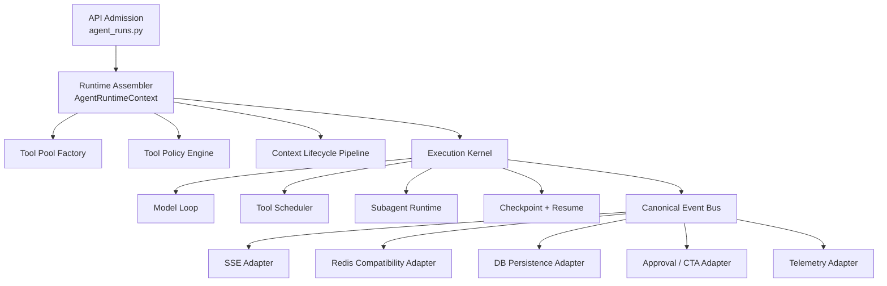
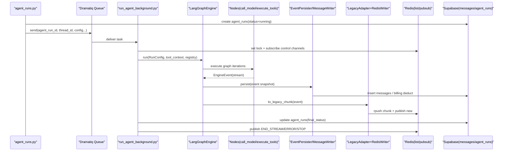

# Claude Code Benchmark vs Zmind Agent Architecture

Date: 2026-04-01
Status: Completed
Scope:
- benchmark target: `E:\app\claude-code`
- local system: `E:\app\zmind\backend`

## 0. Analysis Boundary

This benchmark is valuable, but it must be read correctly.

```text
Claude Code
    = terminal-native agent runtime platform
    = single-process modular monolith
    = optimized for REPL / SDK / bridge / subagent / local tooling

Zmind
    = SaaS backend agent runtime
    = API + worker + Redis + DB + LangGraph
    = optimized for persistent runs, multi-tenant state, canvas/doc surfaces
```

So the right question is not:

```text
"How do we clone Claude Code?"
```

The right question is:

```text
"Which architectural principles make Claude Code top-tier,
 and how do we absorb those principles into a persistent SaaS backend runtime?"
```

## 1. Reference Materials

### Claude Code

```text
E:\app\claude-code\ARCHITECTURE_ANALYSIS.md
E:\app\claude-code\README.md
E:\app\claude-code\src\main.tsx
E:\app\claude-code\src\QueryEngine.ts
E:\app\claude-code\src\query.ts
E:\app\claude-code\src\Tool.ts
E:\app\claude-code\src\tools.ts
E:\app\claude-code\src\services\tools\toolOrchestration.ts
E:\app\claude-code\src\hooks\useCanUseTool.tsx
E:\app\claude-code\src\utils\permissions\permissions.ts
E:\app\claude-code\src\tools\AgentTool\loadAgentsDir.ts
E:\app\claude-code\src\tools\AgentTool\runAgent.ts
E:\app\claude-code\src\services\mcp\client.ts
E:\app\claude-code\src\cli\structuredIO.ts
```

### Zmind

```text
E:\app\zmind\docs\reports\2026-03-31-backend-agent-context-analysis.md
E:\app\zmind\backend\core\agent_runs.py
E:\app\zmind\backend\run_agent_background.py
E:\app\zmind\backend\core\langgraph_engine\engine.py
E:\app\zmind\backend\core\langgraph_engine\graph.py
E:\app\zmind\backend\core\langgraph_engine\nodes\call_model.py
E:\app\zmind\backend\core\langgraph_engine\nodes\execute_tools.py
E:\app\zmind\backend\core\langgraph_engine\tools\catalog.py
E:\app\zmind\backend\core\langgraph_engine\tools\registry.py
E:\app\zmind\backend\core\langgraph_engine\supervisor\*
E:\app\zmind\backend\core\config_helper.py
E:\app\zmind\backend\core\versioning\version_service.py
E:\app\zmind\backend\core\langgraph_engine\persistence\event_persister.py
E:\app\zmind\backend\core\langgraph_engine\checkpoint_store.py
```

## 2. Core Conclusion

Claude Code's real advantage is not just "more features".

Its core advantage is:

```text
It has one unified agent runtime contract.
```

More specifically:

```text
User input / SDK input / bridge input / subagent input
    -> same processUserInput contract
    -> same QueryEngine / query loop
    -> same ToolUseContext
    -> same permission engine
    -> same tool pool assembly logic
    -> same MCP integration boundary
```

That is the strongest benchmark lesson.

By comparison, Zmind already has strong backend durability, but its runtime contract is fragmented:

```text
route layer
    + worker orchestration
    + graph engine
    + tool registry branches
    + Redis legacy stream adapter

=> correct overall behavior
=> but runtime semantics are spread across too many layers
```

## 3. What Makes Claude Code Top-Tier

### 3.1 One runtime contract, many product shells

Claude Code separates:

```text
shells
    = REPL / print / bridge / SDK / remote

core runtime
    = QueryEngine + query.ts + ToolUseContext + permission engine
```

That means product shells differ, but execution semantics stay aligned.

### 3.2 Tool system is a first-class operating model

Claude Code does not treat tools as a flat list.
Its tool contract includes:

```text
- schema
- description
- aliases
- permission checks
- read-only vs destructive
- concurrency safety
- interrupt behavior
- requires user interaction
- enablement gating
- prompt/search metadata
```

This is a mature runtime contract, not just a registry.

### 3.3 Permission model is built into the runtime, not bolted on

Claude Code has a real permission decision engine:

```text
allow / deny / ask / transformed input
    + rule-based policy
    + tool-specific checks
    + sandbox awareness
    + worker/async agent behavior differences
    + interactive escalation path
    + classifier-assisted decisions
```

This is one of its biggest advantages.

### 3.4 Context lifecycle is treated as an engineering system

Claude Code does not only "trim messages".
It has layered context control:

```text
memory prefetch
-> tool result budgeting
-> snip
-> microcompact
-> context collapse
-> autocompact
-> stop hooks
-> memory extraction
```

This is how it keeps long-running agent sessions stable and cost-efficient.

### 3.5 Subagents are recursive runtime citizens

Subagents in Claude Code are not random ad hoc branches.
They are defined with structured metadata:

```text
agentType
model
effort
permissionMode
allowed/disallowed tools
required MCP servers
hooks
memory
isolation
maxTurns
background/sync mode
```

And they ultimately route back into the same query runtime.

### 3.6 MCP integration is deeper than "load some tools"

Claude Code treats MCP as a broader extension surface:

```text
server config
policy filtering
auth cache
connection batching
tool fetch
command fetch
resource fetch
skill discovery
state reconciliation
```

This is a platform-grade integration layer.

### 3.7 Transport is structured

Claude Code supports REPL, SDK, remote, bridge, structured IO, and permission callbacks using a typed control protocol, not a UI-specific one-off stream.

That keeps runtime and transport decoupled.

## 4. Where Zmind Is Already Stronger

This benchmark should not become self-negation.
Zmind already has important strengths that Claude Code does not naturally optimize for.

### 4.1 Persistent backend durability

Zmind has:

```text
agent_runs table
messages persistence
checkpoints
worker heartbeat
stale-run reaper
Redis live transport
DB-backed final status
```

This is stronger for SaaS reliability and replayability.

### 4.2 Multi-tenant backend architecture

Zmind already thinks in:

```text
thread
project
account
agent version
billing
worker instance
```

Claude Code largely operates inside a session-centric CLI runtime.

### 4.3 Domain-specific surfaces

Zmind already has first-class:

```text
canvas surface
doc surface
surface-specific tools
surface-specific context
surface-specific restrictions
```

That is a real product moat, not a missing feature.

### 4.4 Agent versioning

Zmind's `agents` + `agent_versions` model is already stronger than a pure local file-based agent definition approach in terms of SaaS productization.

## 5. Side-by-Side Comparison

```text
+------------------------+-----------------------------------------+-------------------------------------------+----------------------------------------------+
| Dimension              | Claude Code                              | Zmind                                      | Key Judgment                                 |
+------------------------+-----------------------------------------+-------------------------------------------+----------------------------------------------+
| Runtime core           | Unified QueryEngine/query loop           | Route + worker + graph + stream split      | Zmind needs a stronger unified runtime core  |
| Runtime context        | ToolUseContext is canonical              | RunConfig + GraphState + tool_context dict | Zmind lacks one canonical runtime contract   |
| Tool contract          | Rich capability model                    | ToolSpec + registry, less expressive       | Claude clearly ahead                         |
| Tool pool assembly     | Single source of truth                   | Assembled in multiple branches             | Zmind should unify                           |
| Permission engine      | First-class allow/deny/ask runtime       | Limited side_effect/tool policy gating     | Zmind clearly behind                         |
| Context lifecycle      | Multi-stage compaction and memory        | Simple compression/trimming                | Zmind behind                                 |
| Subagents              | Structured recursive runtime             | Supervisor + hardcoded defs                | Zmind behind in definition maturity          |
| MCP integration        | Platform-grade                           | Tool-focused, simpler                      | Zmind behind                                 |
| Transport contract     | Structured IO / bridge / SDK unified     | Canonical events -> legacy Redis adapter   | Zmind should modernize transport boundary    |
| Persistence            | Session/transcript-centric               | DB + checkpoint + heartbeat + reaper       | Zmind ahead for backend durability           |
| Product specialization | General coding agent shell               | Canvas/doc SaaS runtime                    | Not directly comparable, Zmind has focus     |
+------------------------+-----------------------------------------+-------------------------------------------+----------------------------------------------+
```

## 6. The Biggest Gaps We Should Fix

### Gap 1. No single canonical runtime context

Current Zmind runtime state is spread across:

```text
AgentStartRequest
run metadata
RunConfig
GraphState
tool_context
agent_config
thread metadata
doc context
supervisor hint
forced tool call
```

This makes the system work, but it weakens clarity.

#### Claude principle

```text
One runtime context object should describe the whole turn.
```

#### Zmind target

Introduce a typed `AgentRuntimeContext` as the canonical execution contract.

It should own:

```text
run identity
tenant/thread/project/surface
agent identity/version/model
tool pool
permission policy
prompt fragments
context lifecycle config
MCP runtime
stream/persistence handles
resume/checkpoint metadata
subagent/supervisor metadata
```

### Gap 2. Tool execution semantics are under-modeled

Zmind currently knows:

```text
tool schema
side effect level
doc allowlist
some policy filtering
some handoff concurrency
```

But it does not model enough of the tool behavior contract itself.

#### Claude principle

```text
The tool definition is a runtime capability contract.
```

#### Zmind target

Extend tool metadata to include:

```text
aliases
user-facing description
is_read_only
is_destructive
is_concurrency_safe(input)
interrupt_behavior
requires_user_interaction
open_world vs closed_world
search_hint / discoverability metadata
result size policy
surface availability policy
```

### Gap 3. Permission and safety policy is too shallow

Right now Zmind primarily has:

```text
side_effect_policy
tool allowlists/prefix filters
doc surface restriction
chat mode tool disable
```

That is not enough for a top-tier agent runtime.

#### Claude principle

```text
Permission is part of execution semantics, not a post-hoc filter.
```

#### Zmind target

Build a `ToolPolicyEngine` that returns one of:

```text
allow
deny
ask
allow_with_transformed_input
allow_if_sandboxed
defer
```

For Zmind's SaaS model, `ask` can surface as:

```text
agent event
frontend approval UI
CTA/interactive prompt
workflow pause
```

This is how we stop relying on prompt-only caution.

### Gap 4. Context lifecycle is too simple

Zmind has good basics, but not a real long-session context operating model.

#### Claude principle

```text
Prompt window management must be a pipeline, not a single trim.
```

#### Zmind target

Create a staged context lifecycle:

```text
load raw history
-> normalize attachments/tool outputs
-> budget oversized tool results
-> cache-stable context shaping
-> targeted compaction
-> overflow recovery
-> post-turn summary/memory extraction
```

### Gap 5. Supervisor/subagent definitions are too static

Current Zmind supervisor is useful, but the subagent layer is still relatively hardcoded.

#### Claude principle

```text
Subagents should be declarative runtime units, not just prompt branches.
```

#### Zmind target

A subagent definition should contain:

```text
agent_type
purpose
model
effort
allowed_tools
disallowed_tools
permission_mode
required_mcps
surface compatibility
memory policy
execution isolation
max_turns
background/sync behavior
```

Zmind should store this in a versionable way.

### Gap 6. Canonical events still pass through a legacy compatibility choke point

This is one of the biggest technical debts in current Zmind runtime.

Current path:

```text
EngineEvent
    -> LegacyStreamAdapter
    -> Redis response list/pubsub
    -> SSE
```

That is okay as a compatibility bridge, but it should not remain the conceptual center.

#### Claude principle

```text
Runtime emits structured events; shells/transports adapt them.
```

#### Zmind target

Make the canonical event bus primary, and treat:

```text
SSE
Redis chunk format
frontend incremental rendering
background observers
audit logs
```

as adapters, not as runtime truth.

## 7. What We Should Not Blindly Copy

This is important.

### 7.1 Do not copy the CLI shell complexity

Claude Code has:

```text
Commander
Ink UI
bridge
direct connect
desktop/mobile handoff
voice
terminal UX state
```

Most of that is product shell, not the benchmark core we need.

### 7.2 Do not copy feature-flag sprawl as-is

Claude Code's huge feature-flag surface works for its organization and release model, but blindly importing that style into Zmind would increase operational complexity fast.

We should copy:

```text
capability toggles around runtime boundaries
```

not:

```text
feature flags everywhere in the control flow
```

### 7.3 Do not regress our backend durability

Zmind should not become:

```text
session-centric
best-effort
ephemeral
single-process dependent
```

We should preserve and strengthen:

```text
DB persistence
checkpointing
worker heartbeat
stale-run recovery
multi-tenant state
versioned agents
```

## 8. Target Alignment Direction

### 8.1 Target architecture

```text
[API Admission Layer]
    -> auth / billing / create run record
    -> no deep runtime branching

[Runtime Assembly Layer]
    -> build AgentRuntimeContext
    -> build ToolPool
    -> build ToolPolicyEngine
    -> build ContextLifecyclePipeline
    -> build TransportAdapters

[Execution Kernel]
    -> model loop
    -> tool scheduler
    -> subagent runtime
    -> checkpointing
    -> canonical events

[Adapters]
    -> SSE
    -> Redis compatibility
    -> DB persistence
    -> frontend approval channel
    -> analytics/telemetry
```

### 8.2 Mermaid target view



## 9. Concrete Optimization Plan For Zmind

## Option A: Stable Alignment Path

Best when we want high confidence and low migration risk.

### Phase 1. Introduce canonical runtime context

Create a new layer, for example:

```text
backend/core/agent_runtime/context.py
backend/core/agent_runtime/assembler.py
backend/core/agent_runtime/contracts.py
```

Responsibilities:

```text
take route inputs + DB metadata + agent config + worker facts
-> produce AgentRuntimeContext
```

Primary files impacted:

```text
backend/core/agent_runs.py
backend/run_agent_background.py
backend/core/langgraph_engine/engine.py
backend/core/langgraph_engine/graph.py
```

### Phase 2. Unify tool pool assembly

Build a single factory, for example:

```text
backend/core/agent_runtime/tool_pool_factory.py
```

It should own:

```text
chat/doc/canvas/supervisor/tool-policy/MCP composition
```

Primary files impacted:

```text
backend/run_agent_background.py
backend/core/langgraph_engine/tools/catalog.py
backend/core/langgraph_engine/supervisor/registry.py
backend/core/langgraph_engine/tools/doc_surface.py
```

### Phase 3. Introduce ToolPolicyEngine

Build:

```text
backend/core/agent_runtime/tool_policy.py
```

Replace scattered restrictions with one decision system.

Primary files impacted:

```text
backend/core/langgraph_engine/nodes/execute_tools.py
backend/core/langgraph_engine/tools/registry.py
backend/run_agent_background.py
```

### Phase 4. Upgrade context lifecycle

Build:

```text
backend/core/agent_runtime/context_pipeline/*
```

Primary files impacted:

```text
backend/core/langgraph_engine/message_loader.py
backend/core/langgraph_engine/nodes/load_context.py
backend/core/langgraph_engine/nodes/call_model.py
```

### Phase 5. Detach canonical events from legacy stream dependency

Primary files impacted:

```text
backend/core/langgraph_engine/stream/legacy_adapter.py
backend/core/langgraph_engine/stream/redis_writer.py
backend/core/agent_runs.py
backend/run_agent_background.py
```

## Option B: Aggressive Alignment Path

Best when we want to rebase the runtime around a true kernel architecture.

### Big move

Create a new package, for example:

```text
backend/core/agent_kernel/*
```

With these modules:

```text
contracts.py
runtime_context.py
tool_contracts.py
tool_scheduler.py
policy_engine.py
context_pipeline.py
subagent_runtime.py
event_bus.py
transport_adapters.py
resume.py
```

Then reduce current files to adapters:

```text
agent_runs.py
    = API admission only

run_agent_background.py
    = worker bootstrap + kernel invocation only

langgraph_engine/*
    = one execution backend plugged into the kernel
```

This is the cleanest long-term direction, but it is a larger migration.

## 10. Priority Judgment

If the goal is "align with the best principles quickly", the order should be:

```text
P0
    1. Canonical runtime context
    2. Unified tool pool assembly
    3. Tool policy / permission engine

P1
    4. Richer tool contract
    5. Generic tool scheduler with read-only concurrency
    6. Context lifecycle pipeline

P2
    7. Declarative subagent definitions
    8. Canonical event transport refactor
    9. Stronger MCP platform layer
```

## 11. Final Recommendation

The best path is not:

```text
"Port Claude Code architecture."
```

The best path is:

```text
"Keep Zmind's durable SaaS backend strengths,
 but rebuild its runtime around the same rigor Claude Code applies
 to runtime context, tool contracts, permissions, context lifecycle,
 and recursive agent execution."
```

If I reduce the entire benchmark to one sentence:

```text
Claude Code wins because its runtime semantics are unified.
Zmind will level up fastest by unifying its runtime semantics
 without sacrificing its backend durability.
```

## 12. Next Action Recommendation

If we continue immediately, the highest-leverage next step is:

```text
Design `AgentRuntimeContext` + `ToolPoolFactory` + `ToolPolicyEngine`
before changing individual node logic.
```

Reason:

```text
Without those three, any optimization will remain local and fragmented.
With those three, later performance, safety, and subagent improvements
all gain a clean landing zone.
```

## 13. Runtime File Responsibility Matrix

This section answers three concrete questions for the current backend agent feature:

```text
1) Which files implement the feature?
2) What does each file own?
3) What data enters and leaves each file?
```

### 13.1 Zmind runtime ownership matrix (overall -> local)

| Layer | File (evidence) | Ownership | Inbound data | Outbound data |
|---|---|---|---|---|
| API admission | `backend/core/agent_runs.py:212-575` | validate request, resolve thread/project/account, create `agent_runs` row, enqueue worker task | HTTP body (`model_name`, `run_mode`, `interaction_surface`, flags), thread metadata | Dramatiq payload via `run_agent_background.send(...)` |
| Worker orchestration | `backend/run_agent_background.py:149-1060` | singleton lock, heartbeat, stop-signal loop, MCP connect, supervisor routing, tool registry assembly, `RunConfig` creation, engine execution loop | queue payload + Redis channels + DB + agent config | canonical engine events -> legacy chunks -> Redis list/pubsub + final run status update |
| Runtime contract | `backend/core/langgraph_engine/contracts/engine_interface.py:12-55` | `RunConfig` runtime contract | worker-assembled run params | normalized fields consumed by engine and nodes |
| State contract | `backend/core/langgraph_engine/contracts/state_schema.py:19-80` | stable `GraphState` schema (messages, tool calls, termination, checkpoint, shadow policy) | `RunConfig` + loaded checkpoint | state for nodes/persistence/checkpoint |
| Event contract | `backend/core/langgraph_engine/contracts/event_schema.py:6-96` | canonical event types (`assistant_chunk`, `assistant_final`, `tool_message`, `status`, `llm_response_end`, `error`) | node emissions | stream adapter + persistence consumers |
| Engine runtime | `backend/core/langgraph_engine/engine.py:61-149,173-260,311-450` | initial state load/override, async event persistence queue, async checkpoint queue, graph execution loop, final queue flush | `RunConfig`, checkpoint store, tool registry, node outputs | ordered `EngineEvent` stream + checkpoint updates |
| Graph topology | `backend/core/langgraph_engine/graph.py:140-212,348-382` | node DAG and routing (`call_model <-> execute_tools -> finalize`, plus native canvas flow) | current `GraphState` | next node selection and state transitions |
| Context load | `backend/core/langgraph_engine/nodes/load_context.py:221-307` | build system prompt, inject tool hints/supervisor hint, load thread messages, optional compression/caching | DB thread messages + tool registry + run flags + client hint | `state["messages_context"]` |
| Model call | `backend/core/langgraph_engine/nodes/call_model.py:1411-1540,1610-1710,2290-2376` | tool schema export, forced tool-call path, fallback model chain, stream parse, pending tool call extraction, termination decision | `messages_context`, tool schemas, forced tool payload, stop event | `assistant_*` events, `llm_response_end`, `pending_tool_calls`, `termination` |
| Tool execution | `backend/core/langgraph_engine/nodes/execute_tools.py:80-142,286-395` | per-call execution, parallel handoff batches, shadow/side-effect gating, surface gating, result emission | `pending_tool_calls`, `tool_registry`, `tool_context` | `tool_message/status` events + `tool_results` |
| Tool pool assembly | `backend/core/langgraph_engine/tools/catalog.py:18-63` | static tools + MCP tools merge, name/prefix filtering, registry factory | mcp service + allow/deny filters | in-memory tool registry |
| Tool policy | `backend/core/langgraph_engine/tools/policy.py:16-122` | resolve allow/deny/prefix policy from config | `agent_config`, mcp enabled flag | `ToolPolicy(allowed_names/prefixes)` |
| Tool runtime guard | `backend/core/langgraph_engine/tools/registry.py:303-356,358-430` | schema sanitize/lint/cache, alias mapping, args validation/repair, execution-level policy gate | `ToolSpec`, tool call payload | canonical `ToolExecutionResult` |
| Subagent handoff | `backend/core/langgraph_engine/supervisor/handoff_tools.py:407-570` | dynamic `transfer_to_*` tools, context fallback, subagent event bridge to parent stream/persistence | parent state, run config, tool call args | subagent result + forwarded tool/status events |
| Subagent runner | `backend/core/langgraph_engine/supervisor/subagent_runner.py:109-215` | subagent-scoped registry and run config, same kernel reuse, optional research graph path | agent def + parent run config + tool context | subagent assistant/tool outputs |
| Event persistence | `backend/core/langgraph_engine/persistence/event_persister.py:112-153` | persist selected event types and bill on `llm_response_end` | canonical events + state snapshot | rows in `messages` + billing deduction |
| Message mapping | `backend/core/langgraph_engine/persistence/message_writer.py:46-160` | event -> message row mapping, dedup keys, shadow skip | event + state | normalized DB rows |
| Legacy stream mapping | `backend/core/langgraph_engine/stream/legacy_adapter.py:24-90` | canonical event -> legacy chunk translation | canonical events | legacy chunk payloads |
| Redis stream IO | `backend/core/langgraph_engine/stream/redis_writer.py:15-47` | append chunks to response list + notify pubsub | legacy chunks | Redis `rpush` + `publish` |
| Stale-run recovery | `backend/core/agent_reaper.py:114-183`, `backend/api.py:95-110` | stale heartbeat detection, force-fail stale runs, cleanup lock keys, publish terminal error | `agent_runs` table + Redis keys | run status correction + terminal signal |

### 13.2 Claude reference matrix (for direct comparison)

| Chain | File (evidence) | Ownership |
|---|---|---|
| input normalization | `src/utils/processUserInput/processUserInput.ts:85-180` | normalize prompt/media/attachments/hooks into query-ready messages |
| unified query entry | `src/QueryEngine.ts:184-212,335-428,675-686` | one engine entry with shared context + permission telemetry + call into `query(...)` |
| context lifecycle | `src/query.ts:365-470,1256-1310` | tool-result budget -> snip -> microcompact -> context collapse -> autocompact -> stop hooks -> token budget |
| tool orchestration | `src/services/tools/toolOrchestration.ts:19-177` | read-only concurrency-safe batching + serial fallback |
| permission runtime | `src/utils/permissions/permissions.ts:1069-1310` | rule/mode/tool checks with ask/allow/deny decisions and safety/bypass ordering |
| subagent execution | `src/tools/AgentTool/runAgent.ts:412-479,648-757,817-858` | subagent permission scoping + tool pool merge + same `query(...)` kernel + cleanup |
| MCP platform | `src/services/mcp/client.ts:257-314,1688-1704,2212-2234,2813-2860,3194-3230` | auth cache, reconnect semantics, fair batched connection, URL-elicitation retry, session-expiry recovery |

---

## 14. End-to-End Data Flow (ASCII + Mermaid)

### 14.1 Zmind E2E data flow (current implementation)

```text
[HTTP start_agent]
    |
    v
agent_runs.py
    - validate/run_mode/surface
    - create agent_runs row
    - enqueue run_agent_background payload
    |
    v
run_agent_background.py
    - acquire Redis singleton lock
    - heartbeat + stop-signal listener
    - build mcp_service + supervisor hint
    - resolve tool policy + build tool_registry
    - assemble tool_context + RunConfig
    |
    v
LangGraphEngine.run(RunConfig)
    - load checkpoint or initial state
    - build graph + execute node loop
    - async checkpoint queue
    - async event persistence queue
    |
    +--> load_context
    |      -> messages_context (system prompt + db messages + compression)
    |
    +--> call_model
    |      -> assistant_chunk / assistant_final / llm_response_end
    |      -> pending_tool_calls
    |
    +--> execute_tools
           -> tool_started/tool_message/tool_completed
           -> tool_results
    |
    v
canonical EngineEvent stream
    |
    +--> event_persister/message_writer -> DB messages + billing
    |
    +--> legacy_adapter -> redis_writer -> Redis list/pubsub
    |
    v
frontend/consumer receives stream + final status
```

### 14.2 Zmind sequence diagram (runtime + data artifacts)



### 14.3 Claude reference flow (where semantics are tighter)

```text
processUserInput()
    -> query()
       -> tool-result budget
       -> snip
       -> microcompact
       -> context collapse
       -> autocompact
       -> stop hooks
       -> token budget continuation/stop
    -> toolOrchestration(runTools)
       -> concurrent batches for read-only tool calls
    -> permissions pipeline (rule/mode/safety/auto/headless)
    -> MCP client with reconnect/auth/session recovery
```

Key structural difference:

```text
Zmind: strong backend durability, but runtime context and policy logic are still split.
Claude: fewer layers, but tighter runtime semantics via one query kernel.
```

---

## 15. Six Alignment Chains: Evidence Matrix

| Alignment chain | Zmind evidence | Claude evidence | Current gap | Alignment direction |
|---|---|---|---|---|
| Runtime contract | `run_agent_background.py:845-864` builds `RunConfig`; `engine_interface.py:12-55`; `engine.py:61-149` state init/load | `QueryEngine.ts:335-428,675-686` one query entry/context | Zmind has clear contract type, but runtime context is assembled in worker and partially in nodes | Introduce one `AgentRuntimeContext` object passed end-to-end (stable), then thin worker/node adapters (aggressive) |
| Tool pool assembly | `run_agent_background.py:665-744`; `tools/catalog.py:18-63`; `supervisor/registry.py:22-44` | `runAgent.ts:648-664` merges tool pools; `toolOrchestration.ts:19-177` runtime scheduling | Zmind pool assembly is mode/surface/supervisor-branch heavy; scheduling logic split between node and registry | Extract `ToolPoolFactory` + `ToolScheduler` (read-only concurrency rules unified) |
| Permission / policy | `tools/policy.py:16-122`; `tools/registry.py:378-392`; `nodes/execute_tools.py:377-390` | `permissions.ts:1069-1310` explicit rule/mode/safety precedence and headless behavior | Zmind has allow/deny filtering + shadow gating, but lacks fully explicit decision pipeline and reason telemetry | Add centralized policy decision engine + reason codes and observability fields |
| Context lifecycle | `nodes/load_context.py:221-307`; `nodes/call_model.py:1610-1710` fallback call chain | `query.ts:365-470,1256-1310` full lifecycle pipeline | Zmind has load/compress/caching and fallback models, but lacks first-class multi-stage compact/collapse lifecycle | Add deterministic lifecycle pipeline in pre-LLM stage (budget -> compact -> collapse -> retry strategy) |
| Subagent model | `handoff_tools.py:407-570`; `subagent_runner.py:109-215` same kernel reuse | `runAgent.ts:412-479,697-757,817-858` same query kernel + strict lifecycle cleanup | Zmind already reuses kernel (strong), but subagent contract is less declarative and cleanup semantics are less centralized | Keep same-kernel principle, move subagent definition + lifecycle policies to declarative runtime spec |
| MCP platform | `run_agent_background.py:560-564`; `mcp_tool_adapter.py:116-203`; `mcp_service.py:130-153,243-255` | `mcp/client.ts:257-314,1688-1704,2212-2234,2813-2860,3194-3230` | Zmind has MCP tool surfacing and schema caching, but session lifecycle is fragile and recovery strategy is shallow | Build resilient MCP client layer: durable session ownership, reconnect/auth/session-expiry/url-elicitation strategies |

### 15.1 Chain-level priority rationale

```text
P0 must target chains 1/2/3:
- They define runtime semantics, not local behavior.
- If these remain fragmented, any node-level optimization is short-lived.

P1 targets chain 4/5:
- Improves reliability and quality under long sessions and multi-agent runs.

P2 targets chain 6 + transport hardening:
- High upside, but best done after runtime semantics are unified.
```

---

## 16. Risk Register (MCP lifecycle / Context drift / Stream-Persistence coupling)

| Risk ID | Risk | Evidence | Impact | Priority | Mitigation |
|---|---|---|---|---|---|
| R1 | MCP session lifecycle invalidation | `mcp_service.py:130-153` creates session inside `async with streamablehttp_client(...)`; later `mcp_service.py:243-255` still uses cached `connection.session.call_tool(...)` | hidden tool failures, intermittent MCP flakiness, false negatives under load | P0 | refactor MCP connection ownership so session lifetime outlives tool calls; add session health checks + reconnect on expiry |
| R2 | Context drift across long runs | `load_context.py:284-299` only one compression stage; `call_model.py:1610-1710` fallback focuses on model retry not lifecycle compaction | larger prompts, unstable behavior, inconsistent tool-call quality over long turns | P1 | introduce explicit multi-stage lifecycle pipeline before model call |
| R3 | Stream vs persistence dual-path coupling | canonical events are sent to both persistence and legacy stream (`engine.py:254-260`, `run_agent_background.py:915-917`) with separate adapters/writers (`legacy_adapter.py`, `message_writer.py`) | possible divergence in ordering/metadata semantics between UI stream and DB records | P1 | enforce single canonical event envelope + deterministic ordering metadata + reconciliation checks |
| R4 | Permission decision observability gap | policy + shadow gating are distributed (`tools/policy.py`, `execute_tools.py`, `registry.py`) without one decision trace object | hard to audit why a call was blocked/allowed; weaker governance controls | P0 | create central `ToolPolicyDecision` artifact, persist reason/source and expose to telemetry |
| R5 | Routing and forced call coupling | worker injects `forced_tool_call` via `tool_context` (`run_agent_background.py:799-803`), consumed in model node (`call_model.py:1411-1540`) | control logic leaks into model path, harder to reason about policy precedence | P1 | move forced invocation into pre-model planning contract with explicit guardrails |

---

## 17. P0/P1/P2 Execution Backlog (Stable vs Aggressive)

### 17.1 Stable path (lower migration risk, faster production safety gain)

| Priority | Work item | Primary files | Definition of done |
|---|---|---|---|
| P0 | `AgentRuntimeContext` unification | `run_agent_background.py`, `engine_interface.py`, `engine.py`, `nodes/*` | one canonical runtime object passed through worker -> engine -> nodes; no duplicated ad-hoc context fields |
| P0 | `ToolPoolFactory` + `ToolPolicyEngine` split | `run_agent_background.py`, `tools/catalog.py`, `tools/policy.py`, `tools/registry.py` | tool visibility and permission decisions resolved in one place; decision reason emitted with each blocked call |
| P0 | MCP session-lifecycle fix | `core/mcp_module/mcp_service.py` | no session object escaping closed transport scope; reconnect/auth/session-expired recovery tests pass |
| P1 | Context lifecycle pipeline | `nodes/load_context.py`, `nodes/call_model.py` | deterministic pre-LLM stages (budget/snip/compact/collapse) with metrics and retry guards |
| P1 | Stream-persistence consistency contract | `engine.py`, `persistence/*`, `stream/*` | canonical event ordering/id invariants documented and validated |
| P2 | Supervisor contract hardening | `supervisor/*` | declarative subagent policy + clearer routing/forced-call boundaries |

### 17.2 Aggressive path (architecture convergence to top-tier runtime kernel)

```text
Target shape:

API/Worker layer
    -> AgentRuntimeKernel.execute()
        -> ContextLifecyclePipeline
        -> ToolPolicyEngine
        -> ToolScheduler
        -> SubagentRuntime
        -> MCPPlatformClient
        -> EventBus(transport adapters)
```

| Priority | Work item | Scope | Tradeoff |
|---|---|---|---|
| P0 | Build `AgentRuntimeKernel` facade | new kernel module + worker integration | larger initial refactor, strongest long-term decoupling |
| P1 | Move node logic behind kernel strategies | call_model / execute_tools / load_context strategy objects | medium migration effort, cleaner extension points |
| P2 | Replace legacy-first stream path | canonical event bus + adapter plugins | widest blast radius, best observability and protocol consistency |

### 17.3 Recommended immediate execution order

```text
Week 1-2 (P0):
    - RuntimeContext + ToolPoolFactory + ToolPolicyEngine
    - MCP session-lifecycle correction

Week 3-4 (P1):
    - Context lifecycle pipeline
    - Event consistency invariants

Week 5+ (P2):
    - Kernel facade / transport modernization
```

Final practical note:

```text
Do not start from UI or individual tools.
Start from runtime semantics (context, tool pool, policy, MCP lifecycle),
because they determine behavior quality for every downstream feature.
```
