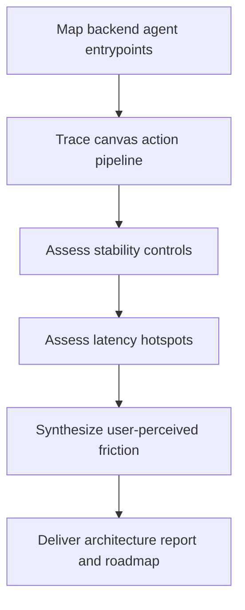

# Backend Agent Architecture Audit Plan

Date: 2026-03-07
Scope: `backend/` agent architecture, canvas operation capability, stability, latency, experiential friction
Status: In Progress

## Assumptions
- This audit focuses on the current production-oriented backend implementation in `backend/`.
- The user wants a professional architecture diagnosis plus improvement program, not a code patch in this round.
- Priority order is: canvas capability > stability > speed > holistic user-perceived experience.

## Audit Goals
```text
+---------------------------+---------------------------------------------+
| Goal                      | What good looks like                        |
+---------------------------+---------------------------------------------+
| Canvas capability         | Agent can plan, execute, verify canvas ops  |
| Stability                 | Same input yields bounded, observable runs  |
| Speed                     | Time-to-first-action and end-to-end improve |
| Experience                | Behavior feels reliable, intentional, calm  |
+---------------------------+---------------------------------------------+
```

## Audit Flow
```text
[Entry/API]
    |
    v
[Run orchestration / worker]
    |
    +--> [Graph / planning nodes]
    |
    +--> [Tool registry / tool contracts]
    |
    +--> [Canvas command path]
    |
    +--> [State persistence / events / retries]
    |
    v
[Observed user pain]
```



## Working Questions
1. Where does intent become executable canvas commands?
2. How many boundaries can fail silently?
3. What adds latency before useful work starts?
4. Which abstractions help engineering but hurt reliability?
5. Why does the experience feel “难受” even when runs technically succeed?

## Evidence Log
- Pending: entrypoint mapping
- Pending: canvas toolchain mapping
- Pending: stability bottleneck mapping
- Pending: latency bottleneck mapping
