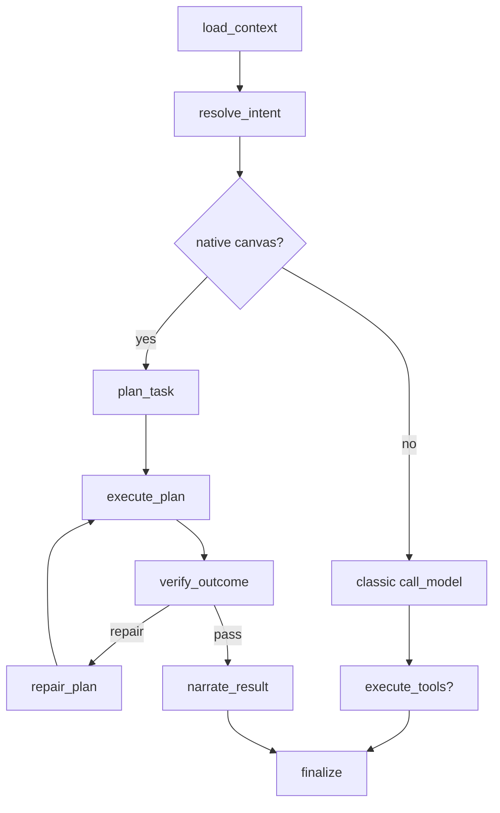

# Canvas Native Runtime Execution Plan

Date: 2026-03-07  
Scope: `Phase 1 delivery completion`  
Decision: `Direction E = LangGraph shell + Canvas Native Runtime`

## Mission

```text
Goal
  = 不迁出 LangGraph
  = 让 Canvas 进入 native execution path
  = 先把高频画布操作做成结构化、可验证、可修复、可观测
```

## Delivery Phases

```text
+-------+---------------------------------------+----------------------------------------------+
| Phase | Deliverable                           | Definition of Done                           |
+-------+---------------------------------------+----------------------------------------------+
| A     | Hybrid routing + graph path           | canvas 请求能走 native path，非 canvas 不受影响 |
| B     | Context resolver + planner            | 能把请求变成 CanvasTaskIR，而不是直接拍脑袋写入 |
| C     | Canonical executor                    | 单一路径写入，带 expected_version/idempotency |
| D     | Verifier + repair loop                | 执行后显式验收，失败可有限修复                  |
| E     | Narration + degraded + shadow/metrics | 用户可感知结果，系统可观测、可灰度               |
+-------+---------------------------------------+----------------------------------------------+
```

## Execution Map

```text
load_context
  -> resolve_intent
     -> route_native_or_classic
        -> native:
             plan_task
             execute_plan
             verify_outcome
             repair_plan? (bounded)
             narrate_result
        -> classic:
             call_model
             execute_tools
             finalize
```



## Phase Review Gates

```text
[x] A review:
    - feature flag 生效
    - 路由只增不破
    - checkpoint/resume 不回归

[x] B review:
    - context 读取 current canvas / selection
    - planner 输出 CanvasTaskIR v1
    - 高频 recipe 至少覆盖 layout/connect/create

[x] C review:
    - executor 只走 canonical write path
    - expected_version 生效
    - idempotency 生效

[x] D review:
    - verifier 有显式 pass/fail
    - repair budget bounded
    - version conflict 可修复

[x] E review:
    - assistant 结果可读
    - degraded_state 可见
    - shadow mode 可开关
    - metrics 打点完成
```

## Implementation Strategy

```text
Native Runtime Core
  + policy
  + context resolver
  + planner
  + executor
  + verifier
  + repair
  + narrator

Write Path
  planner -> IR -> op compiler -> CanvasWriteService.apply_canvas_ops

Read / Verify Path
  context resolver -> realtime snapshot fallback -> verification checks
```

## Non-Negotiables

```text
1. 所有状态字段只做 additive change
2. checkpoint 可恢复，不能重复执行关键写操作
3. native path 必须可灰度开关
4. 每阶段结束：
   -> review
   -> focused tests
   -> git commit
5. 最终结束：
   -> total review
   -> 汇总交付
```
