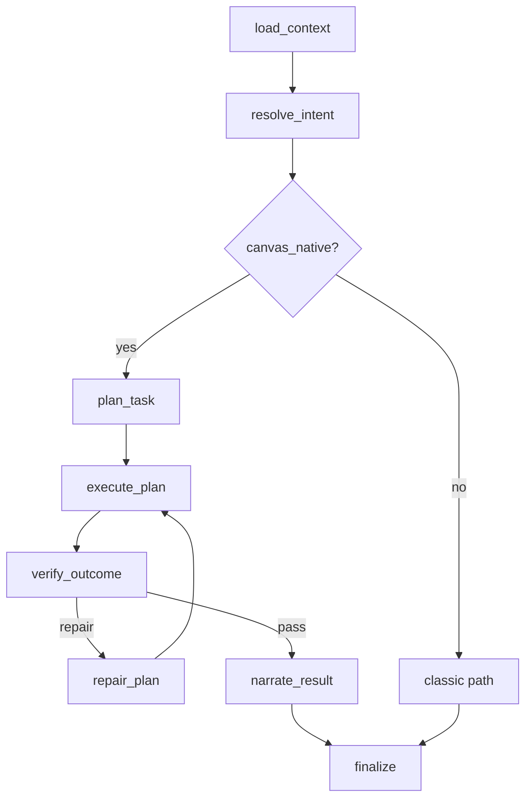

# Canvas Native Runtime Phase 1 Plan

Date: 2026-03-07  
Decision: `Direction E = Orchestrator + Canvas Native Runtime`

## Plan Summary

```text
Phase 1 Goal
  = 在不推翻现有 LangGraph 编排的前提下
  = 建立 canvas-native 的新执行通道
  = 先打穿高频 canvas 请求
```

## Work Breakdown

```text
+---------+--------------------------------------+--------------------------+
| Phase   | Deliverable                          | Outcome                  |
+---------+--------------------------------------+--------------------------+
| A       | Hybrid routing skeleton              | 新旧路径可并行           |
| B       | CanvasTaskIR v1 + planner v1         | 先结构化再执行           |
| C       | Canonical executor v1               | 单一写路径               |
| D       | Verifier / repair v1                | 可检查、可修复           |
| E       | Metrics / degraded state / shadow   | 可观测、可灰度           |
+---------+--------------------------------------+--------------------------+
```

## Execution Flow

```text
load_context
  -> resolve_intent
     -> if canvas_native:
          plan_task
          execute_plan
          verify_outcome
          repair_plan?
          narrate_result
        else:
          classic path
```



## Phase 1 Scope Guard

### In

```text
- current canvas
- selection-aware create/edit/organize
- high-frequency recipes
- bounded repair
- version-safe writes
```

### Out

```text
- full workspace orchestration
- all-domain convergence
- complete legacy removal
- unlimited free-form layout intelligence
```

## Review Checklist

```text
[ ] New path behind feature flag
[ ] GraphState additive-only changes
[ ] CanvasTaskIR v1 covers top scenarios
[ ] Canonical executor enforces expected_version + idempotency
[ ] Verifier reports pass/fail explicitly
[ ] Repair budget bounded
[ ] Stream payload exposes degraded flags
[ ] Shadow mode available for comparison
```
