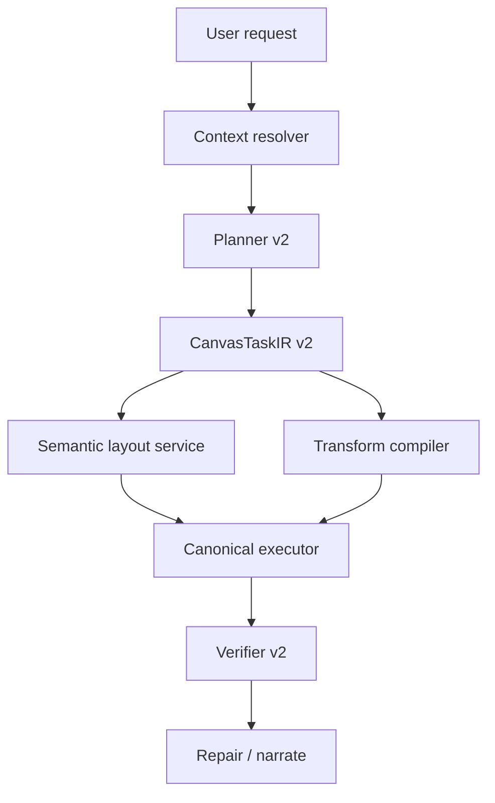

# Canvas Native Runtime Phase 2 Plan

Date: 2026-03-07  
Scope: `Phase 2 = semantic layout engine + selection-native transforms`
Decision: `Stay on LangGraph, deepen canvas-native runtime`

## Target

```text
Phase 1 solved
  = route correctly
  = plan/write/verify/repair correctly

Phase 2 must solve
  = richer semantic layouts
  = stronger operations on existing selection
  = less "generic tool feel", more "native canvas intelligence"

Definition of success
  1. planner can understand more canvas-native request shapes
  2. executor can transform existing selection, not only create new nodes
  3. layout quality becomes deterministic and more expressive
  4. verifier checks semantic outcomes, not only existence
```

## Chosen Direction

```text
Chosen scope
  A. Semantic layout engine
     - grid
     - cluster
     - timeline
     - mindmap
     - swimlane

  B. Selection-native transforms
     - retitle selection
     - summarize selection into hub node
     - organize selection with semantic layout

  C. Stronger verification
     - verify renamed content
     - verify summary node creation
     - verify layout lane positioning
```

## Why This Phase

```text
If Phase 1 is "can execute safely",
Phase 2 is "starts to feel natively powerful".

Without Phase 2
  = agent can write
  = but still feels like a structured automation layer

With Phase 2
  = agent can reshape working thought structures
  = agent begins to behave like a real canvas copilot
```

## Architecture Delta

```text
Before
  planner
    -> simple create/connect/layout heuristics
  executor
    -> add_node / add_connection / move_node

After
  planner v2
    -> recipe detection
    -> selection-aware transforms
    -> richer layout intent

  layout service
    -> deterministic semantic placement

  executor v2
    -> create + relayout + update existing nodes
    -> summary hub synthesis

  verifier v2
    -> existence + content + structure + placement
```



## Execution Stages

```text
+---------+--------------------------------------+----------------------------------------------+
| Stage   | Deliverable                          | Review gate                                  |
+---------+--------------------------------------+----------------------------------------------+
| P2-A    | IR v2 + semantic layout engine       | planner/executor can express richer layouts  |
| P2-B    | selection-native transforms          | retitle/summary flows execute canonically    |
| P2-C    | verifier/tests/docs/final review     | semantic outcomes are regression-covered     |
+---------+--------------------------------------+----------------------------------------------+
```

## Key Design Choices

```text
1. Do not replace canonical ops
   -> still compile into add_node / update_node / move_node / add_connection

2. Add transform layer to IR
   -> lets planner describe "what change should happen"
   -> executor remains deterministic

3. Add standalone layout service
   -> keeps planner semantic
   -> keeps executor focused on compilation

4. Prefer deterministic selection transforms first
   -> retitle selection
   -> summary hub creation
   -> swimlane relayout with explicit lanes
```

## Request Shapes To Cover

```text
create / scaffold
  - "创建一个时间线：发现、分析、修复、复盘"
  - "生成一个脑图：目标、风险、策略"

organize / reshape
  - "把当前选中的节点整理成脑图"
  - "把这些节点按时间线排列"
  - "按产品 / 设计 / 技术三列整理"

transform existing selection
  - "把当前 3 个节点改成：目标、现状、策略"
  - "给这些节点上面加一个总纲节点：增长策略"
```

## Non-Negotiables

```text
1. all changes remain additive
2. native path keeps canonical write discipline
3. tests must cover planner + executor + verifier
4. each stage ends with:
   -> review
   -> focused regression
   -> git commit
5. final stage ends with:
   -> broader regression
   -> final review report
```

