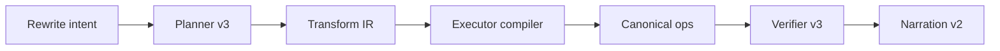

# Canvas Native Runtime Phase 3 Plan

Date: 2026-03-07  
Scope: `Phase 3 = semantic rewrite transforms`
Decision: `Make canvas runtime restructure existing thought structures`

## Goal

```text
Phase 1
  = native execution correctness

Phase 2
  = semantic layout + basic selection transforms

Phase 3
  = semantic rewrite
    -> split
    -> merge
    -> shape-convert

Success criteria
  1. selected nodes can be converted into stronger structures
  2. one node can be expanded into child structures
  3. multiple nodes can be merged into one canonical result
  4. verifier can confirm rewrite outcomes
```

## Chosen Scope

```text
P3-A
  split node into children
  - request: "把这个节点拆成：A、B、C"
  - result: create child nodes + connect from parent

P3-B
  merge selection into one node
  - request: "把这几个节点合并成：增长策略"
  - result: create merged node + reconnect external edges + delete originals

P3-C
  convert selection shape
  - request: "把这些节点整理成时间线/脑图"
  - result: auto-connect selected nodes using target shape semantics
```

## Why This Phase Matters

```text
Without rewrite transforms
  = canvas agent mainly writes and arranges

With rewrite transforms
  = canvas agent can refactor thinking structures
  = that is much closer to a true visual-thinking copilot
```

## Execution Map

```text
user request
  -> planner detects rewrite intent
  -> CanvasTaskIR emits transform grammar
  -> executor compiles canonical ops
  -> verifier checks structural rewrite
  -> narration explains rewrite summary
```



## Non-Negotiables

```text
1. canonical ops remain the only write path
2. merge must reconnect external graph safely
3. destructive actions must be explicit-intent driven
4. every substage ends with:
   -> review
   -> focused tests
   -> git commit
5. final stage ends with:
   -> broader regression
   -> review report
```

