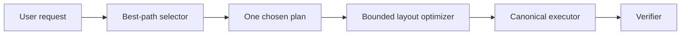

# Canvas Native Runtime Phase 4 Plan

Date: 2026-03-07  
Scope: `Phase 4 = Single-Shot Best Path`  
Decision: `Do not add online multi-candidate ranking`

## Goal

```text
We do not want:
  more user waiting
  more user choices
  more online agent loops

We do want:
  first result is better
  hot path stays fast
  system gets smarter internally
```

## Core Principle

```text
Complexity placement

user-facing complexity
  = zero increase

online hot-path complexity
  = tightly bounded

internal deterministic intelligence
  = allowed
```

## Chosen Scope

```text
P4-A
  single-shot best-path selector
  - request archetype detection
  - selection topology analysis
  - root / chain / cluster / lane judgment
  - one best strategy, not multiple candidates

P4-B
  layout optimizer
  - preserve reading order
  - avoid overlap with nearby nodes
  - better root placement / lane placement
  - bounded optimization passes

P4-C
  latency guardrails
  - explicit plan/layout budgets
  - fallback to deterministic baseline if budget exceeded
  - metadata + tests for bounded behavior
```

## Runtime Shape

```text
user request
  -> best-path selector
  -> one chosen strategy
  -> deterministic layout optimizer
  -> canonical executor
  -> verifier
```



## Why This Is Better Than Online Multi-Candidate

```text
online multi-candidate
  = more delay
  = more inference work
  = more system branching

single-shot best path
  = same user experience shape
  = smarter first decision
  = stable hot path
  = easier to debug and benchmark
```

## Non-Negotiables

```text
1. no extra user-visible waiting loops
2. no user-facing plan choice UI
3. all improvements stay inside deterministic hot path
4. each substage ends with:
   -> review
   -> focused tests
   -> git commit
5. final stage ends with:
   -> broader regression
   -> review report
```

