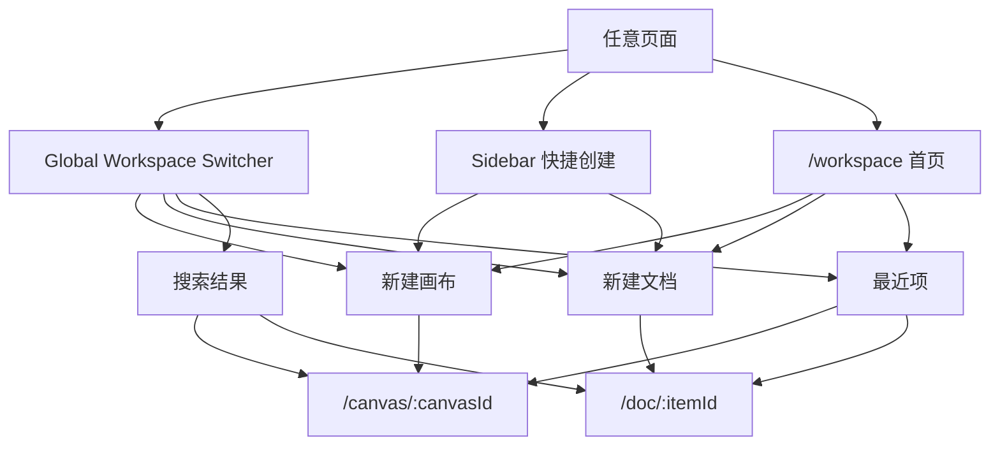
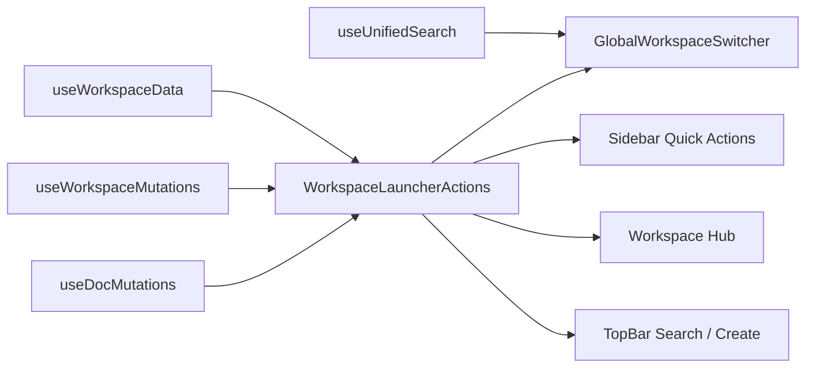

# 前端系统扫描与方案：快速创建画布/文档 + 随时切换

日期：2026-03-07  
范围：`frontend` layout、工作区入口、画布/文档导航、全局搜索、快速创建链路

---

## 0. 目标定义

我们要解决的不是“再加一个按钮”，而是统一用户对工作区的心智：

1. 用户在任何页面都能 **立刻创建** 画布或文档  
2. 用户在任何页面都能 **立刻切换** 到其他画布或文档  
3. 交互必须 **优雅、清晰、简单易懂**  
4. 不让用户去理解“这是 dashboard、workspace、canvas、doc 哪个入口更对”

---

## 1. 当前结构扫描

### 1.1 当前真实前端壳层

```text
App Router
└── DashboardLayoutContent
    ├── SidebarLeft
    │   ├── 顶部站点导航
    │   └── SidebarFileTree
    │       ├── 文件树（folder/canvas/doc 混合）
    │       ├── 可切换 canvas/doc
    │       └── 只提供「新建文件夹 / 新建画布」
    ├── GlobalSearch
    │   └── 目前本质是“画布节点搜索”
    └── Page Outlet
        ├── /dashboard
        │   └── DashboardContent
        │       └── CanvasWorkspaceFlattened
        │           ├── 新建画布
        │           ├── 新建文档
        │           └── UnifiedSearchPanel（支持 doc/canvas/ref）
        ├── /canvas/:canvasId
        │   └── CanvasEditor + TopBar
        └── /doc/:itemId
            └── DocEditorShell + TopBar
```

### 1.2 核心事实

```text
已有能力
├── 工作区聚合数据：有
├── 文件树支持 doc/canvas 混合：有
├── 全局 Cmd/Ctrl+K：有
├── 统一搜索 unified search：有
├── 快速新建 canvas：有
├── 快速新建 doc：有，但只在 dashboard workspace 区域里
└── 任意页统一创建/切换：没有真正打通
```

---

## 2. 五个关键假设与验证

```text
+----+----------------------------------------+----------+----------------------------------------------+
| #  | 假设                                   | 结论     | 验证结果                                     |
+----+----------------------------------------+----------+----------------------------------------------+
| 1  | 数据层已经支持“画布+文档统一工作区”    | 成立     | useWorkspaceData 同时返回 folders/canvases/  |
|    |                                        |          | items/docsMeta/refsSummary                   |
| 2  | 当前全局搜索已经能承担“全局切换器”     | 不成立   | GlobalSearch 仍是 canvas node 搜索           |
| 3  | 当前侧边栏已经支持“随时切换”           | 部分成立 | 文件树能切 doc/canvas，但不支持新建 doc      |
| 4  | 项目里已经存在更接近目标的交互原型     | 成立     | CanvasWorkspaceFlattened 已有新建 doc +      |
|    |                                        |          | UnifiedSearchPanel                           |
| 5  | 当前路由模型已经有明确的 workspace 中心 | 不成立   | /workspace 直接重定向到 /dashboard           |
+----+----------------------------------------+----------+----------------------------------------------+
```

结论：  
**不是能力缺失，而是能力分散。** 现在的问题是入口分裂、命名分裂、搜索分裂、创建分裂。

---

## 3. 现状诊断：问题到底在哪里

### 3.1 用户心智被拆成了两套

```text
套系 A：Dashboard 心智
└── 在首页大卡片区域里创建/打开内容

套系 B：Sidebar Files 心智
└── 在左侧树里浏览/切换内容

问题：
用户不知道“真正的工作区”到底是哪一个。
```

### 3.2 “全局搜索”名义上全局，实际上偏画布

当前 `Cmd/Ctrl+K` 打开的 `GlobalSearch`：

- 文案是“Search all canvases”
- 数据源是 `searchCanvasNodes`
- 跳转目标是 `buildCanvasPath(...)`

这意味着：

```text
用户想切文档
→ 直觉按 Cmd/Ctrl+K
→ 却只能搜画布节点
→ 心智直接断裂
```

### 3.3 “快速创建”不对称

现在：

- Sidebar File Tree：能新建画布，不能新建文档
- Dashboard Workspace：能新建画布，也能新建文档
- Doc/Canvas 编辑页：没有统一的“随手新建”入口

这会导致用户必须记住：

```text
新建画布：很多地方都行
新建文档：只有某些地方行
```

这不简单。

### 3.4 路由语义不完整

`/workspace` 当前只是跳转到 `/dashboard`，这说明：

```text
信息架构有“workspace”概念
但产品入口没有把 workspace 当一等公民
```

这会持续制造命名和导航上的混乱。

### 3.5 创建/跳转逻辑分散，后续很难做顺滑体验

现在的打开/创建逻辑分散在：

- `DashboardContent`
- `SidebarLeft`
- `CanvasWorkspaceFlattened`
- `SidebarFileTree`

问题不是“能不能跑”，而是：

```text
同一件事
├── 在不同地方重复实现
├── 交互细节不一致
├── 未来加 loading / optimistic / guard / telemetry 会越来越乱
└── 用户体验难以统一
```

---

## 4. 推荐方案

我给两个方向：

```text
方案 A（推荐，稳健）
└── 保留现有 sidebar + editor 架构
    ├── 把全局搜索升级为“全局工作区切换器”
    ├── 让 /workspace 成为真正工作区首页
    ├── 统一创建/打开逻辑
    └── 在所有页面提供一致入口

方案 B（激进）
└── 重构 dashboard/ workspace 边界
    ├── dashboard 退回“欢迎/AI 启动页”
    ├── workspace 成为唯一内容中心
    ├── sidebar 大幅减法
    └── 首页、切换器、编辑器共享一套工作区语言
```

### 我的建议

**先做方案 A。**  
原因很直接：

1. 改动集中在前端壳层，可快速验证  
2. 现有 `useWorkspaceData`、`UnifiedSearchPanel`、`CanvasWorkspaceFlattened` 已经提供了 70% 能力  
3. 不需要先推翻整套 layout，就能拿到非常明显的体验收益  

---

## 5. 推荐交互模型

### 5.1 统一成一个“工作区切换器”

从任何页面触发：

- `Cmd/Ctrl + K`
- TopBar 搜索框
- Sidebar 顶部搜索入口

切换器打开后的结构：

```text
┌────────────────────────────────────┐
│ 搜索或切换…                        │
├────────────────────────────────────┤
│ 快捷操作                           │
│ [新建画布] [新建文档]              │
├────────────────────────────────────┤
│ 最近访问                           │
│ 画布 A                             │
│ 文档 B                             │
│ 画布 C                             │
├────────────────────────────────────┤
│ 搜索结果                           │
│ Docs                              │
│ Canvases                          │
│ Nodes / References                │
└────────────────────────────────────┘
```

### 5.2 空输入时：它是“启动器”

不要让空搜索只显示空状态。空输入时应该最有价值：

- 两个主动作：`新建画布`、`新建文档`
- 最近编辑内容混排展示
- 如果当前在团队空间，默认在当前团队内创建/跳转

### 5.3 输入内容时：它是“搜索 + 创建”

当用户输入 `项目复盘`：

应该同时看到：

```text
创建动作
├── 新建画布「项目复盘」
└── 新建文档「项目复盘」

结果动作
├── 文档：项目复盘 Q1
├── 画布：项目复盘脑图
├── 节点：项目复盘 > 风险总结
└── 引用：项目复盘 周报链接
```

这才叫“快”。

### 5.4 文件树：继续保留，但角色降级为“浏览器”

文件树适合：

- 浏览层级
- 拖拽归档
- 结构化整理

文件树不适合承担：

- 最高频快速切换
- 全局搜索
- 唯一创建入口

所以定位应改成：

```text
切换器 = 快速跳转
文件树 = 结构浏览
工作区首页 = 全局总览
```

### 5.5 Sidebar 里的创建入口需要对称

当前只给“新建画布”是不对的。  
推荐改为下面之一：

```text
推荐做法
┌ Files ────────────────────────────┐
│ [+ 画布]  [+ 文档]  [···]         │
└───────────────────────────────────┘
```

而不是只给一个画布加号。

原因：

- 画布/文档是一级对象
- 文件夹是次级整理对象
- 用户更常创建内容，而不是先创建容器

---

## 6. 推荐信息架构

```text
Persistent Shell
├── SidebarLeft
│   ├── Workspace quick actions
│   └── Workspace tree
├── GlobalWorkspaceSwitcher
└── Page Outlet
    ├── /dashboard        -> AI 启动页（可保留）
    ├── /workspace        -> 真正工作区首页
    ├── /canvas/:id       -> 画布编辑
    └── /doc/:id          -> 文档编辑
```

### Mermaid：用户操作流



### Mermaid：前端实现流



---

## 7. 具体落地设计

### 7.1 先把 `GlobalSearch` 升级成 `GlobalWorkspaceSwitcher`

当前问题：

- 名称像全局
- 能力却偏画布

改法：

```text
GlobalWorkspaceSwitcher
├── 输入为空：显示创建动作 + 最近项
├── 输入有值：显示创建建议 + unified search
├── 支持 doc/canvas/ref/node 混合结果
└── 统一处理导航 guard（例如 agent 正在运行）
```

### 7.2 抽出统一动作 Hook：`useWorkspaceLauncherActions`

它应该统一处理：

```text
createCanvasAndOpen(title?)
createDocAndOpen(title?)
openCanvas(canvasId)
openDoc(itemId)
confirmBeforeInterruptingAgentRun()
```

好处：

```text
Dashboard
Sidebar
Workspace Hub
TopBar
└── 全部走同一套动作
```

### 7.3 让 `/workspace` 真正存在

建议：

- 用 `CanvasWorkspaceFlattened` 进化成真正的 `WorkspaceHub`
- 这里作为“总览页 + 最近项 + 搜索入口 + 创建入口”
- `/dashboard` 保留 AI 启动能力，但不再承担“唯一工作区”职责

### 7.4 Sidebar File Tree 增加文档创建

当前 Files header 应该从：

```text
[新建文件夹] [新建画布]
```

变成：

```text
[新建画布] [新建文档] [更多]
```

“更多”里再放：

- 新建文件夹
- 批量整理
- 展开/折叠全部

这更符合优先级。

### 7.5 TopBar 文案要统一

当前 TopBar 的搜索文案还是：

- Search all canvases

应改成：

- 搜索或切换
- Search docs and canvases

这是小改动，但认知收益非常大。

### 7.6 文档创建也要做成“立即响应”

当前 canvas 创建链路已经更接近“秒开”，  
但 doc 创建还是典型“创建成功后再刷新列表”的思路。

建议把 doc create 也补成：

```text
点击新建文档
→ 本地立即插入 optimistic item
→ 直接进入文档页
→ 后台完成正式落库
→ 失败时再回滚/提示
```

这样画布和文档的体感才一致。

---

## 8. 实施顺序（推荐）

### Phase 1：先统一入口

目标：用户从任意页面都能“搜 / 切 / 建”

```text
P1
├── GlobalSearch -> GlobalWorkspaceSwitcher
├── 接入 unified search
├── 空输入显示“新建画布 / 新建文档 / 最近项”
└── TopBar / Cmd+K / Sidebar 都打开同一个切换器
```

### Phase 2：补齐 Sidebar 快捷创建

目标：侧边栏不再偏袒画布

```text
P2
├── SidebarFileTree 增加 New Doc
├── 重排 Files header 操作优先级
└── 把 Folder 放到次级入口
```

### Phase 3：恢复真正的 `/workspace`

目标：让工作区成为明确存在的中心页

```text
P3
├── workspace route 不再 redirect
├── 复用/升级 CanvasWorkspaceFlattened
├── 增加 mixed recent / pinned / folders
└── dashboard 与 workspace 职责分离
```

### Phase 4：做体感优化

目标：真正“优雅”

```text
P4
├── doc create optimistic
├── recent items 本地缓存
├── 打开目标项的过渡动画
├── 当前项高亮更稳定
└── agent run 中断确认统一处理
```

---

## 9. 验收标准

```text
用户故事 1
我在任意页面，1 次动作内可以新建画布

用户故事 2
我在任意页面，1 次动作内可以新建文档

用户故事 3
我按 Cmd/Ctrl+K，可以搜到并打开画布、文档、节点、引用

用户故事 4
我不需要知道“去 dashboard 还是去 files 才能做事”

用户故事 5
我打开切换器时，空状态就很有用，不是空白的
```

---

## 10. 最终判断

### 结论一句话

**这个需求不需要推倒重来，核心是把已经存在的几套能力收束成一个统一工作区模型。**

### 最值得做的第一刀

```text
第一优先级
= 把当前 GlobalSearch 升级成真正的 GlobalWorkspaceSwitcher
```

因为它能同时解决：

- 快速切换
- 快速创建
- 入口统一
- 文档/画布对称
- 任意页可达

这是性价比最高的一刀。

---

## 11. 我给你的明确建议

如果现在就开始做，我建议按这个顺序推进：

```text
Step 1  做 GlobalWorkspaceSwitcher（推荐）
Step 2  补 Sidebar New Doc
Step 3  恢复真实 /workspace
Step 4  做 doc optimistic create
```

其中：

```text
稳健方案（推荐）
├── 不大改布局
├── 先统一入口
└── 先拿到体验收益

激进方案
├── 重划 dashboard / workspace 边界
├── 进一步清理导航噪音
└── 适合下一轮产品信息架构升级
```

