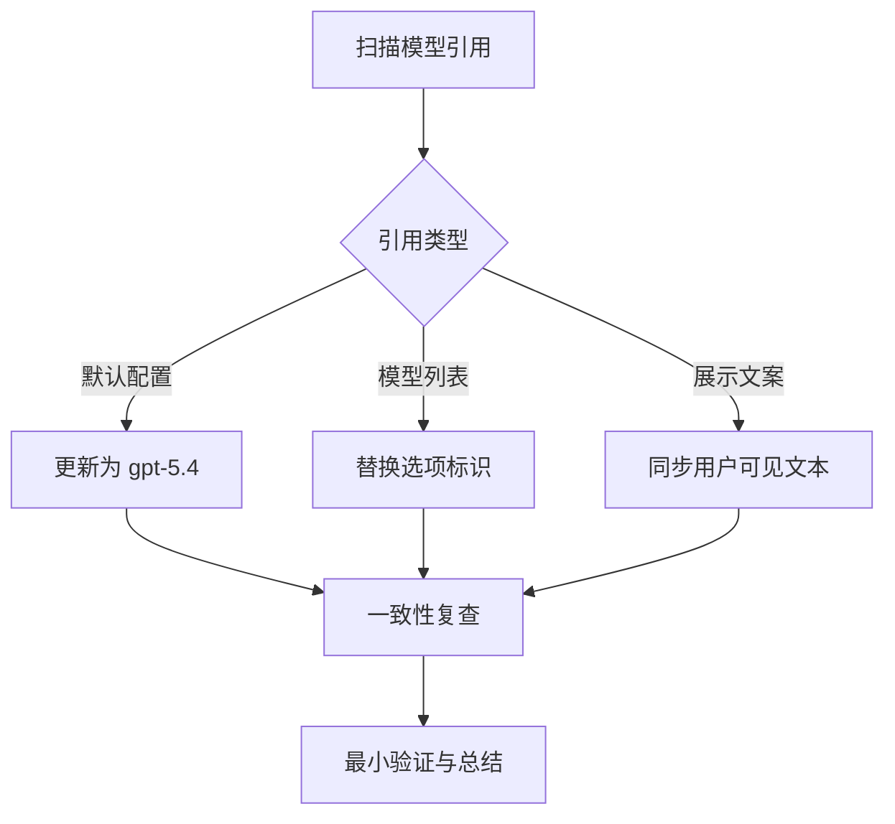

# gpt-5.4 替换 gpt-5.3-codex 实施计划

## 目标
- 将仓库内对 `gpt-5.3-codex` / `5.3codex` 的有效模型引用替换为 `gpt-5.4`
- 复查默认模型、下拉选项、后端兜底配置、文案一致性
- 不扩散修改范围，不触碰无关逻辑

## ASCII 任务流

+------------------+
| 1. 定位引用点    |
+--------+---------+
         |
         v
+------------------+
| 2. 分类配置来源  |
|    - 默认值      |
|    - 枚举/选项   |
|    - 文案/示例   |
+--------+---------+
         |
         v
+------------------+
| 3. 执行替换      |
|    - 精准修改    |
|    - 保持兼容边界|
+--------+---------+
         |
         v
+------------------+
| 4. 复查一致性    |
|    - 前后端对齐  |
|    - 文案对齐    |
+--------+---------+
         |
         v
+------------------+
| 5. 最小验证      |
+------------------+

## Mermaid

## 决策
- 默认采用稳健方案：仅替换明确指向 `gpt-5.3-codex` / `5.3codex` 的配置与可见文案
- 若存在 `codex` 泛化能力枚举，将先核实其是否为独立模型族，再决定是否替换
