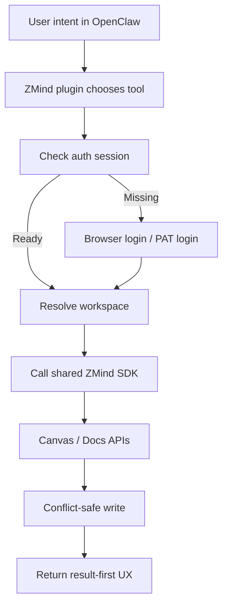

# ZMind x OpenClaw 完整路线规划

Date: 2026-03-09
Scope: `backend/`、`apps/cli`、OpenClaw plugin、认证、文档/画布远程操作、生态发布
Status: Planning complete

## Planning Assumptions
- 目标不是“能跑通一次”，而是做出可发布、可维护、可扩展的正式接入方案。
- 优先级顺序是：
  1. 真正可登录
  2. 真正可读写画布/文档
  3. Agent 体验自然
  4. 可观测、可恢复、可发布
- 当前后端 canvas/docs API 继续复用，不推翻重建。
- 当前 `apps/cli` 继续保留 local-first 能力，但新增 cloud/remote 能力。

## Executive Recommendation
```text
+----------------------+------------------------------+----------------------------------+
| 方案                 | 特征                         | 结论                             |
+----------------------+------------------------------+----------------------------------+
| 激进方案（推荐）     | SDK + 远程 CLI + 插件并行    | 6-8 周做出完整闭环               |
| 稳健方案             | 先 CLI 远程化，再做插件      | 风险更低，但生态接入更晚         |
| 错误方案             | 只做 skill / prompt / demo   | 无法真实操作产品                 |
+----------------------+------------------------------+----------------------------------+
```

**推荐拍板**
- 采用 **激进方案**
- 原因：你们后端能力已经够，真正缺的是中间层与体验层；继续保守只会拖慢生态接入，不会显著降低风险

## What Still Needs To Be Built
```text
缺口总览
├─ 共享 SDK
│  ├─ auth client
│  ├─ workspace client
│  ├─ canvas client
│  ├─ docs client
│  └─ error / retry / idempotency
│
├─ 远程 CLI
│  ├─ login / logout / status
│  ├─ workspace list / use
│  ├─ canvas remote commands
│  └─ docs remote commands
│
├─ OpenClaw plugin
│  ├─ tool registry
│  ├─ plugin commands
│  ├─ config schema
│  └─ auth bridge
│
├─ 体验层
│  ├─ 人类可读结果
│  ├─ 冲突恢复
│  └─ 首次登录引导
│
└─ 发布层
   ├─ npm package
   ├─ docs
   ├─ beta rollout
   └─ community listing / ClawHub
```

## Target End State
```text
User in OpenClaw
      |
      v
"把这份会议纪要整理到 ZMind 画布"
      |
      v
OpenClaw ZMind Plugin
      |
      +--> session check
      +--> workspace resolve
      +--> get/create target canvas
      +--> apply canvas or docs ops
      |
      v
ZMind Backend APIs
      |
      v
Canvas / Docs updated
      |
      v
"已在《项目周会》画布中新增 8 个节点并自动分组"
```



## Roadmap Overview
```text
+---------+------------------------------+--------------------------------------+
| Phase   | Goal                         | Exit condition                       |
+---------+------------------------------+--------------------------------------+
| P0      | Freeze contracts             | 范围、能力、错误模型冻结             |
| P1      | Build shared SDK             | TS SDK 可稳定读写 canvas/docs        |
| P2      | Remote-enable CLI            | CLI 可登录并真实改线上画布           |
| P3      | Ship OpenClaw plugin         | OpenClaw 可真实调用 ZMind tools      |
| P4      | Harden UX / safety / retry   | 冲突恢复与错误提示成熟               |
| P5      | Beta rollout                 | 小流量真实用户稳定使用               |
| P6      | Ecosystem publish            | npm / docs / community listing 完成  |
+---------+------------------------------+--------------------------------------+
```

## Phase 0 — Contract Freeze
```text
目标
├─ 统一“可暴露给 agent 的能力白名单”
├─ 冻结 Phase 1/2 的 API 映射
├─ 确定错误模型
└─ 明确 auth 方案先后顺序
```

Deliverables:
- capability matrix
- auth decision record
- SDK interface contract
- plugin tool contract

Must decide:
- Phase 1 登录先用 `PAT/access token`，还是直接做浏览器 OAuth
- 是否允许 Phase 1 先只支持单 workspace 默认模式
- docs 功能是否对 beta workspace 默认开启

Recommendation:
- Phase 1 先做 **PAT/access token + workspace select**
- 浏览器 OAuth 放到 Phase 4

## Phase 1 — Shared JS/TS SDK
```text
目标
├─ 建一个所有入口共用的 ZMind client
├─ 封装 HTTP、鉴权、workspace、重试、冲突
└─ 让 CLI 和 OpenClaw plugin 不再各写一套网络逻辑
```

Package recommendation:
- `packages/zmind-sdk` 或 `apps/cli` 抽出 `packages/sdk`

Module split:
- `auth/`
- `session/`
- `workspace/`
- `canvas/`
- `docs/`
- `share/`
- `errors/`
- `transport/`
- `idempotency/`

SDK responsibilities:
- attach `Authorization` header
- attach `X-Workspace-Id`
- attach `X-Client-Request-Id`
- handle `If-Match` and version conflicts
- normalize error payloads
- expose typed high-level methods

Example high-level methods:
- `loginWithPat()`
- `getSession()`
- `listWorkspaces()`
- `useWorkspace()`
- `listCanvases()`
- `getCanvas()`
- `createCanvas()`
- `applyCanvasOps()`
- `getDoc()`
- `createDoc()`
- `applyDocOps()`

Exit criteria:
- SDK integration test can read and write one real canvas
- SDK can handle expired token / unauthorized / workspace denial
- SDK can detect version conflict and surface a stable error

## Phase 2 — Remote-first CLI
```text
目标
├─ 在不破坏 local-first 的前提下补 remote 功能
├─ 让 CLI 成为正式远程入口
└─ 为 OpenClaw plugin 先打好命令与体验基底
```

Command surface:
```text
zmind auth login
zmind auth status
zmind auth logout

zmind workspace list
zmind workspace use <workspace-id>

zmind canvas list
zmind canvas get --id <id>
zmind canvas create --title <title>
zmind canvas apply --id <id> --ops-file <file>

zmind docs list
zmind docs get --id <id>
zmind docs create --title <title>
zmind docs apply --id <id> --ops-file <file>
```

CLI experience rules:
- default to human-readable results
- `--json` returns stable machine format
- no raw DB IDs unless user explicitly asks
- no “sync adapter not configured” leaks to end users
- first-run experience should guide, not punish

Exit criteria:
- 命令行可完成登录
- 命令行可选择 workspace
- 命令行可真实创建/读取/写入线上画布
- 命令行可真实读取/写入线上文档

## Phase 3 — OpenClaw Plugin
```text
目标
├─ 把 ZMind 能力暴露成 OpenClaw 可调用 tools
├─ 让 plugin 复用 SDK / session store
└─ 让 agent 用“高层能力”而不是低层 REST
```

Tool shortlist:
- `zmind_canvas_list`
- `zmind_canvas_get`
- `zmind_canvas_create`
- `zmind_canvas_apply_ops`
- `zmind_canvas_search`
- `zmind_doc_get`
- `zmind_doc_create`
- `zmind_doc_apply_ops`
- `zmind_share_create`

Plugin commands:
- `zmind-login`
- `zmind-logout`
- `zmind-workspace-select`
- `zmind-status`

Plugin config:
- `baseUrl`
- `defaultWorkspaceId`
- `authMode`
- `sessionStorage`
- `safeMode`

Design principle:
```text
不要让 agent 直接拼 REST 请求
要让 agent 调：
"在这个画布里新增节点并按主题分组"
而不是：
"POST /api/canvases/123/apply with 17 ops"
```

Exit criteria:
- OpenClaw 可成功识别插件
- OpenClaw 可调用至少 4 个真实 ZMind tools
- 登录缺失时有明确引导
- 工具返回结果可直接给终端用户阅读

## Phase 4 — UX / Safety / Recovery
```text
目标
├─ 让结果可理解
├─ 让错误可恢复
└─ 让冲突有自动处理策略
```

Need to build:
- result-first copy
- conflict-aware write pipeline
- optimistic read -> write -> retry
- network timeout / token expiry / access denied handling
- user-safe confirmations for destructive actions

Conflict policy:
```text
写入前
├─ 拉最新版本
├─ 生成 ops
├─ 带 If-Match 提交
└─ 冲突则：
   ├─ 再拉最新版本
   ├─ 重新规划
   └─ 最多重试 N 次
```

Human-facing copy examples:
- 好：`已在《Q2 规划》里新增 5 个优先级节点`
- 坏：`409 version conflict on apply endpoint`

Exit criteria:
- 高频错误都有自然语言提示
- 冲突场景通过自动恢复或清晰提示闭环
- destructive actions require explicit confirmation strategy

## Phase 5 — Security / Observability / Governance
```text
目标
├─ 保证 token 安全
├─ 保证每次操作可追踪
└─ 保证 beta 可控
```

Security work:
- secure session storage
- token rotation / logout cleanup
- workspace isolation validation
- audit metadata on tool-initiated writes

Observability work:
- command metrics
- plugin tool metrics
- auth success / failure metrics
- version conflict rate
- write latency
- error taxonomy dashboard

Governance:
- beta allowlist
- rate limiting
- feature flags for docs / plugin tools
- kill switch for destructive tools

Exit criteria:
- logs and metrics can answer “谁在什么时候通过哪条链路改了什么”
- support team can diagnose top 5 failure reasons

## Phase 6 — Beta Rollout
```text
目标
├─ 用小流量真实用户验证
├─ 收敛体验和可靠性问题
└─ 准备生态发布
```

Beta cohorts:
- internal team
- power users
- selected partner workspaces

Beta checklist:
- onboarding doc
- sample prompts
- known limitations
- support escalation path
- issue templates

Success gates:
- auth completion rate healthy
- first successful write within acceptable time
- low unrecoverable failure rate
- support burden manageable

## Phase 7 — Ecosystem Publishing
```text
目标
├─ 发布 npm package
├─ 发布文档
├─ 申请 OpenClaw community listing
└─ 补充 ClawHub skill（可选）
```

Publish assets:
- plugin README
- auth setup guide
- troubleshooting guide
- examples / prompt cookbook
- changelog

Optional growth layer:
- public skill pack on ClawHub
- webhook recipes
- “meeting notes -> canvas” starter workflow

Exit criteria:
- package installable
- docs self-serve
- external dev can complete setup without工程师手把手陪跑

## Timeline Recommendation
```text
+---------+-----------------------------------------------+
| Week    | Focus                                         |
+---------+-----------------------------------------------+
| 1       | Phase 0 + SDK contract freeze                 |
| 2       | SDK auth/workspace/canvas                     |
| 3       | SDK docs/share + conflict handling            |
| 4       | CLI remote auth/workspace/canvas              |
| 5       | CLI docs + polish + integration tests         |
| 6       | OpenClaw plugin MVP                           |
| 7       | UX recovery + observability + beta prep       |
| 8       | Beta rollout + publish assets                 |
+---------+-----------------------------------------------+
```

## Workstream Matrix
```text
+-------------------+-----------------------------+-------------------------------+
| Workstream        | Owner type                  | Output                        |
+-------------------+-----------------------------+-------------------------------+
| SDK               | TS platform engineer        | shared client + tests         |
| CLI               | TS/full-stack engineer      | remote commands + UX          |
| Plugin            | TS/full-stack engineer      | OpenClaw plugin + tools       |
| Backend support   | Python backend engineer     | API gaps / flags / audit      |
| UX copy           | product + frontend mindset  | result-first wording          |
| Release           | PM / devrel                 | docs / beta / community       |
+-------------------+-----------------------------+-------------------------------+
```

## API Mapping Plan
```text
+--------------------------+-------------------------------+------------------------------+
| User intent              | SDK method                    | Backend API                  |
+--------------------------+-------------------------------+------------------------------+
| 看我的画布列表           | listCanvases()                | GET /api/canvases            |
| 打开某个画布             | getCanvas(id)                 | GET /api/canvases/{id}       |
| 新建画布                 | createCanvas(title)           | POST /api/canvases           |
| 修改画布                 | applyCanvasOps(id, ops)       | POST /api/canvases/{id}/apply|
| 打开文档                 | getDoc(id)                    | GET /api/docs/{id}           |
| 新建文档                 | createDoc(payload)            | POST /api/docs               |
| 修改文档                 | applyDocOps(id, ops)          | POST /api/docs/{id}/agent... |
+--------------------------+-------------------------------+------------------------------+
```

## Acceptance Test Matrix
```text
核心验收
├─ auth
│  ├─ 首次登录
│  ├─ token 过期
│  └─ workspace 切换
│
├─ canvas
│  ├─ list / get / create
│  ├─ apply success
│  └─ version conflict recovery
│
├─ docs
│  ├─ get / create
│  ├─ apply success
│  └─ feature flag disabled case
│
├─ plugin
│  ├─ missing session
│  ├─ happy path write
│  └─ human-friendly result
│
└─ release
   ├─ fresh install
   ├─ fresh login
   └─ sample workflow success
```

## Major Risks
```text
+----------------------------+-----------------------------+-------------------------------+
| Risk                       | Why it matters              | Mitigation                    |
+----------------------------+-----------------------------+-------------------------------+
| CLI / plugin auth duplication | 后续维护成本爆炸         | 先抽共享 SDK                  |
| Docs feature flags         | 用户以为坏了，实际未开通    | 显式 capability check         |
| Version conflicts          | agent 写入体验容易崩        | If-Match + auto replan        |
| Bad tool shape             | agent 能调用但不好用        | 高层语义 tools                |
| Token storage weakness     | 安全风险高                  | keychain / secure store       |
| Over-exposing internals    | 终端用户体验很差            | result-first response design  |
+----------------------------+-----------------------------+-------------------------------+
```

## Non-Negotiables
```text
1. 不复制三套 auth / HTTP client 逻辑
2. 不把低层 API 细节直接暴露给最终用户
3. 不靠浏览器自动化点击 UI 伪装集成
4. 不只做 skill，不做真实 plugin tools
5. 不在没有回滚/恢复策略下开放 destructive writes
```

## Success Metrics
- login completion rate
- first successful connected write rate
- canvas/doc write success rate
- conflict auto-recovery rate
- median end-to-end action latency
- beta workspace weekly active usage
- support tickets per 100 connected workspaces

## Final Recommendation
```text
先做什么
1. 冻结 SDK / auth / workspace contract
2. 把 CLI 远程化
3. 用共享 SDK 做 OpenClaw plugin
4. 收口 UX / retry / observability
5. 再发布生态

为什么
- 这样路线最短
- 复用最多
- 后续维护成本最低
- 能最快做出“真操作”的体验
```

## External References
- [OpenClaw Plugins](https://docs.openclaw.ai/tools/plugin)
- [OpenClaw Plugin Manifest](https://docs.openclaw.ai/tools/plugin-manifest)
- [OpenClaw Provider OAuth Guide](https://docs.openclaw.ai/providers/guides/oauth)
- [OpenClaw Webhooks](https://docs.openclaw.ai/automation/webhooks)
