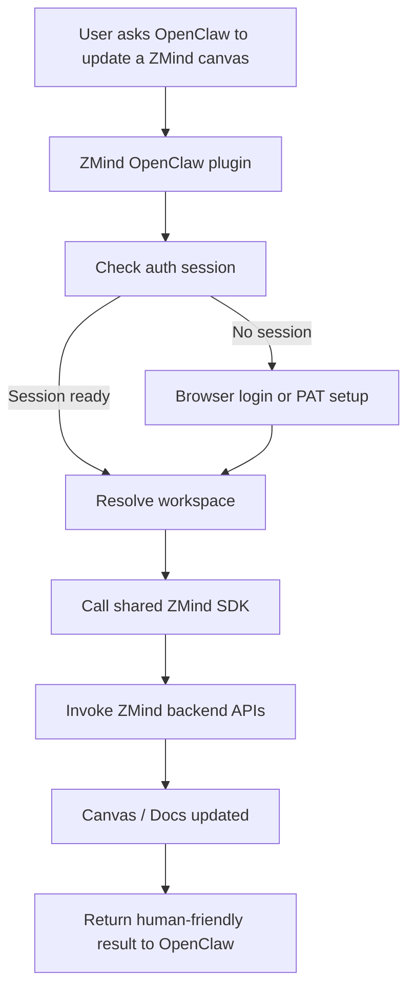
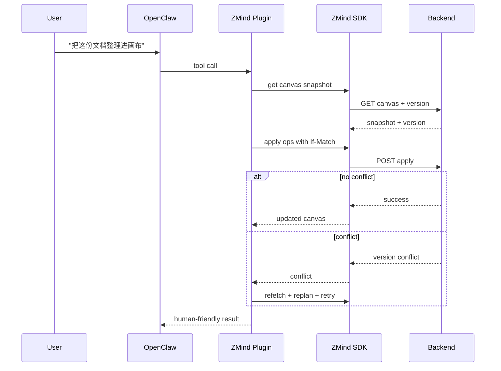

# ZMind x OpenClaw 真接入蓝图

Date: 2026-03-09
Scope: `apps/cli`、OpenClaw 插件接入、ZMind 远程认证与画布/文档操作链路
Status: Ready for implementation

## Assumptions
- 目标不是“做一个概念 Demo”，而是让 OpenClaw 在登录授权后真实读写 ZMind 的云端画布与文档。
- 当前 `backend/` 提供的 canvas/docs HTTP API 视为可继续复用的正式能力面。
- 当前 `apps/cli` 视为本地优先 CLI，需要补齐远程层，而不是推倒重写。
- Phase 1 优先解决“真的能操作”，Phase 2 再追求“生态可分发、体验更顺滑”。

## Executive Decision
```text
+----------------------+------------------------------+----------------------------------+
| 方案                 | 做法                         | 结论                             |
+----------------------+------------------------------+----------------------------------+
| 激进方案（推荐）     | 共享 SDK + 远程 CLI + 插件   | 能最快形成真实生态闭环           |
| 稳健方案             | 先远程 CLI，再封装插件       | 风险更低，但插件交付时间更晚     |
| 伪集成方案（拒绝）   | 只做 prompt/skill，不做工具  | 只能“会说”，不能“真操作”        |
+----------------------+------------------------------+----------------------------------+
```

## Current Truth
```text
今天已经有的
├─ ZMind backend
│  ├─ canvas 查询/写入 API
│  ├─ docs 查询/写入 API
│  └─ JWT + workspace membership 校验
│
├─ ZMind CLI
│  ├─ 本地 vault/canvas/node/edge 命令
│  └─ sync 只是 adapter 边界，尚未接远程
│
└─ OpenClaw
   ├─ plugins
   ├─ agent tools
   ├─ plugin CLI commands
   ├─ config schema / sensitive fields
   ├─ skills / ClawHub
   └─ webhooks
```

## Product Goal
```text
用户在 OpenClaw 里只需要表达意图
      |
      v
OpenClaw 调用 ZMind 工具
      |
      v
必要时触发登录 / 选择 workspace
      |
      v
ZMind API 完成真实读写
      |
      v
返回“结果”而不是返回内部实现细节
```



## Core Architecture
```text
+--------------------+        +--------------------+        +--------------------+
| OpenClaw Plugin    | -----> | ZMind JS SDK       | -----> | ZMind Backend API  |
|                    |        |                    |        |                    |
| - agent tools      |        | - auth client      |        | - /api/canvases    |
| - plugin commands  |        | - workspace client |        | - /api/docs        |
| - skill metadata   |        | - canvas client    |        | - JWT auth         |
| - config schema    |        | - docs client      |        | - workspace check  |
+--------------------+        +--------------------+        +--------------------+
           ^
           |
           +--------------------+
           | ZMind CLI          |
           | - auth login       |
           | - workspace use    |
           | - canvas remote    |
           | - docs remote      |
           +--------------------+
```

## Why This Shape Wins
```text
一个 SDK 解决三件事
1. CLI 不再重复写 HTTP/认证逻辑
2. OpenClaw 插件不直接耦合散乱 REST 细节
3. 权限、重试、幂等、ETag、workspace header 都能统一
```

## Phase Design

### Phase 0 — Capability Freeze
```text
目标
├─ 统一确定“可对外暴露”的操作白名单
├─ 冻结 Phase 1 API 映射
└─ 明确错误模型与返回模型
```

Deliverables:
- ZMind remote capability matrix
- 错误码映射表
- 插件/CLI 共用的 auth/session contract

### Phase 1 — Shared SDK
```text
目标
├─ 抽出 `@zmind/sdk`
├─ 封装认证、workspace、canvas、docs client
└─ 屏蔽 REST 细节、header、重试与冲突处理
```

Recommended SDK modules:
- `auth`
- `sessionStore`
- `workspace`
- `canvas`
- `docs`
- `errors`
- `idempotency`

SDK responsibilities:
- 附加 `Authorization: Bearer <token>`
- 附加 `X-Workspace-Id`
- 处理 `If-Match` / 版本冲突
- 为 agent 写请求自动生成 `X-Client-Request-Id`
- 将底层 HTTP 错误翻译成稳定业务错误

### Phase 2 — Remote-first CLI
```text
目标
├─ 保留 local-first 能力
├─ 新增 cloud profile / login / workspace
└─ 让 CLI 真的能操作线上内容
```

Recommended command surface:

```text
zmind auth login
zmind auth status
zmind auth logout

zmind workspace list
zmind workspace use <workspace-id>

zmind canvas list
zmind canvas get --id <canvas-id>
zmind canvas create --title <title>
zmind canvas apply --id <canvas-id> --ops-file <file>

zmind docs get --id <doc-id>
zmind docs create --title <title>
zmind docs apply --id <doc-id> --ops-file <file>
```

CLI rules:
- 默认输出人话结果
- `--json` 输出稳定机器格式
- 不向最终用户暴露内部表名、数据库 ID、异常堆栈
- 登录完成后只让用户做“选工作区”这一件必要的事

### Phase 3 — OpenClaw Plugin
```text
目标
├─ 把 ZMind 变成 OpenClaw 可调用能力
├─ 让 agent 能读写画布/文档
└─ 把复杂度藏在插件内部
```

Recommended plugin tools:
- `zmind_canvas_list`
- `zmind_canvas_get`
- `zmind_canvas_create`
- `zmind_canvas_apply_ops`
- `zmind_canvas_find_nodes`
- `zmind_doc_get`
- `zmind_doc_create`
- `zmind_doc_apply_ops`
- `zmind_search`
- `zmind_share_create`

Recommended plugin commands:
- `zmind-login`
- `zmind-logout`
- `zmind-workspace-select`
- `zmind-session-status`

Recommended plugin config:
- `baseUrl`
- `defaultWorkspaceId`
- `authMode`
- `tokenRef` or local session path

### Phase 4 — Experience Layer
```text
目标
├─ 降低用户理解成本
├─ 让 agent 返回“结果”
└─ 做到可恢复、可确认、可解释
```

Experience rules:
- 不返回“apply succeeded with 17 low-level ops”
- 返回“已在《产品路线图》里新增 6 个节点并自动连线”
- 冲突时不说 `409 If-Match failed`
- 要说“这个画布刚被别人改过，我先帮你拉最新版本再继续”

## Auth Strategy

### Recommended path
```text
Phase 1
├─ PAT / access token 登录
├─ 本地安全存储 session
└─ 手动选择 workspace

Phase 2
├─ 浏览器 OAuth / magic link
├─ 自动回填 token
└─ 自动恢复最近 workspace
```

### Auth flow
```text
OpenClaw / CLI asks for ZMind action
        |
        v
Check local session
        |
   +----+----+
   |         |
   | yes     | no
   v         v
Use token   Start login
   |         |
   v         v
Resolve workspace membership
        |
        v
Call backend API
```

### Storage recommendation
```text
+------------------------+----------------------------+----------------------------+
| Token location         | 优点                       | 风险控制                   |
+------------------------+----------------------------+----------------------------+
| 系统 keychain（推荐）  | 最安全，用户感知最低       | 需要平台适配               |
| OpenClaw sensitive cfg | 插件集成简单               | 生命周期需更清晰           |
| 本地加密文件           | 跨平台容易                 | 要管理轮换和损坏恢复       |
+------------------------+----------------------------+----------------------------+
```

## API Mapping
```text
+--------------------------+-------------------------------+------------------------------+
| ZMind capability         | Backend API                   | CLI / Plugin action          |
+--------------------------+-------------------------------+------------------------------+
| 列出画布                 | GET /api/canvases             | canvas list                  |
| 获取画布                 | GET /api/canvases/{id}        | canvas get                   |
| 创建画布                 | POST /api/canvases            | canvas create                |
| 应用画布操作             | POST /api/canvases/{id}/apply | canvas apply / agent tool    |
| 获取文档                 | GET /api/docs/{id}            | docs get                     |
| 创建文档                 | POST /api/docs                | docs create                  |
| 应用文档操作             | POST /api/docs/{id}/agent/... | docs apply / agent tool      |
+--------------------------+-------------------------------+------------------------------+
```

## Tool Contract Design
```text
坏设计
用户: “帮我整理这份会议纪要”
工具: 需要用户提供 canvasId / docId / workspaceId / patch schema / version

好设计
用户: “把会议纪要整理成画布”
插件:
  1. 自动列工作区或用默认工作区
  2. 自动找目标画布或新建
  3. 自动生成 ops
  4. 回写并返回结果
```

Tool output should prefer:
- `title`
- `target`
- `changedSummary`
- `nextSuggestion`

Avoid exposing:
- raw DB ids
- JWT fragments
- low-level operation payload unless user asks

## Conflict & Safety Model
```text
每次写入前
├─ 读取当前版本 / ETag
├─ 生成 ops
├─ 带 If-Match 提交
└─ 冲突时自动进入“拉新版本 -> 重算 -> 再提交”流程
```



## Two-Week Execution Plan
```text
+--------+--------------------------------------+----------------------------------+
| Week   | Focus                                | Exit condition                   |
+--------+--------------------------------------+----------------------------------+
| Week 1 | SDK + CLI auth + workspace + canvas  | CLI 能登录并真实读写 1 个画布    |
| Week 2 | Docs + OpenClaw plugin + UX polish   | OpenClaw 能真实写画布/文档       |
+--------+--------------------------------------+----------------------------------+
```

### Week 1
- 抽 `@zmind/sdk`
- 接通 `auth status / login / logout`
- 接通 `workspace list / use`
- 接通 `canvas list / get / create / apply`
- 加最小验收测试：登录、读取、写入、冲突处理

### Week 2
- 接通 `docs get / create / apply`
- 做 OpenClaw plugin manifest / tool registry / commands
- 做登录缺失时的引导 UX
- 做 tool result copy，保证人类可读
- 做最小 smoke test：OpenClaw 指令驱动画布更新

## Non-Negotiables
```text
1. 不把“认证细节”暴露给终端用户
2. 不让用户先研究 schema 再能操作产品
3. 不复制三份 auth/client 逻辑
4. 不让 OpenClaw 通过浏览器点 UI 来假装集成
5. 不只做 skill，不做真实 tool
```

## Success Criteria
- 用户在 OpenClaw 中可完成一次真实登录
- 用户在 OpenClaw 中可列出自己的 ZMind 工作区与画布
- 用户可直接让 agent 新建/更新画布
- 用户可直接让 agent 创建/更新文档
- 冲突时有可理解的恢复路径
- 所有返回文案遵守“结果优先、少术语、少噪音”

## Evidence Anchors
- 当前后端已存在 canvas query/command routes
- 当前后端已存在 docs create/get/update/apply routes
- 当前后端已存在 JWT + workspace membership 校验
- 当前 CLI 仍是 local-first，sync adapter 尚未实现

## External References
- [OpenClaw Plugins](https://docs.openclaw.ai/tools/plugin)
- [OpenClaw Plugin Manifest](https://docs.openclaw.ai/tools/plugin-manifest)
- [OpenClaw Provider Auth Guide](https://docs.openclaw.ai/providers/guides/oauth)
- [OpenClaw Webhooks](https://docs.openclaw.ai/automation/webhook)
