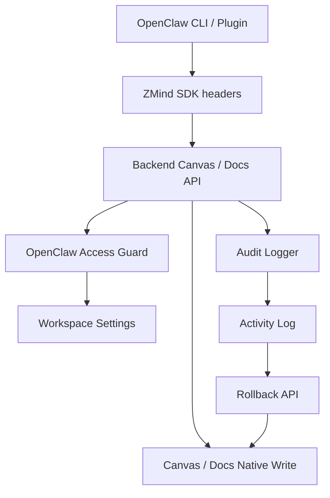

# ZMind x OpenClaw 产品主流程接入计划

日期：2026-03-10

## 目标

把已经打通的 `SDK / CLI / OpenClaw Plugin` 能力，真正接进产品主流程，让团队可以：

1. 在产品内开启或关闭 OpenClaw 接入
2. 控制哪些角色、哪些能力可以被 OpenClaw 调用
3. 对 OpenClaw 写操作形成清晰审计
4. 对可回滚操作提供一键回滚入口
5. 在工作区中给出用户看得懂、能直接操作的入口

## 约束

```text
不重做已有能力
├─ 继续复用现有 canvas / docs API
├─ 继续复用现有 event_audit / admin audit 能力
├─ 不要求用户理解 SDK、Header、Token 细节
└─ 默认走最安全权限

高风险动作默认收敛
├─ 写权限默认仅 owner / admin
├─ rollback 需要显式开启
└─ 每次 OpenClaw 写操作都必须留痕
```

## 方案总览

```text
OpenClaw 调用
   |
   v
ZMind SDK / Plugin 追加来源标识
   |
   v
后端通用 Canvas / Docs API
   |
   +--> OpenClaw 权限守卫
   |      ├─ 工作区是否开启
   |      ├─ 当前成员角色是否允许
   |      └─ 当前能力是否允许
   |
   +--> OpenClaw 审计记录
   |      ├─ 记录操作者
   |      ├─ 记录资源与操作
   |      ├─ 记录回滚信息
   |      └─ 更新最后验证时间
   |
   +--> 现有 Canvas / Docs 写入
          ├─ canvas create / apply
          ├─ docs create / apply
          └─ rollback 复用现有版本/修订能力
```

## 数据结构

```text
openclaw_workspace_settings
├─ workspace_id
├─ enabled
├─ allowed_roles
├─ allowed_capabilities
├─ last_verified_at / by
├─ linked_at / by
└─ updated_at / by

openclaw_activity_log
├─ id
├─ workspace_id
├─ actor_id
├─ operation_key
├─ resource_type / resource_id
├─ status / summary
├─ metadata
├─ rollback_payload
├─ rollback_status
└─ created_at / rolled_back_at / rolled_back_by
```

## 能力矩阵

```text
能力键                默认开放角色        是否可回滚
---------------------------------------------------
canvas.read           member+             否
canvas.write          owner/admin         是
canvas.create         owner/admin         是
doc.read              member+             否
doc.write             owner/admin         是
doc.create            owner/admin         是
rollback.execute      owner/admin         -
```

## UI 设计

```text
入口层
├─ Sidebar: Integrations > OpenClaw
├─ Team 路由镜像
└─ Workspace 首页推荐卡

页面层
├─ 状态卡：是否已开启、最近一次验证、默认权限
├─ 权限卡：角色/能力开关
├─ 接入指引：CLI / Plugin 接入方式
└─ 活动流：最近写操作 + 一键回滚
```

## 实施阶段

```text
Phase A 规划
├─ 落文档
└─ 确认接入边界

Phase B 后端
├─ 新增 settings / activity 表
├─ 新增 OpenClaw 权限与审计服务
├─ 接入 canvas/docs 写链路
└─ 提供 activity rollback API

Phase C 前端
├─ 新增 OpenClaw 集成页
├─ 新增 hooks / API client
├─ 接入侧边栏和 team route
└─ 工作区首页增加推荐入口

Phase D Review
├─ 单元测试
├─ 联调 smoke
├─ 文档复查
└─ 分阶段 git 提交
```

## Mermaid


