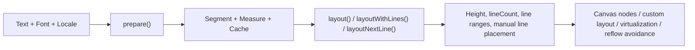
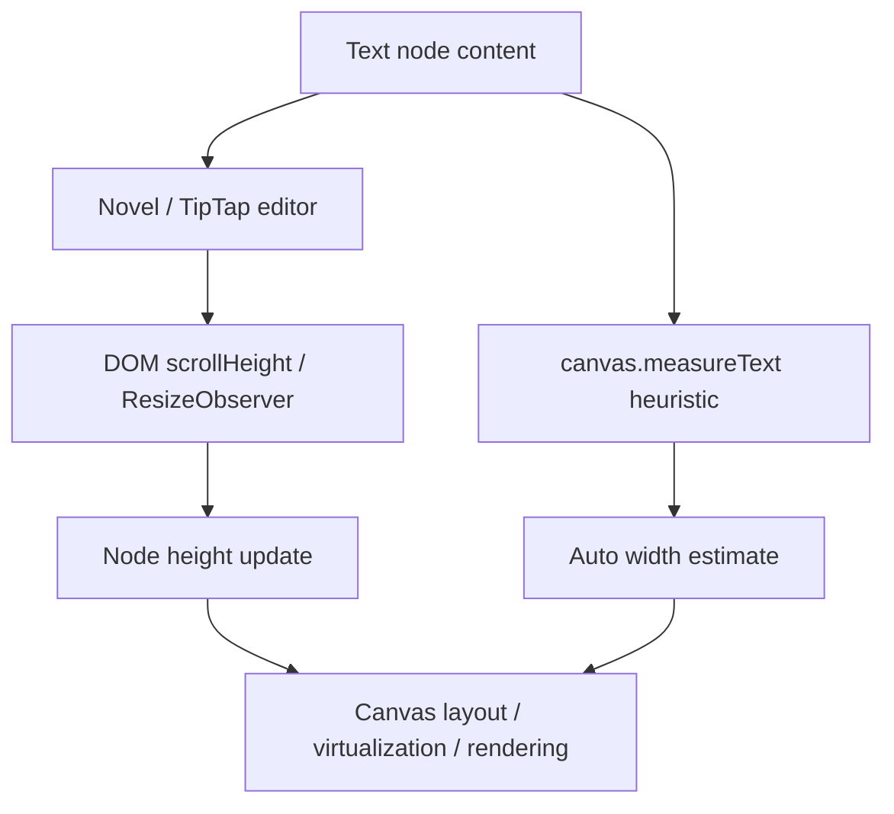
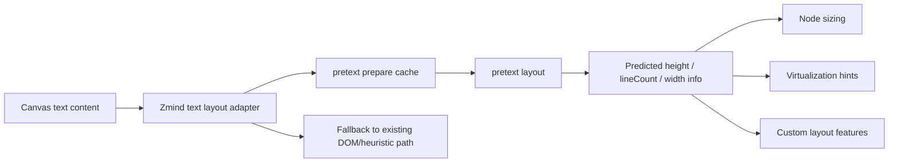

# Pretext for Zmind: Evaluation and Adoption Plan

Date: 2026-04-01
Scope: `https://github.com/chenglou/pretext`
Decision target: whether Zmind should adopt `@chenglou/pretext`, where to adopt it, and what value it would unlock.

## Executive Summary

Conclusion:
- Yes, we can install it.
- Yes, it can help Zmind.
- No, it should not replace our rich-text editor stack.
- Yes, it is a strong candidate for canvas text measurement, auto-sizing, virtualization, and custom layout.
- No, it is not ready to be treated as a server-side text layout engine in our current stack.

Recommended path:
- Short term: do not replace `Novel` / `TipTap`.
- Short term: introduce `pretext` only as a browser-side text layout service for plain-text / markdown-derived node sizing.
- Mid term: use it for canvas node auto-sizing, mindmap label width estimation, and scroll/virtualization stabilization.
- Mid term: evaluate selective use for infographic/editorial layout features where we need custom line placement.

## Assumption

This evaluation assumes the user intent is:

```text
Use pretext as a capability module inside Zmind's frontend canvas/runtime,
not as a full editor replacement and not as a backend rendering engine.
```

## What Pretext Actually Is

`pretext` is not a rich-text editor.
`pretext` is not a markdown editor.
`pretext` is not a ProseMirror / TipTap / Lexical alternative.

It is:

```text
+----------------------+--------------------------------------------+
| Category             | Reality                                    |
+----------------------+--------------------------------------------+
| Core identity        | Multiline text measurement + layout engine |
| Main strength        | DOM-free paragraph height prediction       |
| Hot-path model       | prepare() once, layout() many times        |
| Output style         | line count / height / line ranges / lines  |
| Best fit             | canvas UI, custom layout, virtualization   |
| Weak fit             | WYSIWYG editing replacement                |
+----------------------+--------------------------------------------+
```

Its design center is:



## Why It Exists

The core problem it attacks:

```text
DOM read/write interleaving
  -> layout reflow
  -> resize thrash
  -> unstable node height
  -> virtualization guesswork
  -> scroll jump / layout shift
```

Pretext's promise:

```text
prepare()
  = expensive work once

layout()
  = arithmetic-only hot path

Result
  = far less dependence on getBoundingClientRect / offsetHeight / scrollHeight
```

## Installation Verdict

### Can we install it?

Yes.

Verified facts:
- npm package exists: `@chenglou/pretext`
- latest observed version: `0.0.3`
- license: `MIT`
- package type: `module`
- package exports are built `dist/` JS + types
- unpacked size is moderate: ~641 KB
- no runtime peer dependency requirements were reported by `npm view`

### Can our stack add it?

Yes.

Validation performed:

```text
1. npm view @chenglou/pretext                  -> package exists
2. npm install @chenglou/pretext in temp dir  -> success
3. yarn add @chenglou/pretext in temp dir     -> success
4. ESM import in Node smoke test              -> success
```

### Important boundary

This is the hard constraint:

```text
Importing the package in Node works.
Calling prepare() in plain Node fails without OffscreenCanvas or a DOM canvas context.
```

Meaning:
- Browser runtime: suitable
- Next.js client components: suitable
- Pure Node / SSR measurement: not ready as-is

## Maturity Assessment

Signal snapshot:

```text
+------------------------+----------------------------------------------+
| Signal                 | Observation                                  |
+------------------------+----------------------------------------------+
| Repo created           | 2026-03-07                                   |
| npm release start      | 2026-03-27                                   |
| latest observed ver.   | 0.0.3 on 2026-03-29                          |
| stars                  | ~30k+                                        |
| issue count            | 62 open                                      |
| activity               | still actively pushed as of 2026-04-01       |
| test philosophy        | accuracy snapshots + benchmark snapshots     |
| browser validation     | Chrome / Safari / Firefox checked-in reports |
+------------------------+----------------------------------------------+
```

Interpretation:
- The idea is strong.
- The engineering discipline is unusually serious for such a new package.
- The published package is still very early-stage.
- We should treat it as "promising frontier infra", not "boring mature utility".

## Accuracy and Performance Signals

Checked-in status snapshot claims:

```text
Browser accuracy:
  Chrome  : 7680 / 7680 matches
  Safari  : 7680 / 7680 matches
  Firefox : 7680 / 7680 matches
```

Observed benchmark highlights:

```text
Chrome:
  prepare()          ~19.35 ms  (cold 500-text batch)
  layout()           ~0.092 ms  (hot 500-text batch)
  DOM batch          ~3.85 ms   (write-all then read-all)
  DOM interleaved    ~45.55 ms  (write/read per div)

Safari:
  prepare()          ~18.5 ms
  layout()           ~0.12 ms
  DOM batch          ~90.5 ms
  DOM interleaved    ~157.5 ms
```

The practical takeaway is not "always faster than DOM in every situation".
The practical takeaway is:

```text
If our hot path is repeated resize/reflow/layout recomputation,
pretext's cached arithmetic model is architecturally aligned with our needs.
```

## Zmind Current State

Current Zmind text/layout path already mixes 3 strategies:

```text
+---------------------------+-------------------------------------------+
| Current mechanism         | Where seen                                |
+---------------------------+-------------------------------------------+
| Rich editor DOM height    | TextNodeEditor uses scrollHeight          |
| Rendered DOM measurement  | domMeasure uses offsetHeight              |
| Heuristic width estimate  | canvasUtils uses canvas.measureText       |
+---------------------------+-------------------------------------------+
```

Relevant code signals:
- `frontend/src/canvas/domain/text-layout/textLayoutService.ts`
- `frontend/src/canvas/utils/domMeasure.ts`
- `frontend/src/canvas/components/editors/TextNodeEditor.tsx`
- `frontend/src/canvas/utils/canvasUtils.ts`

Current shape:



This means Zmind already has the exact category of problem pretext targets:
- height instability
- repeated DOM measurement
- heuristic width estimation
- mixed measurement models

## Best-Fit Use Cases in Zmind

### 1. Text node auto-height

Best immediate fit.

Why:
- we currently read `.scrollHeight` during editing
- we currently read `.offsetHeight` for rendered content fallback
- node height is a core canvas layout primitive

Potential upgrade:

```text
prepare(markdown-to-plain-text or rendered text, font)
layout(prepared, nodeWidth, lineHeight)
=> predictable target height
```

Benefit:
- less layout thrash
- more stable auto-size
- easier virtualization
- fewer feedback loops between editor DOM and canvas node shell

### 2. Mindmap / text node auto-width estimation

Strong fit.

Why:
- current width estimate is based on `canvas.measureText` plus markdown cleanup heuristics
- pretext can reason about multiline fit, not just single-line width

Benefit:
- better "fit to 2-3 lines" sizing
- less over-wide node creation
- more human-looking initial layout

### 3. Virtualized canvas and scroll anchoring

Strong fit.

Why:
- the package explicitly targets virtualization/occlusion and layout-shift prevention
- this maps directly to dense canvas scenarios

Benefit:
- pre-computable text heights before nodes enter viewport
- more stable anchor math during resize and data streaming

### 4. Infographic / editorial / obstacle-aware text layout

High-upside, but secondary.

Why:
- demos show dynamic obstacle-aware routing and manual line placement
- this is valuable for poster-like or infographic-like Zmind outputs

Benefit:
- visually distinctive layouts
- tighter export composition
- less dependence on brittle CSS hacks

### 5. Rich inline mixed-token custom rendering

Interesting but not first adoption target.

Why:
- demos show text fragments + chips + custom line composition
- could help with knowledge cards / labels / semantic pills

Risk:
- more implementation complexity
- not necessary for initial ROI

## Bad-Fit Use Cases

### 1. Replacing Novel / TipTap

Do not do this.

Reason:
- pretext does not solve editing behaviors
- no schema/plugin ecosystem like ProseMirror
- no selection, command system, collaboration semantics, slash menu stack, etc.

### 2. Full markdown/rich text block layout parity today

Not as a drop-in replacement.

Reason:
- current pretext caveats target common text setup, not full browser typography semantics
- markdown blocks with headings, lists, quotes, code blocks, embeds and mixed inline decorations need a richer block model around it

### 3. Immediate Next.js SSR typography engine

Do not assume this.

Reason:
- package itself says server-side is "soon"
- direct Node runtime call failed in validation without DOM/OffscreenCanvas context

## Adoption Options

```text
+-----------+--------------------------------+----------------+----------------------+
| Option    | What we do                     | Upside         | Risk                 |
+-----------+--------------------------------+----------------+----------------------+
| Aggressive| Use pretext as core text       | Big perf gain  | Integration cost,    |
|           | layout engine for canvas nodes | unified model  | early-package risk   |
+-----------+--------------------------------+----------------+----------------------+
| Balanced  | Add pretext behind a feature   | Best ROI/risk  | Need adapter layer   |
|           | flag for text/todo sizing      | clear fallback | dual path for a time |
+-----------+--------------------------------+----------------+----------------------+
| Conservative | Do not integrate yet; keep  | No churn       | Miss layout/perf win |
|              | watching package maturity   |                | remain DOM-bound     |
+-----------+--------------------------------+----------------+----------------------+
```

## My Recommendation

Recommendation:

```text
Choose the Balanced path.
```

Meaning:

```text
Phase 1
  Add a browser-only adapter around pretext.

Phase 2
  Use it only for:
    - text node estimated height
    - todo/text auto width estimate
    - virtualization pre-measure support

Phase 3
  Compare:
    - height accuracy
    - resize stability
    - typing smoothness
    - scroll jump rate
    - node creation quality

Phase 4
  Only after that, consider:
    - infographic layout
    - editorial export layout
    - advanced custom text flow
```

## Suggested Integration Architecture



## Integration Rules

If we adopt it, use these rules:

```text
1. Browser-only adapter first
2. Feature flag first
3. Never bind editor typing directly to a fragile experimental path
4. Keep fallback to current DOM/heuristic measurement
5. Cache by text + font + locale + whiteSpace mode
6. Re-run layout() on width changes; avoid re-running prepare() unless inputs changed
7. Restrict initial scope to plain text and markdown-derived text blocks
8. Avoid SSR promises until we own a verified measurement host strategy
```

## Immediate Risks

```text
+----------------------------------+--------------------------------------+
| Risk                             | Notes                                |
+----------------------------------+--------------------------------------+
| Early package maturity           | version still 0.0.x                  |
| Browser-only runtime assumption  | Node direct execution failed         |
| Full markdown parity gap         | good for text flow, not full blocks  |
| Font exactness sensitivity       | named fonts are safer than system-ui |
| Windows dev ergonomics           | repo dev scripts are Bun/Unix-leaning|
+----------------------------------+--------------------------------------+
```

## Decision

Final decision recommendation:

```text
YES, installable.
YES, useful for Zmind.
NO, not as editor replacement.
YES, worth a scoped browser-side adapter spike.
```

## Suggested Next Step

Best next engineering move:

```text
Build a 1-day spike:
  "pretext adapter for text/todo node sizing"

Measure against current path:
  - predicted height vs actual rendered height
  - node resize smoothness
  - large-canvas scroll stability
  - cost under repeated width changes
```

If that spike is clean, then adoption becomes a productively boring engineering decision instead of a speculative one.

## Sources

- GitHub repo: https://github.com/chenglou/pretext
- README: https://raw.githubusercontent.com/chenglou/pretext/main/README.md
- package.json: https://raw.githubusercontent.com/chenglou/pretext/main/package.json
- changelog: https://raw.githubusercontent.com/chenglou/pretext/main/CHANGELOG.md
- development notes: https://raw.githubusercontent.com/chenglou/pretext/main/DEVELOPMENT.md
- research log: https://raw.githubusercontent.com/chenglou/pretext/main/RESEARCH.md
- status snapshot: https://raw.githubusercontent.com/chenglou/pretext/main/status/dashboard.json
