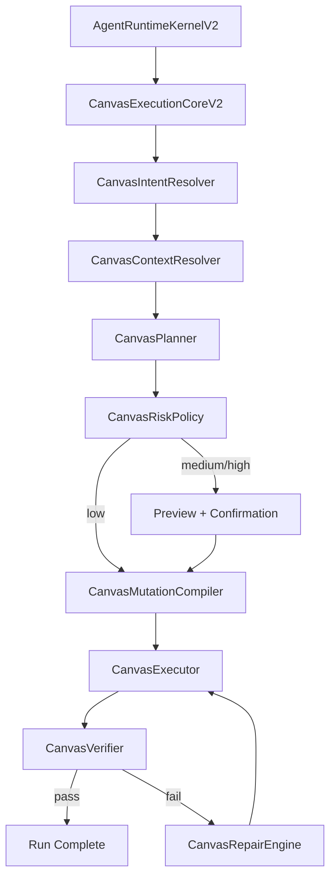

# Agent Runtime V2 Big Bang Implementation Plan

## Goal

This document freezes the execution shape for the final `Agent Runtime V2` refactor.

The target is:

- one unified runtime kernel
- canvas as the primary execution plane
- existing canvas CRUD logic retained only as an internal mutation backend
- deterministic context lifecycle
- continuity/resume as first-class runtime state
- verification as a completion gate
- canonical event flow as the shared source for stream, persistence, analytics, and replay

## Decisions

```text
Execution mode     : Clean Break
Release mode       : Big Bang
Canvas mode        : Canvas Native First
Risk policy        : Risk-tier Auto
Verify policy      : Strict Verify Gate
Continuity policy  : Full Continuity
Rollback policy    : Git branch / deployed version rollback only
Legacy CRUD status : Keep engine, remove model-facing primacy
```

## Target Topology

```text
[API / Worker Shell]
        |
        v
[AgentRuntimeKernelV2]
        |
        +--> [Input Normalization]
        +--> [Intent Resolver]
        +--> [Execution Lane Selector]
        |         canvas / doc / general / subagent
        |
        +--> [ContextLifecyclePipelineV2]
        |         normalize
        |         enrich
        |         budget
        |         replacement
        |         compact
        |         collapse
        |         prompt assemble
        |
        +--> [Policy Engine]
        |         safety / permission / write gate / risk tier
        |
        +--> [Execution Cores]
        |         CanvasExecutionCoreV2
        |         LangGraphLaneAdapterV2
        |         ToolPoolFactoryV2
        |         MCPPlatformClientV2
        |
        +--> [Verifier + Repair]
        |
        +--> [Canonical Event Bus V2]
                  |
                  +--> realtime stream projection
                  +--> persistence projection
                  +--> analytics / tracing / billing
                  +--> resume / replay
```

## Canvas Lane

```text
User Request
   |
   v
CanvasIntentResolver
   |
   v
CanvasContextResolver
   |
   v
CanvasPlanner
   |
   v
CanvasRiskPolicy
   |
   +--> low    -> compile -> execute -> verify -> repair? -> done
   |
   +--> medium -> preview -> await confirm -> execute -> verify -> repair? -> done
   |
   +--> high   -> mandatory confirm -> execute -> full verify -> repair? -> done
```



## State Machines

### Lane State

```text
init
  -> normalize_input
  -> prepare_context
  -> resolve_intent
  -> select_lane
  -> execute_lane
  -> verify_if_needed
  -> persist_final_state
  -> complete | fail | stopped
```

### Verify Gate

```text
planned
  -> executed
  -> lightweight_verify
       -> fail -> repair
       -> pass -> if non_trivial then full_verify else complete
  -> full_verify
       -> fail -> repair
       -> pass -> complete
```

### Resume

```text
resume_requested
  -> load_continuity_state
  -> rebuild_runtime_context
  -> consistency_check
       -> mismatch -> fail_safe_stop
       -> match -> continue_from_last_lane_checkpoint
```

## Risk Tier Matrix

```text
+-------------+--------------------------------------------------+-----------------------------+
| Tier        | Examples                                         | Runtime behavior            |
+-------------+--------------------------------------------------+-----------------------------+
| low         | single rename, light content update, small add   | auto execute + verify       |
| medium      | selection rewrite, local relayout, split, links  | preview first, then confirm |
| high        | delete, merge, cross-canvas, replace, big relayout| explicit confirm + full gate|
+-------------+--------------------------------------------------+-----------------------------+
```

## Trivial vs Non-trivial

```text
Trivial
- single node rename
- single node content patch
- single node style patch

Non-trivial
- multi-node write
- any structural transform
- relayout
- split / merge
- connection add or delete
- image generate / attach
- any multi-step execution
```

## Continuity Payload

```text
ContinuityStateV2
  transcript
  sidechains
  event_history
  replacement_ledger
  artifact_refs
  collapse_state
  verifier_history
  repair_history
  active_lane
  resume_metadata
```

## Initial Delivery Slices

### Slice 0

- freeze docs, contracts, ADR
- create V2 package structure
- create branch and isolated refactor path

### Slice 1

- introduce `AgentRuntimeKernelV2`
- introduce `AgentRunStartV2`, `RuntimeContextV2`, `AgentEventV2`
- introduce `ContextLifecyclePipelineV2`
- introduce continuity checkpoint store wrapper

### Slice 2

- introduce `CanvasExecutionCoreV2`
- split compile semantics from execute semantics
- adapt existing canvas runtime services behind V2 adapters
- add risk-tier preview gate
- add strict verify gate

### Slice 3

- route worker through V2 kernel
- keep worker as lease/stop/status shell only
- add V2 -> legacy stream adapter during transition

### Slice 4

- add artifact budget + replacement ledger
- add resume reconstruction + consistency check
- add tool pool / policy / scheduler V2 wrappers

## Exit Criteria

```text
1. Canvas requests no longer rely on model-direct CRUD tool calls as the primary path.
2. Every canvas write goes through verify-before-complete semantics.
3. Runtime state can be checkpointed and resumed with continuity metadata.
4. Worker delegates execution semantics to AgentRuntimeKernelV2.
5. Canonical V2 events exist independently from legacy Redis chunks.
```
