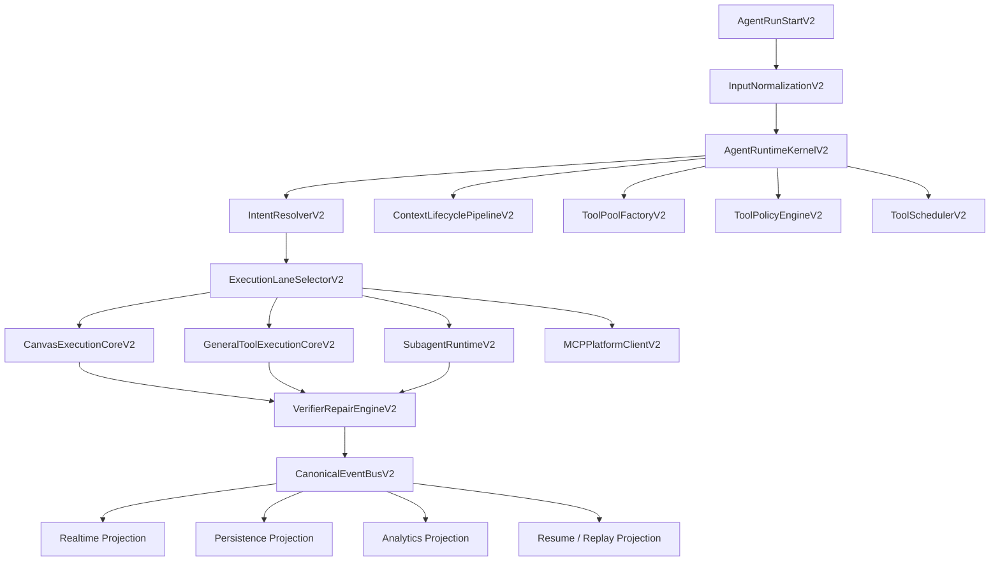
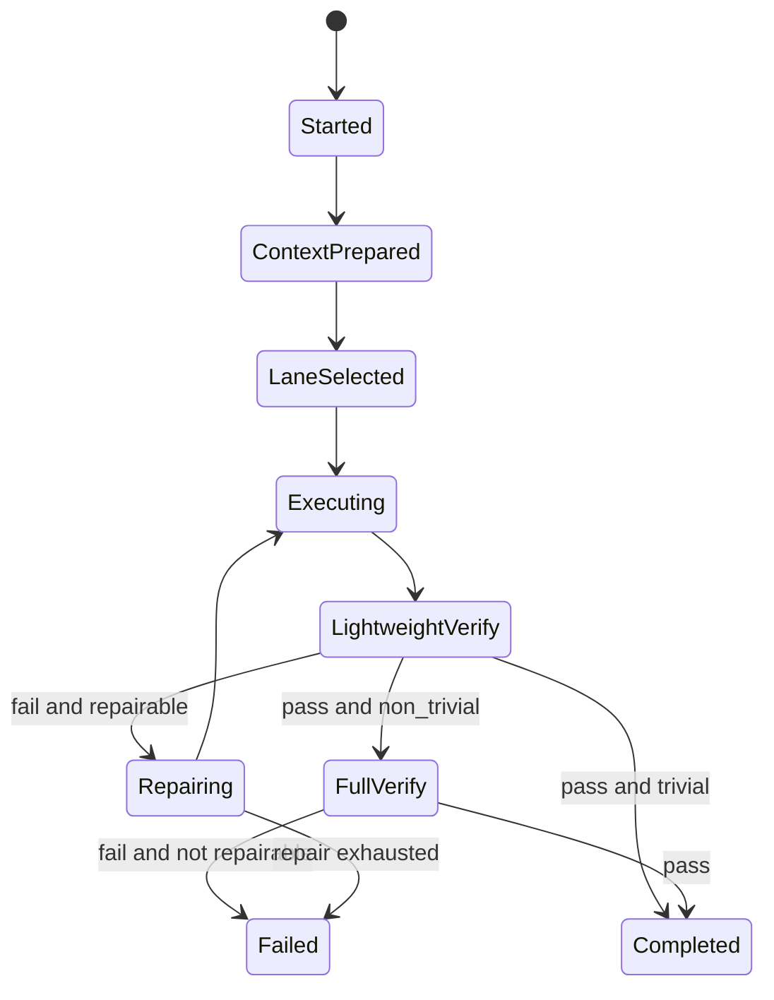

# Agent Runtime V2 Big Bang Refactor Plan

Date: 2026-04-02
Status: In Progress
Owner: Codex
Branch: `codex/agent-runtime-v2`

## Goal

```text
We are not "adding another agent path".

We are replacing the current backend agent runtime with one canonical runtime:

    input normalization
        -> runtime kernel
        -> lane selection
        -> context lifecycle
        -> execution core
        -> verify gate
        -> canonical event bus
        -> persistence / stream / resume

Canvas becomes the primary execution surface.
Legacy canvas CRUD remains only as an internal mutation engine.
```

## Final Decisions

```text
+----------------------------+-----------------------------------------------+
| Topic                      | Decision                                      |
+----------------------------+-----------------------------------------------+
| Refactor mode              | Clean Break                                   |
| Release mode               | Big Bang                                      |
| Rollback                   | Git branch / version rollback only            |
| Canvas execution model     | Canvas Native First                           |
| Canvas write policy        | Risk-tier Auto                                |
| Completion gate            | Strict Verify Gate                            |
| Continuity scope           | Full Continuity                               |
| Old canvas CRUD            | Keep as internal engine / adapter only        |
| Legacy runtime behavior    | No runtime fallback as primary semantics      |
| Hooks / enrichers          | First-party trusted only in V1 of V2 runtime  |
+----------------------------+-----------------------------------------------+
```

## Architecture Target

```text
[AgentRunStartV2]
    |
    v
[InputNormalizationV2]
    |
    v
[AgentRuntimeKernelV2]
    |
    +--> IntentResolverV2
    +--> ExecutionLaneSelectorV2
    |       - canvas
    |       - doc
    |       - general
    |       - subagent
    |
    +--> ContextLifecyclePipelineV2
    |       normalize
    |       enrich
    |       budget
    |       replacement
    |       compact
    |       collapse
    |       prompt_assembly
    |
    +--> ToolPoolFactoryV2
    +--> ToolPolicyEngineV2
    +--> ToolSchedulerV2
    |
    +--> Execution Cores
    |       - CanvasExecutionCoreV2
    |       - GeneralToolExecutionCoreV2
    |       - SubagentRuntimeV2
    |       - MCPPlatformClientV2
    |
    +--> VerifierRepairEngineV2
    |
    +--> CanonicalEventBusV2
            -> persistence projection
            -> realtime projection
            -> analytics projection
            -> resume / replay projection
```



## V2 Contract Freeze

```text
AgentRunStartV2
  - run_id
  - thread_id
  - account_id
  - project_id
  - surface
  - interaction_mode
  - user_input
  - canvas_target
  - selection_context
  - workspace_target
  - response_mode
  - resume_token
  - model_config
  - agent_config
  - stop_event

RuntimeContextV2
  - identity
  - lane
  - surface
  - canvas_target
  - selection_scope
  - workspace_target
  - prompt_context
  - policy_context
  - tool_context
  - continuity_state
  - budget_context
  - diagnostics

AgentEventV2
  - event_id
  - event_type
  - run_id
  - thread_id
  - lane
  - sequence
  - timestamp
  - payload
  - user_visible
  - persistence_hint
  - analytics_hint

CanvasIntentIRV2
  - user_goal
  - target_canvas
  - selection_scope
  - operation_class
  - risk_level
  - verification_contract
  - planning_hints

CanvasPlanV2
  - intent
  - planning_summary
  - preview
  - layout_strategy
  - transforms
  - connection_intents
  - compiler_hints

CanvasMutationBatchV2
  - canvas_id
  - expected_version
  - idempotency_key
  - operations
  - operation_summary
  - verification_contract

ContinuityStateV2
  - transcript_state
  - sidechain_state
  - event_history
  - replacement_ledger
  - collapse_state
  - verifier_history
  - resume_metadata
```

## Core State Machines

### Lane state machine

```text
START
  -> normalize_input
  -> resolve_intent
  -> select_lane
     -> canvas
     -> doc
     -> general
     -> subagent
  -> execute_lane
  -> verify
     -> pass -> complete
     -> fail + repairable -> repair -> verify
     -> fail + not repairable -> incomplete
```

### Verify gate state machine

```text
PLANNED
  -> EXECUTED
  -> LIGHTWEIGHT_VERIFY
      -> fail -> REPAIR_OR_STOP
      -> pass -> if trivial then COMPLETE
      -> pass -> FULL_VERIFY
                -> pass -> COMPLETE
                -> fail -> REPAIR_OR_STOP
```

### Resume state machine

```text
INTERRUPTED
  -> load continuity state
  -> reconstruct context
  -> restore replacement ledger
  -> restore collapse state
  -> restore lane-local state
  -> consistency check
      -> pass -> resume execution
      -> fail -> emit resume drift error
```



## Risk-tier Policy

```text
+------------+-------------------------------------------------------------+-----------------------------------------------+
| Risk Level | Examples                                                    | Default behavior                               |
+------------+-------------------------------------------------------------+-----------------------------------------------+
| low        | single rename, light content update, small style update     | auto execute + lightweight verify              |
| medium     | selection relayout, summarize, split, retitle multi-nodes   | preview + readable plan + confirm + full verify|
| high       | delete, merge, big relayout, cross-canvas, overwrite        | explicit confirm + full verify + repair gate   |
+------------+-------------------------------------------------------------+-----------------------------------------------+
```

### Trivial vs non-trivial

```text
trivial
  - single node rename
  - single node content patch
  - single style-only patch

non-trivial
  - multi-node edits
  - connections add/delete/update
  - relayout
  - split / merge / summarize
  - image generate / attach
  - multi-step plan
```

## Module Layout

```text
backend/core/agent_runtime_v2/
  __init__.py
  contracts.py
  kernel.py
  normalization.py
  lane_selector.py
  hooks.py
  event_bus.py
  continuity.py
  artifacts.py
  tool_policy.py
  tool_pool.py
  tool_scheduler.py
  adapters/
    legacy_events.py
    langgraph_general_lane.py
    persistence.py
  canvas/
    contracts.py
    intent_resolver.py
    planner.py
    mutation_compiler.py
    execution_core.py
    verifier.py
    repair.py
    risk.py
  context/
    pipeline.py
    enrichers.py
    replacement.py
    collapse.py
```

## Execution Strategy

```text
Phase 0
  freeze contracts / ADR / state machines / policy tables

Phase 1
  create Runtime Kernel V2 shell
  create canonical event bus
  create runtime context + start contract

Phase 2
  lift canvas into CanvasExecutionCoreV2
  reuse current canvas native services
  move CRUD engine behind mutation adapter
  add risk-tier preview/confirm
  enforce verify gate

Phase 3
  continuity + artifact store + replacement ledger + resume check

Phase 4
  tool pool / policy / scheduler / subagent / MCP platform cleanup

Phase 5
  event and persistence projection switch
  worker becomes runtime shell only

Phase 6
  soak / regression / release gates
```

## Non-Negotiables

```text
1. Worker must stop owning high-level runtime semantics.
2. Model must not directly author low-level canvas CRUD batches.
3. Canvas writes are not "done" until verify passes.
4. Resume must restore runtime semantics, not just chat text.
5. Large tool/canvas results must be replaceable artifacts.
6. Canonical event ordering must be deterministic and replayable.
7. Existing canvas CRUD logic is retained only as internal execution backend.
```

## Review Checklist

```text
[ ] Kernel is the only primary runtime entry
[ ] Canvas lane is model-facing primary write path
[ ] Risk-tier preview/confirm works
[ ] Verify gate blocks false completion
[ ] Continuity ledger survives resume
[ ] Event bus is canonical source
[ ] Worker is reduced to shell responsibilities
[ ] No raw runtime internals leak to user-facing messaging
```
