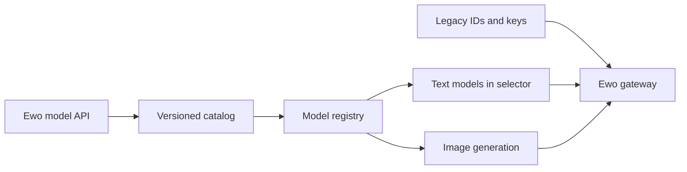

# Ewo gateway and model catalog

## Scope and completion criteria

- Rename the gateway to Ewo and use `https://eapi.site/v1`; reuse the existing key.
- Import the complete authenticated model catalog (33 models on 2026-09-08).
- Show only text/chat models in user model selectors; retain image models for media generation.
- Preserve existing stored `habitat/...` IDs and provider policies; accept `ewo/...` aliases.
- Keep Sol as the default. Preserve existing pricing where known; do not invent prices for new models.
- Verify configuration compatibility, catalog filtering, protocol selection, and representative live calls.

```text
Ewo /v1/models -> checked-in catalog -> registry
                                       +-> text/chat -> user selector
                                       +-> image     -> media generation
old IDs + old keys -------------------> compatible routing -> eapi.site
```



## Steps

1. Verify gateway metadata and document scope.
2. Update configuration, import catalog, separate text visibility from model availability, preserve aliases.
3. Run focused regressions and live protocol probes; review and commit task changes only.

Runtime deployment is separate from local configuration and code verification. Do not claim production activation without deployment evidence.

## Implementation and verification

- Imported the authenticated 33-model snapshot into `backend/core/ai_models/ewo_catalog.json`; this is a versioned snapshot, not a background auto-sync service.
- Added EWO environment variables with legacy key/base compatibility. Updated the ignored local environment without changing the key value.
- Preserved stored provider/model identifiers and added `ewo/...` aliases. Provider display names now say Ewo.
- Catalog images remain enabled for media; both backend user lists and the frontend selector filter by chat capability. Unknown token pricing no longer hides text models.
- Versioned model-list cache reads and invalidations together so previously cached three-model lists do not survive deployment.
- Updated inline, selection, infographic-planning and title defaults to Sol because their old Gemini default is absent from the current catalog. Updated the default hedge to the catalog's Gemini 3.8 Flash.
- Backend: 29 focused tests passed (catalog, aliases, configuration compatibility, protocol routing, default selection, image tools, media credentials, hedging).
- Frontend: the real model-selection hook passed a mocked-data contract check for 30 visible text models and three hidden image models; scoped ESLint passed.
- Live calls through the modified backend and original key: Sol returned OK in 53.2 seconds; Gemini 3.8 Flash returned OK in 46.3 seconds. Claude Sonnet 4.6 returned an upstream quota error; GPT-6 Astra failed after roughly 67 seconds (request timeout). These are not evidence of universal provider availability.
- No production deployment or authenticated browser end-to-end verification was performed.
