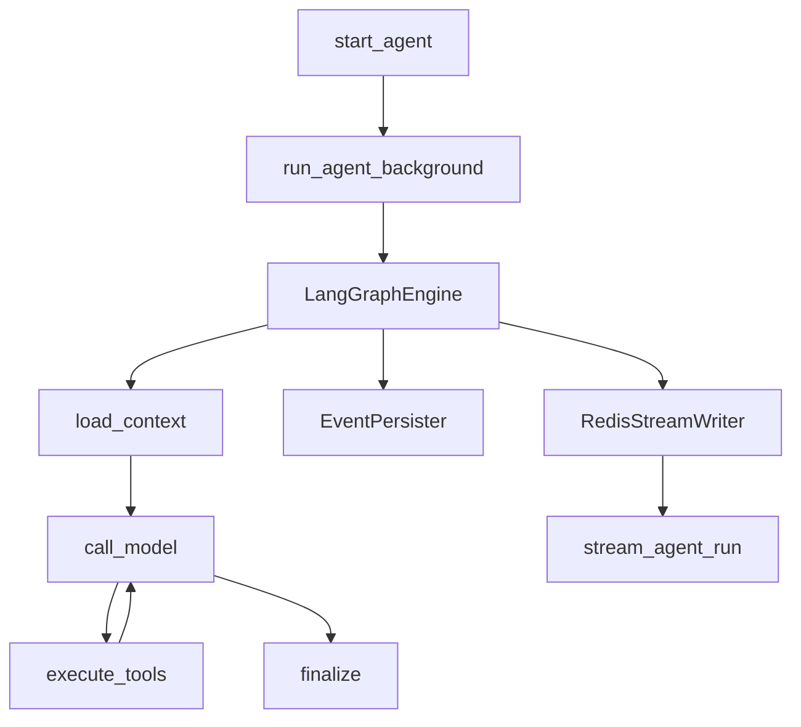
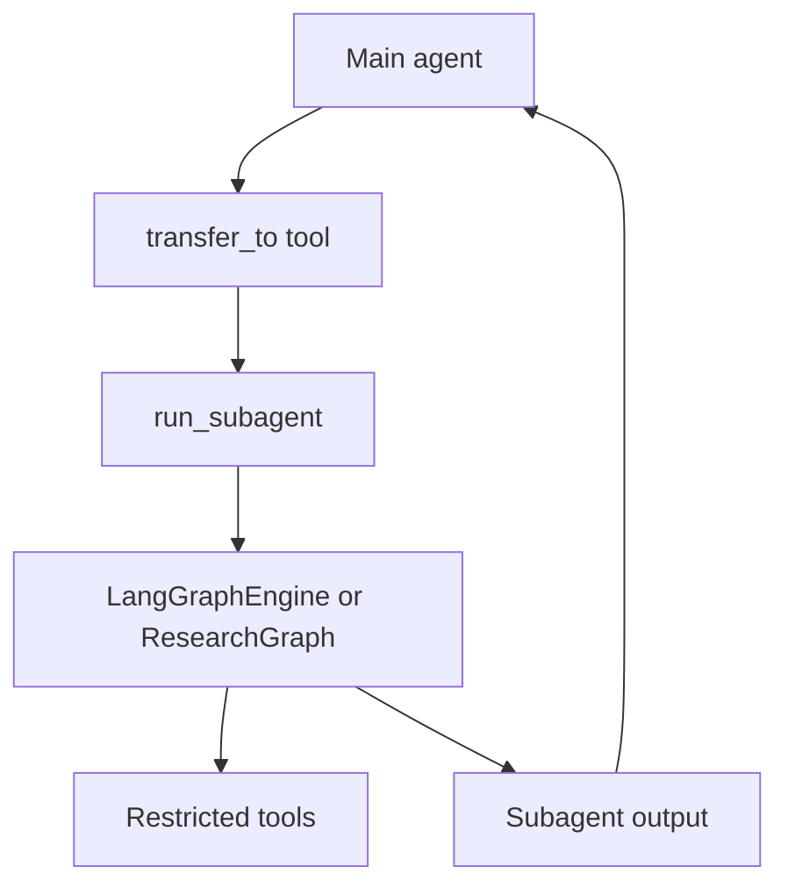
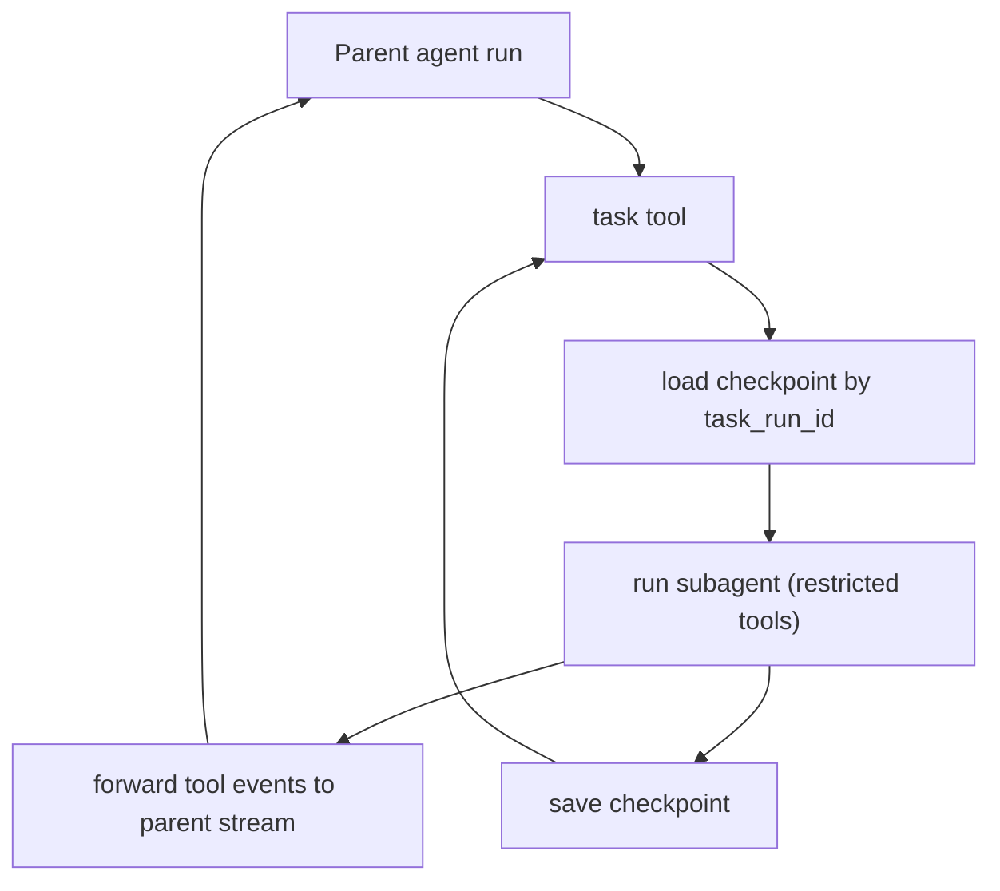
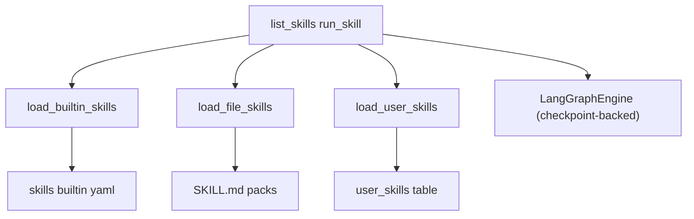

# Zmind 后端 Agent 架构

本文档梳理 zmind 后端 agent 架构，并标注核心实现文件、数据流、工具与 skills 系统。
同时提供与 OpenCode 的对照表，便于后续迁移与能力补齐。

## 范围

- 入口与运行生命周期
- LangGraph 引擎与节点
- Prompt 与上下文管理
- 工具注册与执行、MCP 集成
- Supervisor 与子 agent
- Skills 配置与运行
- Streaming 与持久化
- 与 OpenCode 对照

## 总览流程

```
HTTP 请求
  -> agent_runs.start_agent
     -> 插入 agent_run
     -> run_agent_background (dramatiq worker)
        -> 构建 tool_registry + tool_context
        -> LangGraphEngine.run
           -> load_context
           -> call_model (LLM stream + tool calls)
           -> execute_tools
           -> finalize
        -> Redis list + pubsub stream
  -> agent_runs.stream_agent_run (SSE)
```



关键文件：
- `backend/core/agent_runs.py`
- `backend/run_agent_background.py`
- `backend/core/langgraph_engine/engine.py`
- `backend/core/langgraph_engine/graph.py`
- `backend/core/langgraph_engine/nodes/load_context.py`
- `backend/core/langgraph_engine/nodes/call_model.py`
- `backend/core/langgraph_engine/nodes/execute_tools.py`

## 入口与生命周期

### HTTP API
- `backend/core/agent_runs.py`：鉴权、选择 agent 配置、创建 agent_run、触发 worker。
- `backend/core/agent_runs.py`：SSE 从 Redis list/channel 读取并推送给前端。

### 后台 Worker
- `backend/run_agent_background.py`：模型选择、Supervisor/MCP 初始化、tool registry 构建、事件写入 Redis 与 DB。
- 通过 `RunConfig` 将运行参数注入引擎。

## LangGraph 引擎

### Engine
- `backend/core/langgraph_engine/engine.py`：调度、checkpoint、事件分发与持久化。
- `backend/core/langgraph_engine/graph.py`：状态图与路由规则。

### 节点
- `backend/core/langgraph_engine/nodes/load_context.py`：系统提示、上下文读取、压缩与缓存。
- `backend/core/langgraph_engine/nodes/call_model.py`：LLM stream、工具 schema 注入、tool call 解析与重试。
- `backend/core/langgraph_engine/nodes/execute_tools.py`：执行工具、并发与 side-effect policy 校验。

## Prompt 与上下文管理

- `backend/core/prompts/prompt_manager.py`：构建系统提示，注入知识库与画布选区信息。
- `backend/core/prompts/prompt.py`：基础系统提示（长规则集）。
- `backend/core/langgraph_engine/message_loader.py`：拉取线程消息、内联附件、规范化 tool call。
- `backend/core/langgraph_engine/context_manager.py`：超长消息压缩与裁剪。

## 工具系统

### Registry 与 Catalog
- `backend/core/langgraph_engine/tools/catalog.py`：构建静态工具 + MCP 动态工具。
- `backend/core/langgraph_engine/tools/registry.py`：schema 清洗、参数校验、执行与策略限制。

### 工具可见性过滤（Tool Policy）

在不做 allow/deny/ask 审批的前提下，仍建议（并已实现）“模型可见工具集合”的过滤：让 LLM 在 schema 层面看不到被禁用的工具，从源头减少误调用与 tool loop。

- 策略解析：`backend/core/langgraph_engine/tools/policy.py`
  - 支持 `agent_config.tool_allowlist/tool_allow_prefixes/tool_denylist`（推荐）
  - 兼容 `agent_config.native_tools`（best-effort 映射）
- 应用入口：`backend/run_agent_background.py`（受 env `ENABLE_TOOL_POLICY_FILTER` 控制）

### 工具输出治理（LLM Context 截断）

Zmind 的策略是“只截断喂给 LLM 的 tool message，上屏/落库/Redis 仍保留完整输出”，兼顾稳定性与可追溯性：

- 截断逻辑：`backend/core/langgraph_engine/tool_message_truncation.py`
- 生成事件（全文）+ 写入 LLM context（截断版）：`backend/core/langgraph_engine/nodes/execute_tools.py`
- 历史加载与压缩时对 tool message 再截断：`backend/core/langgraph_engine/message_loader.py`、`backend/core/langgraph_engine/context_manager.py`
- 配置：`backend/.env.example`（`TOOL_MESSAGE_CONTEXT_MAX_CHARS`、`TOOL_MESSAGE_CONTEXT_TRUNCATE_MODE`）

### 原生工具
- `backend/core/langgraph_engine/tools/adapters/native_tool_adapter.py`：
  messaging、canvas、PPT、web search、知识库、上传、skills 等。

### MCP 工具
- `backend/core/langgraph_engine/tools/adapters/mcp_tool_adapter.py`：
  MCP tool 发现、schema 清洗、Redis 缓存与命名规划。

### Side-effect Policy
- `backend/core/langgraph_engine/tools/registry.py`：根据 `side_effect_policy` 与 `is_shadow` 拦截非只读工具。
- `backend/core/langgraph_engine/nodes/execute_tools.py`：执行时二次校验并发出 status 事件。

## Supervisor 与子 agent

### 定义
`backend/core/langgraph_engine/supervisor/agent_defs.py`
- `canvas_agent`：canvas 只写工具 + 布局规则
- `socratic_agent`：引导式思考
- `presentation_agent`：PPT 规划与 CTA 流程
- `deep_research_agent`：research graph runner
- `integration_agent`：data provider 与 MCP
- `synthesis_agent`：无工具汇总输出

### 路由与 Registry
- `backend/core/langgraph_engine/supervisor/config.py`：启用/禁用与模式控制。
- `backend/core/langgraph_engine/supervisor/router.py`：关键词/语义路由。
- `backend/core/langgraph_engine/supervisor/registry.py`：handoff tools + 可选 native tools。

### Handoff 与执行
- `backend/core/langgraph_engine/supervisor/handoff_tools.py`：
  transfer_to_* 工具，转发子 agent 事件到主 stream。
- `backend/core/langgraph_engine/supervisor/subagent_runner.py`：
  子 agent 执行与工具 allowlist。



### 通用 task 子任务（checkpoint-backed，可续跑）

除 `transfer_to_*`（supervisor 路由用）之外，后端新增了通用 `task` 工具，用于“任意子任务拆解/组合/续跑”，对齐 OpenCode 的 `task(session_id)` 能力：

- 工具实现：`backend/core/tools/task_tool.py`
- 工具注册：`backend/core/langgraph_engine/tools/adapters/native_tool_adapter.py`（ToolSpec: `task`）
- 续跑能力：`backend/core/langgraph_engine/contracts/engine_interface.py`、`backend/core/langgraph_engine/engine.py`（`append_messages_context/reset_loaded_state`）
- 子任务事件桥接：`backend/core/langgraph_engine/stream/subtask_forwarder.py`（只转发 `tool_message` + tool 状态）
- 元数据表（需落库）：`backend/supabase/migrations/20260113170000_agent_task_sessions.sql`



## Skills 系统

### 来源
- 内置 YAML：`backend/core/skills/builtin/*.yaml`
  - 示例：`skill.ppt_plan`、`skill.note_to_structure`。
- 用户技能：DB `user_skills` 表。
- 文件技能包（SKILL.md）：`backend/core/skills/registry.py`
  - 项目级：`.zmind/skills/**/SKILL.md`（默认）
  - 可选：`.claude/skills/**/SKILL.md`（便于复用 Claude skills 资产）
  - 可选：`~/.config/zmind/skills/**/SKILL.md`（全局技能目录）

### Loader 与类型
- `backend/core/skills/registry.py`：合并内置与用户技能。
- `backend/core/skills/types.py`：`SkillDefinition` 数据模型。

### 运行工具
- `backend/core/tools/skills_tool.py`：list_skills / run_skill / allowlist / tool fallback。
  - `run_skill` 支持 `task_run_id` 续跑（与 `task` 同一套 checkpoint 机制）。



## Streaming 与持久化

- `backend/core/langgraph_engine/stream/legacy_adapter.py`：
  engine event 到 Redis/SSE 协议的转换。
- `backend/core/langgraph_engine/stream/redis_writer.py`：
  Redis list + pubsub 推送。
- `backend/core/langgraph_engine/persistence/event_persister.py`：
  持久化与计费扣费。

## Agent 配置与版本

- `backend/core/config_helper.py`：Zmind 默认 config 与版本合并。
- `backend/core/zmind_config.py`：Zmind 默认 prompt 和 tool 开关。
- `backend/core/agent_crud.py` + `backend/core/versioning/*`：agent 版本管理。

## 与 OpenCode 对照表

| 维度 | Zmind | OpenCode | 差距/建议 |
| --- | --- | --- | --- |
| Agent 配置来源 | DB + ZMIND_CONFIG | 多层级文件合并 | 增加 project/global 文件层级与合并 |
| 工具权限/能力边界 | side_effect_policy + is_shadow + tool policy（可选） | allow/deny/ask 规则 | 我们不做审批也可继续：优先把“可见工具集合”做强 |
| Skills 发现 | YAML + DB + SKILL.md（文件扫描） | SKILL.md 目录扫描 | 差距缩小；后续可补“上行/全局多目录 merge” |
| 子 agent | transfer_to_*（supervisor）+ task（通用、可续跑） | 通用 task tool + 子 session | 已补齐核心能力；后续可做 UI/接口化 |
| Compaction | 无专用 agent | compaction/summary agent | 引入 compaction 与摘要 agent |
| Tool 输出控制 | LLM context 截断（DB/SSE 保留全文） | truncation + disk artifact | 可选补齐 artifact 存储（S3/本地）与回读工具 |
| MCP 工具 | 有 | 有 | 兼容性差距小，保留命名策略 |
| Streaming | Redis list + SSE | 直接 streaming | 保持现有，重点补齐工具事件规范 |

## 主要差距与升级方向

Phase 0/1 已补齐的能力：tool policy（可选）、LLM context 截断、SKILL.md 扫描、通用 `task` 可续跑、子任务事件桥接。

仍与 OpenCode 有差距、且对“能力/性能”最关键的升级方向：
1) 插件与 hooks：缺少类似 `@opencode-ai/plugin` 的扩展点（tool.before/after、chat.params、event tap），治理与扩展都需要改核心代码。
2) 配置体系：Agent/Tool/Command 的项目级/全局级文件合并（类似 `.opencode/agent|tool|command`）还没有标准化入口。
3) Artifact 机制：OpenCode 会把超大 tool 输出落盘并提供回读策略；Zmind 当前只做 LLM context 截断，后续建议接入对象存储（S3/MinIO）+ artifact 工具。
4) Compaction/summary 专用链路：现有 context_manager 能压缩，但缺少“显式 compaction agent + 可控触发策略”，长会话稳定性仍可增强。
5) 权限体系（可选）：你们不需要交互式审批，但仍可继续强化“能力边界”（agent/skill/tool 级 allowlist、资源域隔离、审计）。

## 附录：关键文件索引

- 入口与执行
  - `backend/core/agent_runs.py`
  - `backend/run_agent_background.py`
  - `backend/core/langgraph_engine/engine.py`
  - `backend/core/langgraph_engine/graph.py`
- Prompt 与上下文
  - `backend/core/prompts/prompt_manager.py`
  - `backend/core/prompts/prompt.py`
  - `backend/core/langgraph_engine/message_loader.py`
  - `backend/core/langgraph_engine/context_manager.py`
- 工具体系
  - `backend/core/langgraph_engine/tools/catalog.py`
  - `backend/core/langgraph_engine/tools/registry.py`
  - `backend/core/langgraph_engine/tools/adapters/native_tool_adapter.py`
  - `backend/core/langgraph_engine/tools/adapters/mcp_tool_adapter.py`
- Supervisor 与子 agent
  - `backend/core/langgraph_engine/supervisor/agent_defs.py`
  - `backend/core/langgraph_engine/supervisor/handoff_tools.py`
  - `backend/core/langgraph_engine/supervisor/subagent_runner.py`
  - `backend/core/langgraph_engine/supervisor/router.py`
- Skills
  - `backend/core/skills/registry.py`
  - `backend/core/skills/types.py`
  - `backend/core/tools/skills_tool.py`
